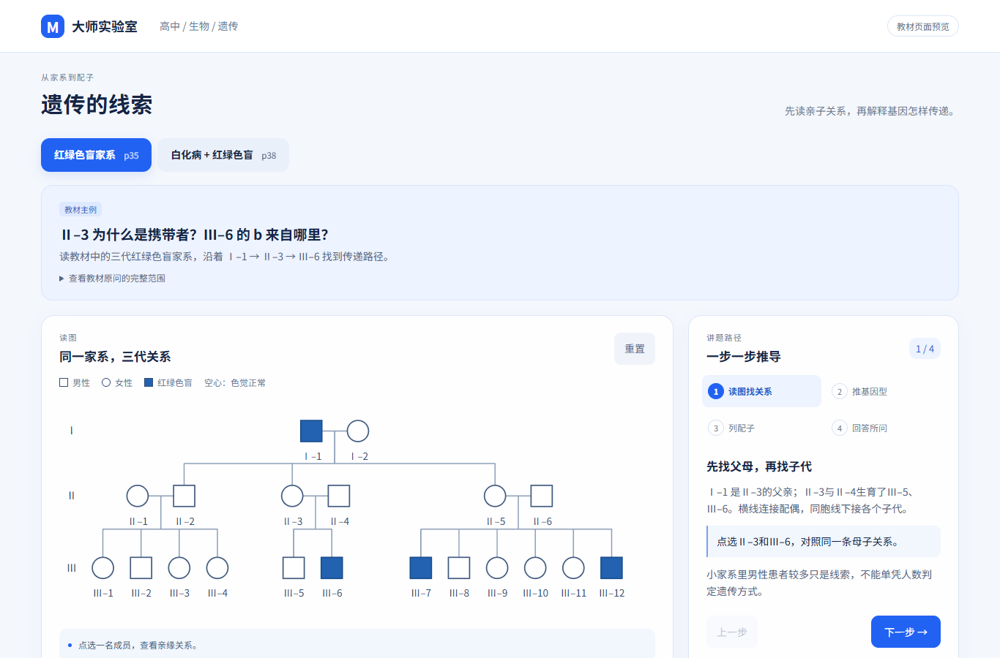
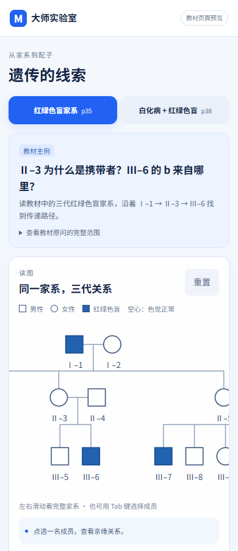
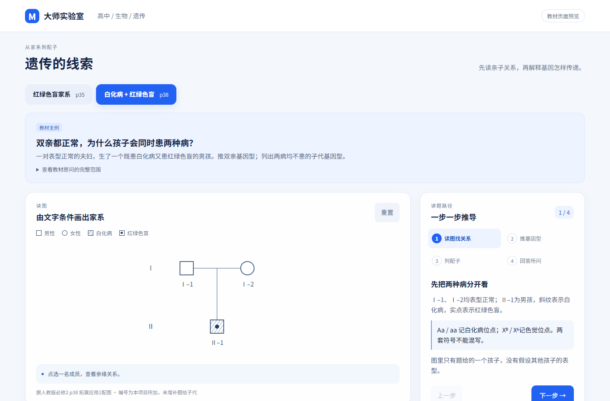
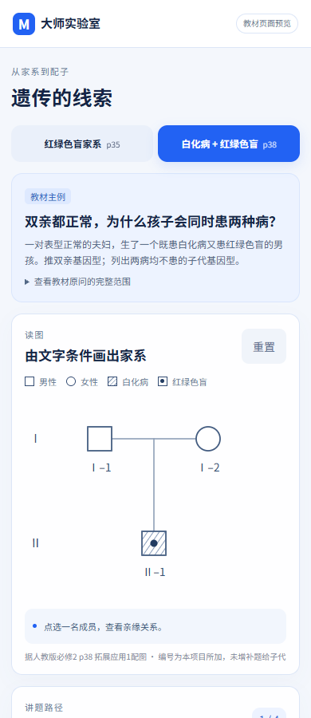

# 本轮精选预览与实际核查

这是两道教材题的**设计预览证据**。尚无产品模板、自由题正常入口、收藏分享或完整适用回归的交付声明。

## 两组首屏

每道题各给桌面1366×900与手机宽度390×900。原图默认不选中成员；选中与分步过程见下方录屏，不能把截图当成全部交互通过。

### p35：三代红绿色盲家系





### p38：白化病＋红绿色盲





## 一段短录屏

[打开27.48秒实际操作录屏（390×844，WebM，无旁白）](textbook-walkthrough-390.webm)

不是生成动画或课件渲染：在隔离触控模拟上下文中，依次打开p35默认图、点Ⅱ–3、走四步并回看携带标记；切p38默认图、点母亲、走四步、选择条件概率变式并重置。可以看到选择只加轮廓、同一图随步骤显示推导。课程原视频没有嵌入或二次上传。

本机已解码核查4s、11s、20s、25s代表帧；其他学段、其他实验和真实设备效果不在此录屏的证据范围内。

## 命令与最终源文件指纹

基线 `ef7af5d8df18e66b2631a4c117abf959c221a0f9`。完整预览执行提交为 `b9570df65584fb59d991c0c96db6f9ae451a9cfd`，已在提交后同源复跑7组通过。转入Issue #13的补丁只改任务归属、进度文档、清单说明和公告，没有修改预览代码或精选媒体；最新Draft head与检查状态在Issue #13回帖列明。本目录按内容给出 [manifest.json](manifest.json)：6个相关源文件的**LF正规化SHA-256**，4张PNG与录屏的原字节SHA-256。导入的`web/styles.css`来自基线且未修改。不可把Windows工作区换行字节哈希与Git blob混称相同。

环境：Windows，Node v24.22.1，Edge 158.0.4370.45（Chromium引擎）、Playwright；全新浏览器上下文、临时127.0.0.1只读服务器。没有个人浏览器配置、密钥、真实AI或真实网关。

下面`$NODE` / `$PY`为实际运行时可执行路径的脱敏别名，`$PW`为实际Playwright模块目录，`$BROWSERS`为工作区已安装的浏览器/FFmpeg运行时目录，`$OUT`为工作区外于Git仓库的本轮原始产物目录：

```powershell
& $PY -X utf8 docs/genetics-textbook-v2/checks/verify-design-arithmetic.py
# 退出0；150结构分布归一、手写9格/6格及独立乘法、核心目标值一致。

& $NODE --check docs/genetics-textbook-v2/preview/preview.js
& $NODE --check docs/genetics-textbook-v2/checks/preview-check.cjs
# 均退出0。

$env:PLAYWRIGHT_MODULE = $PW
$env:PLAYWRIGHT_BROWSERS_PATH = $BROWSERS
$env:PREVIEW_OUT = $OUT
$env:RECORD_PREVIEW = '1'
& $NODE docs/genetics-textbook-v2/checks/preview-check.cjs
# 退出0；7个预览检查组通过。
```

- [实际预览结果](preview-report.json)：完整20人、III-10/11性别、4个患病标记；点击/键盘选择保持几何与填充；四步、问法与重置；联合题六种基因型及五变式；360/390/820/1366、844×390无页面横向溢出、所有成员命中区≥44px；实际录屏；0外发、0 POST、0页面异常。
- [独立算术校核](arithmetic-result.json)：显式手算表生成的离线设计预期，不调用预览JS或未来产品代码。165是后续表型模式覆盖计划，**不称本轮165项产品测试通过**。
- 1366桌面完整家系无内部裁切；较窄布局只在图内横向滚动。几何断言与人工截图查看同时进行。
- 原始截图、解码帧、进程日志留在本地；只提交这四张精选首屏、一段录屏及脱敏结构化摘要。

## 实际失败、修正及未执行

早期在沙箱内启动Edge失败（0检查组到达）；随后获准用隔离上下文在沙箱外启动。首次录屏未配置已有FFmpeg目录，5组完成后在录屏创建处失败；设置工作区既有运行时目录后最终7组完成。两项均保留原始本地失败记录，未称产品故障。第一版截图发现桌面末端裁切，已调整列宽并新增1366完整家系几何断言，再复拍；旧截图不作为本次最终证据。

**未执行**：产品正常“生成实验”入口、自由题解析、全部亲本组合面板、学生作答控件、收藏、分享、独立会话恢复、BFCache、导师往返、真实触屏设备、Firefox、Safari及产品完整Node/浏览器回归。因为本轮仍是题面与预览阶段，这些必须在样式/教学验收后实现并核查，不写成通过。旧斜面guard、种群后台等历史失败本轮未独立复跑或定位，仍属后续同基线完整回归核对项。

真实AI、部署与额外安全扫描未执行。GitHub Actions / checks / statuses按提交后实际查询在Issue #13回帖列明；没有记录不能称CI通过。新独立Draft只供题面、手算和两例样式/教学审阅，产品接入仍待实现。没有合并或主线/公网写入，旧PR #12保留作审查记录。
