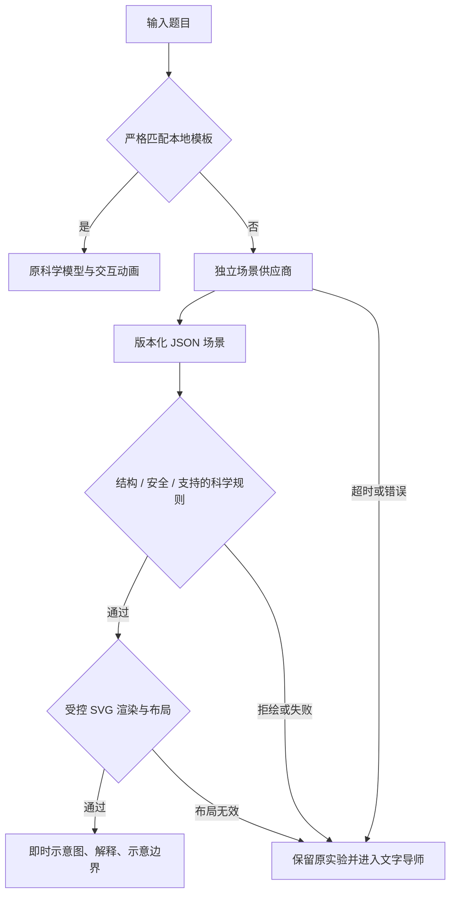

# AI 即时科学示意图 V1 开发与验收报告

验收日期：2026-10-18。仓库：`yanyucheng-master/ai-science-studio`。开发基线为当日获取的 `origin/master`：`b42a405c10e95e85f359bdfbb75c71fcf71d0fc3`。

结论：已打通“陌生题目 → DeepSeek 结构化场景 → 程序校验 → SVG 展示 → 失败转导师”链路，达到**有边界的 V1 原型演示标准**。尚不应作为无教师审核的通用科学绘图产品正式发布。30 题最终留存样本为 24 幅合格示意图、6 次符合题意的拒绘；这是首轮评测、定向修复和最终回放后的结果，不能解释为首次生成成功率 100%。

开发阶段由主模型完成开发、测试与逐图复核，没有使用子代理；该阶段没有暂存、commit、push、PR 或部署。开发前副本在 `artifacts/instant-engine-2026-10-18/baseline/`。用户随后于 2026-10-18 授权检查最新更新并推送 GitHub，本次按 master 源码范围发布，纳入既有导师与品牌动效；不将原型自动同步到公网，不部署或更改 Render 实际配置。本次发布复核只执行必要静态核查，不重跑下文开发阶段的测试。本地测试报告、原始响应和截图不属于默认提交范围。

## 1. 新增功能与修改文件

- 严格匹配本地题目时继续使用原模型和动画，浏览器测试确认这条路径不发起即时图请求。
- 未匹配题目可生成静态科学图，显示“AI 即时生成 · 科学示意图”、题目给定、科学依据与解释、示意边界。
- 支持取消、等待秒数、短期缓存、100%–250% 放大、请导师讲解、返回原实验。失败和切换题目不会把旧响应写入新题目。
- 桌面采用编号图例，手机将图例移到图下。编号避让坐标刻度；无法合理排布的过密刻度或超长图例拒绘。分式、根式、化学式和中文上下标沿用现有公式引擎。
- 即时图暂不保存为收藏，避免误收藏仍在内存中的旧实验；返回原实验后原收藏功能恢复。

| 范围 | 文件 | 作用 |
| --- | --- | --- |
| 共享协议与安全边界 | `web/instant-scene.js`、`server/schema/instant-scene-v1.schema.json` | System Prompt、Schema、图元、表达式与科学规则 |
| 安全绘图 | `web/instant-scene-renderer.js` | SVG DOM 渲染、程序采样、编号和公式布局 |
| 前端链路 | `web/instant-experiment.js`、`web/instant-experiment.css` | 请求、状态隔离、缓存、放大和恢复 |
| 网关 | `server/src/instant-scene-service.js`、`server/src/server.js` | 供应商边界、超时、取消、限额及新端点 |
| 既有界面接入 | `web/app.js`、`web/ai-tutor.js`、`web/index.html` | 模板优先、导师上下文和独立面板；只增量接入 |
| 测试 | `server/test/instant-scene.test.js`、`server/eval/instant-scene-bank.json`、`server/scripts/eval-instant-scenes.js`、`server/scripts/verify-instant-browser.js`、`server/scripts/verify-instant-live-browser.js`、`server/package.json` | 40 项新增单测、30 题、真实调用及浏览器验收 |
| 发布前置与记录 | `render.yaml`、`docs/render-publish.md`、`web/announcements.json`、本报告及计划和逐题报告 | 网关共享文件依赖、准确公告和验收边界 |

当前工作区中 `web/styles.css`、品牌资源目录和 `web/brand-motion.js` 等变化原已存在，不计为本引擎的新功能。未重构原实验库或放宽严格题目解析。

## 2. 架构与生成流程

独立提示词使用“中国初高中理科教师 + 科学可视化设计师 + SVG 绘图专家”的角色，排序为科学准确性、教学可读性、视觉美观。正式界面只接收 JSON，不开放原始 SVG 对照输出。

JSON 包含学科、标题、题目逐字引用、依据、示意假设、对象坐标与角色、连接关系、标注和解释。10 类基本图元可以自由组合：线段、箭头、矩形、圆、椭圆、多边形、折线、圆弧、坐标轴、受限表达式曲线。默认 viewBox 为 `800×450`；窄屏主图使用 `575×450`，完整图例移到下方。并非把 30 道题做成固定绘图模板。

当前供应商为独立的 `DeepSeekSceneProvider.generate(question, {signal})`，模型别名 `deepseek-flash`，启用思考，未改变原 AI 导师的独立模型配置。官方文档在验收日将此别名列为 `DeepSeek-V4.1-Flash-1017`；这属于供应商文档与请求配置证据，不能独立证明服务器实际加载的权重版本。

无个人密钥时走 `POST /api/v1/scene/generate`；有个人密钥时沿用原机制直连 DeepSeek。服务端密钥不会发给浏览器。网关路径在服务端验证后，浏览器再次验证。Schema 可供以后支持约束解码的供应商使用；当前 DeepSeek 请求使用 JSON 输出模式，真正的字段、几何和科学边界由代码执行。

性能预算：90 秒服务端超时、95 秒前端超时、最多 2 个网关并发、16000 输出 tokens、48000 UTF-8 场景字节、96000 字节响应上限、48 图元、12 标注、每折线最多 96 点、1800 SVG 节点。成功图缓存 5 分钟，服务端最多 24 条，浏览器保留最近一条。不自动循环重试；用户取消也不会自动再调用导师。

## 3. 30 道题目与真实调用结果

完整题目、每题科学复核结论、版式、耗时、历史失败和原始响应来源见 [30 题逐题验收](instant-engine-v1-evaluation.md)。题目覆盖斜面、摩擦、电路、光路、滑轮、简单机械、函数、化学装置和生物结构，并包含 6 个信息不足或科学关系不成立的拒绘案例。

| 证据层 | 结果 | 含义 |
| --- | --- | --- |
| 首次完整 Flash 30 题评测 | 19 幅图、5 次输出截断、6 次正确拒绘 | 应绘题首轮成功 19/24，约 79.2% |
| 定向修复及最终验证 | 24 幅图、6 次正确拒绘 | 使用每题最后保留的真实原始响应；没有重新进行一轮独立全量冷启动评测 |
| 最终真实浏览器回放 | 24 幅图全部显示，6 题拒绘结果符合预期 | 页面、最终校验器、布局和导师降级；回放期间不再调用公网模型 |
| 独立真实浏览器端到端 | G03 根式函数成功，1 次 scene 请求，17.642 秒 | Edge → 本机网关 → 真实 DeepSeek → 页面；控制台错误为空 |

O03 有特殊记录：最后一次真实模型响应的几何正确，“薄透镜”说明在 `basis` 中，旧规则只检查 `explanation` 而误拒。修复为检查两处用户可见说明后，**同一份未经修改的原始响应**通过最终校验与真实浏览器回放；不能把当次网关曾经误拒写成当时即成功。

科学复核由主模型依据教材参考、题目条件、对象坐标和独立计算完成，未把生成模型的 `basis` 或自评作为通过依据。函数重新代入关键点；受力、光路、连接和装置通过逐图及坐标检查。没有教师真人试用或学科专家认证记录。

## 4. 发现的科学错误与失败案例

| 问题 | 发现与处理 |
| --- | --- |
| 早期斜面受力方向错误及新增假设 | 最初 Pro 无思考试验中发现支持力/拉力方向错误，且三题假设越界被拒绝；加入独立方向与题意规则，最终 P01 在 Flash 结果上复核通过 |
| 长输出被截断 | 首轮 Flash 的 P03/E01/E02/O03/C02 未完整返回；调整输出预算到 16000。C02 曾再次截断，所有截断均降级，不显示残图 |
| 电桥缺 R5 对应标注 | 图形存在但遗漏关键标注；新增题目点名电阻必须直接对应图元的规则，重新生成 E01 后通过 |
| 凹透镜混入单界面法线 | 早期 O03 将透镜折射与单界面法线混用；新增透镜形状、主轴、虚焦点、虚线反向延长线、折射点与方向核验。缺角色和约定不清时拒绘 |
| 排水集气装置无法真实连通 | 早期 C02 集气瓶口被闭合线封住、导气管未进入发生瓶；增加开口、浸水、瓶颈/胶塞与管路关系校验，最新真实响应通过 |
| 标注误指与数字遮挡 | 修复圆弧标注指向空白包围盒、编号碰撞、函数折点编号遮住刻度；过密坐标文字拒绘，手机版使用更大编号 |

6 次拒绘对应：电路拓扑不明、滑轮绕法不明、未知液体却指定产氢、缺少附图、违反能量守恒的永动机、无法唯一判断摩擦方向。它们属于符合题意的降级，不计作科学图生成成功。

## 5. SVG 安全与科学约束

23 类恶意/越界变异均被拦截，包括脚本、`foreignObject`、外链、事件、样式注入、任意 path 字符串、标签 HTML、TeX 外部资源、原型字段、数值字符串、NaN/Infinity、越界尺寸坐标、重复 ID、无效引用、节点/点数预算、伪造题目条件、额外科学假设、未经复核的数值结论与超长输出。

渲染只通过 `createElementNS` 和 `textContent` 创建受控元素。曲线表达式由自有有限语法解析，允许数字、x、π、基本运算、有限整数幂及 sin/cos/sqrt/abs/ln，不使用 eval/Function、不允许属性访问或任意函数调用。平台计算采样点；模型不能提供可执行 JavaScript。

确定性数值规则覆盖欧姆定律、重力、牛顿第二定律、勾股定理、力矩。数值与单位必须能在原题引用中配对找到，并满足规则前提。几何检查覆盖垂直、平行、反向、等长、线段端点相连、包围盒包含；包含检查不是所有任意曲线的精确拓扑证明。

方向与领域检查已覆盖部分受力/分解、传送带摩擦、反射与折射、凹透镜、函数坐标和排水装置。它们仍是有限规则；生物形态、复杂电路的所有连接、任意装置及自然语言解释尚无全面的自动科学证明。界面将其明确作为静态示意图，不宣称精确仿真。

临时测试密钥文件已删除；没有写入源码或修改原 `server/.env`。后续实时演示需要通过既有安全机制配置有效凭证。清理的是本机测试副本，不代表代替用户撤销了供应商端密钥。

## 6. 浏览器、响应式及现有功能回归

| 测试 | 结果 | 本地证据 |
| --- | --- | --- |
| 完整单元测试 | 344/344；基线 304，新增 40 | `artifacts/instant-engine-2026-10-18/regression-tests.log` |
| 新模块最终定向复测 | 40/40 | 同目录 `scene-tests.log` |
| 严格题库 | 294/294：157 本地、137 转 AI | 同目录 `question-bank.log` |
| 第二周实验库浏览器 | 144 项，0 失败 | 同目录 `week2/browser-report.json` |
| 即时图浏览器 | 23 项；24 图显示；6 正确拒绘；控制台错误 0 | 同目录 `browser/report.json` |
| 原导师浏览器 | 9 场景通过 | 同目录 `tutor/report.json` |
| 原实验动画 | 6 变体、真实后台切换/恢复通过 | `outputs/animation-upgrade/verification/report.json` |
| 真实 DeepSeek 浏览器单题 | 成功，控制台错误 0，浏览器无服务端密钥 | `artifacts/instant-engine-2026-10-18/live-smoke/report.json` |

导师故障测试中的“未配置密钥的自由题”会产生预期 HTTP 503 并给出提示，未把这条故障注入记录当成正常路径无错误。最终定向单测第一次在受限环境因本机网络权限 EACCES 未完成，在允许本机网络的测试环境复测通过；未为此修改测试预期。

真实浏览器为 Microsoft Edge/Chromium `155.0.4283.62`。390、768、1366、1920 px 四尺寸均无页面横向溢出，图例没有越界或行间重叠，最大示例 SVG 为 155 节点。函数图另在 390 px 复查编号与刻度避让。移动端为浏览器尺寸模拟，尚无真实手机触摸与不同系统字体验收。

已覆盖放大、取消、客户端超时、连续生成不串线、实验/学科切换、导师往返、收藏隔离、缓存、个人密钥直连路由（模拟响应）、恶意响应/服务失败降级及 `?demo=1`。关键截图：

- [1366 桌面](../artifacts/instant-engine-2026-10-18/browser/viewport-1366.png)
- [390 手机布局](../artifacts/instant-engine-2026-10-18/browser/viewport-390.png)
- [768 平板布局](../artifacts/instant-engine-2026-10-18/browser/viewport-768.png)
- [1920 桌面](../artifacts/instant-engine-2026-10-18/browser/viewport-1920.png)
- [函数标注修复后](../artifacts/instant-engine-2026-10-18/browser/G02.png)
- [手机函数图](../artifacts/instant-engine-2026-10-18/browser/G02-390.png)

## 7. 耗时与 API 成本

最终 24 幅留存图的原始调用平均 31.48 秒，中位数 31.37 秒，范围 14.33–50.82 秒。6 次拒绘平均 1.66 秒。该统计只计算各题最后留存响应的一次服务调用，不含历史失败、重试、导师二次讲解或缓存回放耗时。独立浏览器真实链路 G03 为 17.642 秒。

共保存 47 次评测调用记录，其中 40 条有 usage，累计 276087 tokens；7 次早期截断没有留下 usage。按验收日 DeepSeek 官方非高峰价、缓存命中及实际各模型类型估算，**已记录部分约 US$0.1486**。这不是完整测试总费用，也不是实际账单，不能补估未取得用量的 7 次调用。实际扣费未取得。

价格来源：[DeepSeek 模型与价格](https://api-docs.deepseek.com/quick_start/pricing/)。详细用量和缺失列表：`artifacts/instant-engine-2026-10-18/metrics.json`。初期 Pro 对照调用同样计入已知用量，不仅统计最终成功的 Flash 图。

## 8. 未解决的问题与风险

1. 规则不能自动证明所有陌生题的科学正确性，特别是复杂电路拓扑、生物形态和未覆盖的器材。生成解释仍可能含错误；正式教学前需要教师复核及更广的盲测。
2. 24 幅通过是经过定向修复后的样本集合，未做最终提示词下新的全量独立样本或多轮随机稳定性实验。不能外推陌生题的总体正确率。
3. 只支持静态场景。参数绑定、运动、时间轴、可保存的即时图、导师对现有图的结构化编辑尚未实现。
4. 手机小画布上的细刻度仍较小，提供放大入口；真实手机、Safari/Firefox和较旧浏览器尚未验收。图示面板依赖 ResizeObserver 和原生 dialog。
5. 长题、多物体场景可能达到输出或标签预算而降级。服务端并发上限、缓存是单进程内存机制，不等于生产级集群配额与持久缓存。
6. API 成本只有部分估算，没有实际账单；生成时间随供应商负载变化。场景失败后进入导师会再产生导师调用费用。
7. 本轮没有上线。无个人密钥路径需要新网关端点；Render 网关服务根目录必须从 `server` 调整到仓库根目录，以访问共享校验器，详见 [发布前置条件](render-publish.md)。公网分支仍须保留独立 AI 配置。

## 9. V1 可演示标准判断

通过：预设实验不增加场景调用；陌生题真实模型生成；结构、安全和有限科学规则独立执行；SVG 与公式可读；失败可靠进入导师；状态不串线；四尺寸、原实验与 demo 回归完成。

边界：可用于说明产品链路和已复核题目的原型演示。未达到“任意理科题无人审核直接作为教学事实”的发布标准。删除测试凭证后，实时演示前需配置有效 DeepSeek 密钥；保存的回放验收无需密钥。

## 10. 下一阶段：动态 SVG 与其他供应商

先增加版本化参数声明、单位/上下限、受限绑定表达式和确定性科学模型；由程序计算新数值、位置、轨迹，再加入可暂停/复位的固定时间步动画。每个动态场景都要验证量纲、守恒/约束、参数边界和初始状态。AI 只提出结构化意图，不生成任意 JavaScript。

供应商保持 `generate(question, {signal})` 边界。未来在允许使用的地区增加 GPT 适配器，把同一 Schema 接到其结构化输出能力，并沿用独立校验器、统一超时预算和同一评测题库。本轮未开通 GPT、未验证其成本或生成质量。

## 复核参考

- OpenStax：[斜面](https://openstax.org/books/physics/pages/5-4-inclined-planes)、[摩擦](https://openstax.org/books/university-physics-volume-1/pages/6-2-friction)、[受力图](https://openstax.org/books/university-physics-volume-1/pages/5-7-drawing-free-body-diagrams)。
- OpenStax：[反射定律](https://openstax.org/books/university-physics-volume-3/pages/1-2-the-law-of-reflection)、[折射](https://openstax.org/books/university-physics-volume-3/pages/1-3-refraction)。
- OpenStax：[神经元](https://openstax.org/books/biology-2e/pages/35-1-neurons-and-glial-cells)、[根](https://openstax.org/books/biology-2e/pages/30-3-roots)、[叶与气孔](https://openstax.org/books/biology-2e/pages/30-4-leaves)。
- RSC：[过滤教学](https://edu.rsc.org/separating-mixtures/filtration-developing-understanding-11-14-years/4023930.article)。

电路与简单机械另外按题目连接图、力臂定义逐项核对；函数按原表达式重新计算，不用参考页面替代本题计算。上述参考不是对全部生成场景的外部认证。
