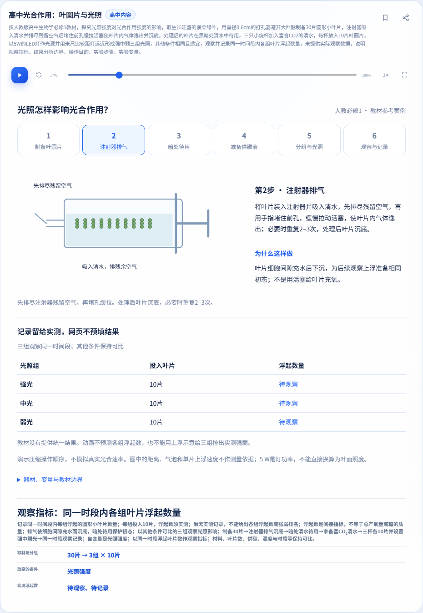
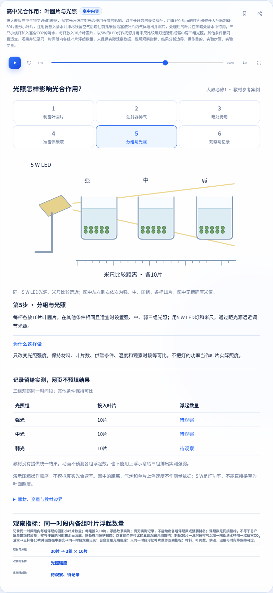
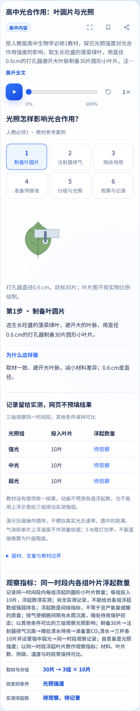
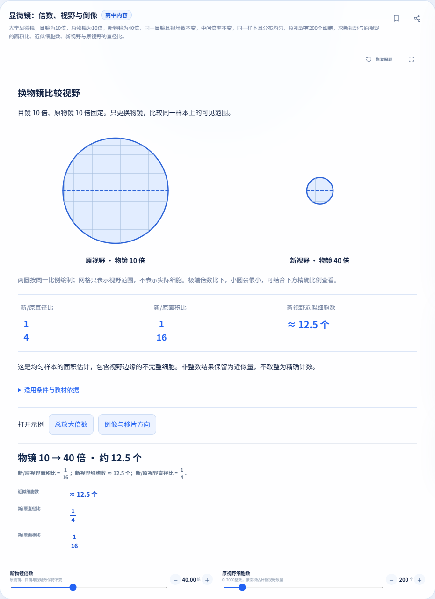
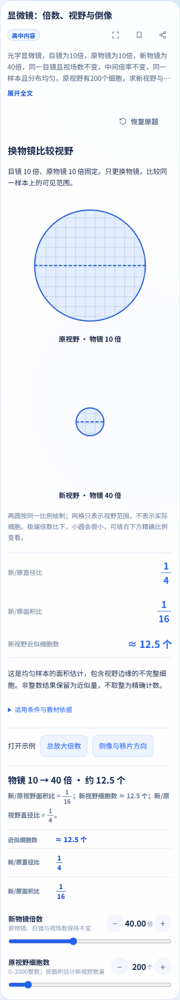

# 光合作用退回修复证据（2026-11-03）

针对[负责人退回评论](https://github.com/yanyucheng-master/ai-science-studio/issues/9#issuecomment-6603663397)补交。本页对应人教必修1《分子与细胞》2019审核体系正文105页的已授权样例。仅为J02同叶遮光或H11叶圆片的部分，不申报J01–J08/H01–H12全专题完成，也未代用户确认20族整体方案。

## 版本与主线保留

- 完整执行源码：`34809407d34e077ac80640b7ab1a3a5a558492e3`；树`ecf39b2cd0bb53543087dafa4b0a4559e2d91ebc`。运行期间隔离源码未变。最终PR若只增加证据/公告元数据，另验公告并在Issue列最终head，不将旧执行重命名为新提交执行。
- fetch基线：`e6f43c5b398fb039c80e2f02382119d3566ae1f5`。两PR仍独立面向master、Draft；初中追加合并提交接入主线，无历史重写。主线560题原样保留，初中574、高中586题。
- 联用审查分支`codex/photosynthesis-joint-review`含两个修复源码，归并共享app/page/menu、题库、公告与测试夹具；完整联用源码`45be585eafd38aa72761c78fefca438a55c3c502`、树`6b63f13e1c544b204f67ba1d6f078721c1fe5447`，600=560+14+26题。该分支供负责人核查，不表示PR已接纳，不合并PR/主线、不部署。
- [逐文件和数据保留核对](source-preservation.json)：拍题、移动样式、显微镜、种群的12个相关文件与master逐字节一致；主线既有公告不改。共享文件只归并本实验必要片段。

## 等义题修复证据

[真实模板API前后对照](review-reproduction.json)：旧head的原句成功、两条独立改写失败；修复版原句与改写均成功。`expectedAccepted=true`表示正确语义预期，旧版false是已复现缺陷，不能当成正确拒绝。

[逐例输入、独立预期、实际页面结果](semantic-cases.json)：49例（17正、32反），手写输入不调用模板生成器当预期。覆盖明确等义操作、问句前/后置、条件反序、句号/冒号/分号、适用单位、逐项缺失、矛盾/重复、数字角色、错误操作和附加子问。页面逐例实际生成或拒绝；拒绝后原题/播放位置保留，而新题导师无旧结果/旧步骤。

解析逐条件消费完整题目、独立核对所有所问；不再整句相等才通过，也不是只看关键词。只支持列明的有限等义词法，不宣称理解任意自然语言；未知片段或缺项具体提示，不补条件、不吞子问、不弱化拒绝。事实列举可以换序，明确写出的操作先后关系仍逐项核对。

Node总计1000/1000，本实验专项94已含在总数中，不重复相加。Edge/Chromium专项分别301/301项、25/25份布局记录。

## 完整适用执行

| 集合 | 源码 | 通过 | 失败 | 进程超时 | 未执行组 |
| --- | --- | ---: | ---: | ---: | ---: |
| 本实验38组 | `34809407d34e` | 36 | 2 | 0 | 0 |
| 干净主线36组 | `e6f43c5b398f` | 33 | 3 | 0 | 0 |
| 两项联用41组 | `45be585eafd3` | 39 | 2 | 0 | 0 |

未执行组0仅表示列出的进程都实际启动并结束，**失败脚本在中止点之后的断言不计通过**。本轮重新完整执行，不沿用旧31/45项专项当补证。原始时间戳UTC；环境Windows、Nodev24.22.1、Playwright1.62.1、Edge156.0.4314.58、Chromium151.0.7922.34。两浏览器同引擎。

[脱敏执行摘要](execution-summary.json)包含每个集合的命令、退出码、计数、失败内容、日志哈希、DOM/几何断言、浏览器与分享/动画记录。原始日志和未选图片留本地`.handoff/photosynthesis-review-20261103/`独立目录。设置安装环境的`PLAYWRIGHT_MODULE`、隔离`PLAYWRIGHT_BROWSERS_PATH`、`BROWSER_CHANNEL`和`SECONDARY_BROWSER_CHANNEL`，从`server`目录按下表复跑；无需真实AI密钥。

| 命令（server目录） | 退出码 | 状态 | 计数摘要 |
| --- | ---: | --- | --- |
| `node scripts/verify-leaf-disks-browser.js` | 0 | 通过 | checks=301, layouts=25, semanticCases=49 |
| `node --test test/biology-leaf-disks.test.js` | 0 | 通过 | tests=94, pass=94, fail=0, cancelled=0, skipped=0, todo=0 |
| `node --test` | 0 | 通过 | tests=1000, pass=1000, fail=0, cancelled=0, skipped=0, todo=0 |
| `node scripts/verify-question-bank-browser.js` | 0 | 通过 | totalQuestions=586, local=270, mockRoute=316 |
| `node scripts/verify-week1-browser.js` | 0 | 通过 | layouts=50, failures=0 |
| `node scripts/verify-week2-browser.js` | 0 | 通过 | checks=144, failures=0 |
| `node scripts/verify-tutor-browser.js` | 0 | 通过 | reportCases=9 |
| `node scripts/verify-animation-browser.js` | 0 | 通过 | variants=6 |
| `node scripts/verify-announcements-browser.js` | 0 | 通过 | cases=8, passedCases=8, failedCases=0, reportedPasses=8 |
| `node scripts/verify-formula-browser.js` | 0 | 通过 | layouts=69, failures=0, ai=5 |
| `node scripts/verify-ai-quality-browser.js` | 0 | 通过 | reportCases=17 |
| `node scripts/verify-share-browser.js` | 0 | 通过 | checks=14, roundTrips=270, adjustedTemplates=43 |
| `node scripts/verify-instant-browser.js` | 0 | 通过 | reportedPassLines=13 |
| `node scripts/verify-instant-routing-browser.js` | 0 | 通过 | reportedPassLines=8 |
| `node scripts/verify-tutor-diagram-browser.js` | 0 | 通过 | cases=19, passedCases=19, failedCases=0 |
| `node scripts/verify-tutor-presentation-browser.js` | 0 | 通过 | cases=27, passedCases=27, failedCases=0 |
| `node scripts/verify-incline-diagram-browser.js --guard-only` | 1 | 失败 | cases=6, passedCases=1, failedCases=5 |
| `node scripts/verify-incline-diagram-browser.js` | 0 | 通过 | cases=7, passedCases=7, failedCases=0 |
| `node scripts/verify-incline-diagram-browser.js --render` | 0 | 通过 | cases=11, passedCases=11, failedCases=0 |
| `node scripts/verify-incline-diagram-browser.js --competition` | 0 | 通过 | cases=19, passedCases=19, failedCases=0 |
| `node scripts/verify-incline-diagram-browser.js --data` | 0 | 通过 | cases=32, passedCases=32, failedCases=0 |
| `node --test test/chemistry-experiments.test.js` | 0 | 通过 | tests=20, pass=20, fail=0, cancelled=0, skipped=0, todo=0 |
| `node scripts/verify-chemistry-browser.js` | 0 | 通过 | checks=200, layouts=6 |
| `node --test test/math-experiments.test.js` | 0 | 通过 | tests=25, pass=25, fail=0, cancelled=0, skipped=0, todo=0 |
| `node scripts/verify-math-experiments-browser.js` | 0 | 通过 | checks=203, layouts=9 |
| `node scripts/verify-experiment-layout-browser.js` | 0 | 通过 | layoutsCases=73, cases=46, passedCases=46, failedCases=0 |
| `node --test test/unit-circle.test.js` | 0 | 通过 | tests=73, pass=73, fail=0, cancelled=0, skipped=0, todo=0 |
| `node scripts/verify-unit-circle-browser.js` | 0 | 通过 | checks=219, layouts=15 |
| `node --test test/chemistry-equilibria.test.js test/chemistry-equilibria-templates.test.js` | 0 | 通过 | tests=63, pass=63, fail=0, cancelled=0, skipped=0, todo=0 |
| `node scripts/verify-chemistry-equilibria-browser.js` | 0 | 通过 | checks=134, layouts=14 |
| `node --test test/biology-mendel.test.js` | 0 | 通过 | tests=17, pass=17, fail=0, cancelled=0, skipped=0, todo=0 |
| `node scripts/verify-mendel-browser.js` | 0 | 通过 | checks=105, layouts=7 |
| `node scripts/verify-acceptance-fixes-browser.js` | 0 | 通过 | checks=62, failures=0 |
| `node --test test/biology-microscope.test.js test/biology-microscope-questions.test.js test/biology-microscope-templates.test.js` | 0 | 通过 | tests=36, pass=36, fail=0, cancelled=0, skipped=0, todo=0 |
| `node scripts/verify-microscope-browser.js` | 0 | 通过 | checks=249, layouts=21 |
| `node --test test/biology-population.test.js test/biology-population-logistic.test.js` | 0 | 通过 | tests=65, pass=65, fail=0, cancelled=0, skipped=0, todo=0 |
| `node scripts/verify-population-browser.js` | 0 | 通过 | checks=215, layouts=16 |
| `node scripts/verify-population-background-browser.js` | 1 | 失败 | checks=1 |

## 失败与未执行边界

- 旧斜面guard断言保留；干净基线、两候选与联用的原始结果分别记录。共同失败不计通过，也不据同签名断言已证明根因。
- 种群后台若在S型暂停后pending RAF=1、期望0处停止，离散部分与停止前已到达内容单列；S型其后断言未到达。未接手重写种群。
- 干净主线原share在等待页点击隐藏按钮的原始超时保留。另份基线副本仅改等待页夹具：断言按钮隐藏并调用公开copy确认拒绝未生成实验，之后全部原断言保留。候选/联用采用该夹具；原失败与补测通过分开列，不倒改为全绿。
- 联用探索首轮漏配主动追问mock，4次本地503使无错误断言失败；补齐模拟响应后完整重跑，原失败留本地，未删断言。高中探索预检期间资源元数据同步不作冻结证据，本页完整执行使用固定源码。
- Firefox/Safari、真机、真实相机/OCR准确率、真实AI/live、部署未执行。Edge/Chromium不能代替跨引擎结果。本地通过不等于CI/安全扫描/签名通过，最终GitHub记录在Issue另报。

## 精选页面

新图来自上述完整执行源码，基线图来自同一干净master。1366/820/390/**360**及844×390均覆盖真实页面、触控模拟、全屏滚动、文本边界、按钮尺寸与SVG/图线断言；联用另验跨模板A→B→A、AI往返、固定追问、模拟照片上传只填题、显微镜与种群入口。独立导入、刷新、收藏、重置、实际BFCache由专项和完整share验证。截图不能替代实际交互检查。

[PNG尺寸/哈希/源码SHA](manifest.json)。教材映射见上级文档。没有提交教材原PDF/页图、密钥、个人配置、原始日志或未选产物。

### 本轮种群后台的实际差异

| 集合 | 实际状态 | 已完成模式 | 停止点 |
| --- | --- | --- | --- |
| baseline-full | 失败 | discrete | 暂停后pending RAF=1，期望0；其后S型断言未到达 |
| junior-full | 通过 | discrete, logistic | 两种模式及最终检查完成 |
| senior-full | 失败 | discrete | 暂停后pending RAF=1，期望0；其后S型断言未到达 |
| joint-full | 失败 | discrete | 暂停后pending RAF=1，期望0；其后S型断言未到达 |
| baseline-population-repeat | 失败 | discrete | 暂停后pending RAF=1，期望0；其后S型断言未到达 |
| junior-population-repeat | 通过 | discrete, logistic | 两种模式及最终检查完成 |

初中完整执行和定向复核都通过，而同一未改主线的完整执行和定向复核都在S型暂停计数处失败；其余集合如表。没有以初中的通过删除原失败，也没有把现象差异归因为本实验修复或宣称根因已确认。

### 先排残气再堵孔缓拉 · 1366

### 同高三杯、单光源与米尺 · 820

### 独立单片机理与待测记录 · 390

### 直径0.6cm避开大叶脉 · 390

### 新增360宽机理与待测记录

### 同一基线显微镜布局对照 · 1366

### 同一基线显微镜布局对照 · 390

上轮失败和版本映射仍可在[原交付提交](https://github.com/yanyucheng-master/ai-science-studio/blob/2fb001837dd09aee904e2b7ae2155dd57912c304/docs/leaf-disks-evidence/README.md)核对，没有改称本轮执行。
