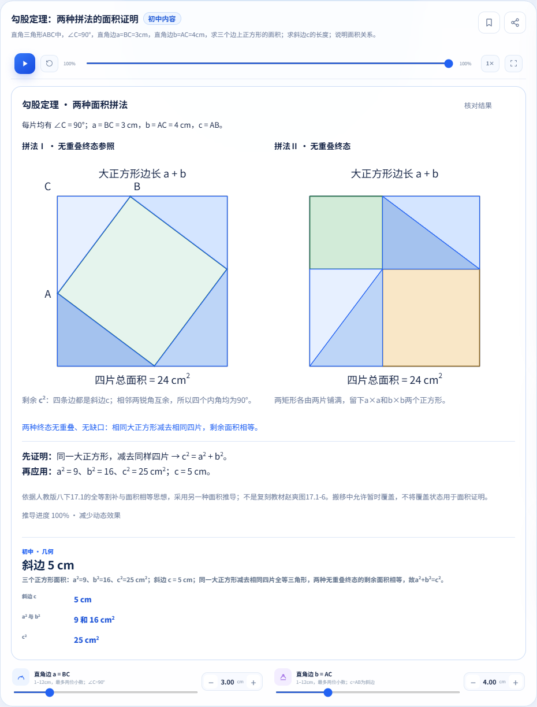
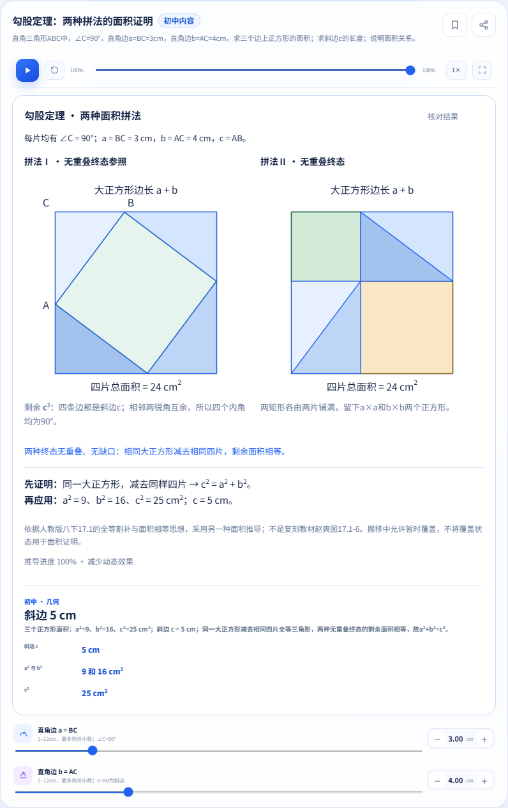
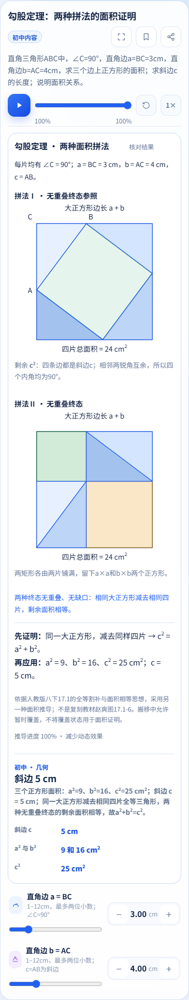
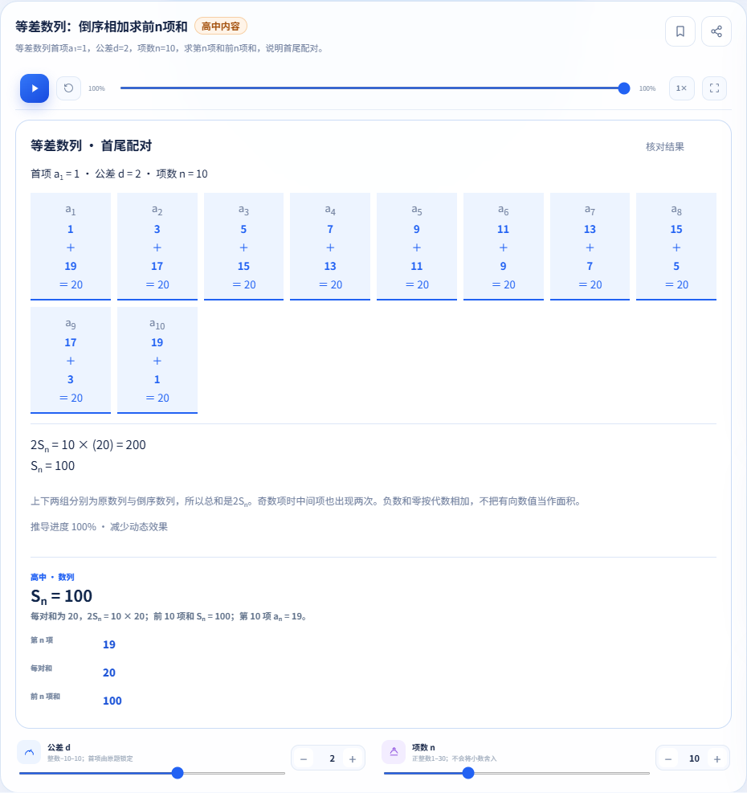
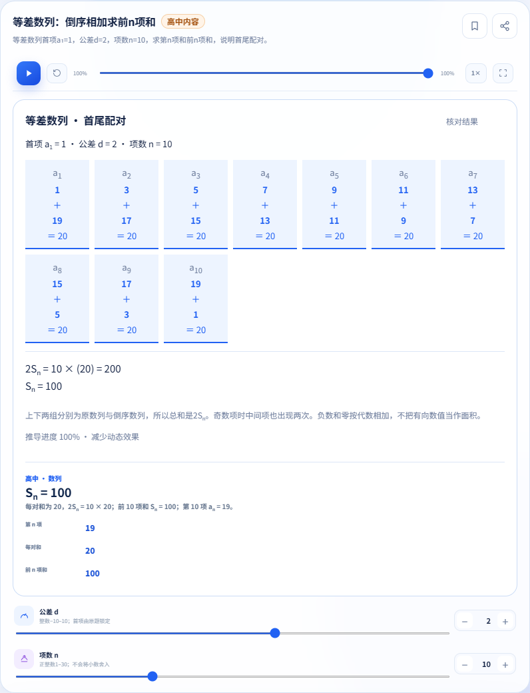
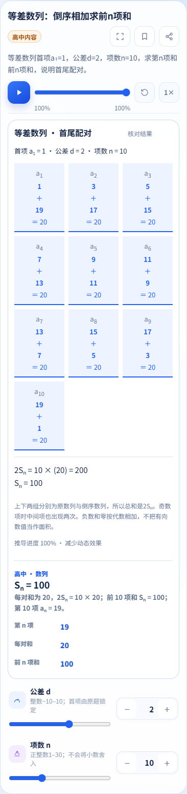
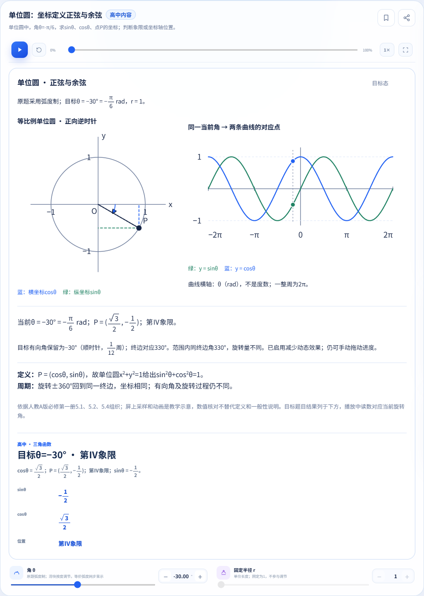
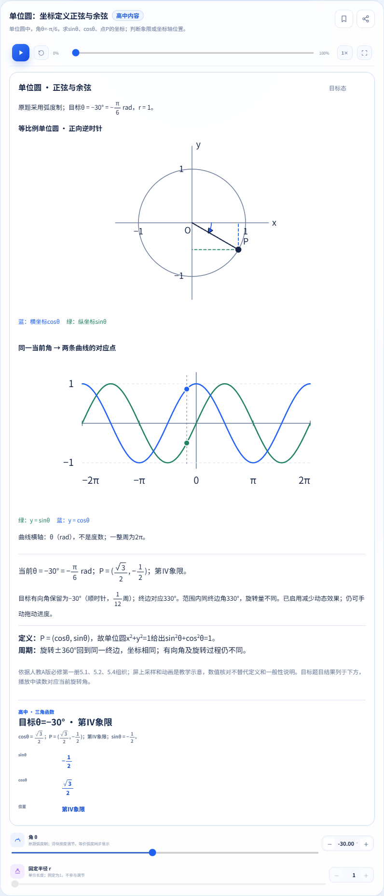
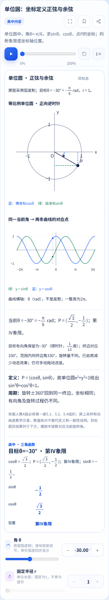

# 数学整合精选证据（2026-10-26，阶段交付）

固定执行源码 `00f00d8f64e9aac94bf223022ec96e3f2f63d920`。已整合master c4b1cce。Chromium数学页面/58例共享布局通过，Node702/702、完整题库392题通过。完整26组与干净master对照仍在运行，week1出现44条字号/参数布局断言，尚未分类；不宣称最终完整交付。

[数列人教版正文映射](../math-arithmetic-textbook.md) · [脱敏阶段执行摘要](execution-summary.json) · [PNG哈希、源码/目录树与尺寸](manifest.json)

下面九图均为同一源码的Chromium实际页面，视口1366/820/390，裁取完整实验卡。原始截图/日志、教材整本/原页和个人配置不提交。最终完整回归结果将更新本目录。

## pythagoras · 1366

## pythagoras · 820

## pythagoras · 390

## arithmeticSum · 1366

## arithmeticSum · 820

## arithmeticSum · 390

## unitCircle · 1366

## unitCircle · 820

## unitCircle · 390

