# 最终功能源码验收证据

开工基线为 `a91e09f4fb3d965ea927e55b305ca71f34ab8b82`，完整执行源码为 `582ceccf74d341e122fb6cdc988bc3882566c868`，树为 `a71ee0f2184557e70ac9992da9d7383015fbf867`。

全部验证使用隔离浏览器和本机模拟响应，参数与题面中的数据均为虚构教学输入。

| 集合 | 通过组 | 失败组 | 进程超时 | 未执行组 |
| --- | ---: | ---: | ---: | ---: |
| 同基线 | 26/47 | 21 | 0 | 0 |
| 最终候选 | 27/48 | 21 | 0 | 0 |

逐组命令、退出码、计数、失败位置、未到达边界与日志哈希保留在[脱敏执行摘要](execution-summary.json)。

| 集合 | 实际失败组 |
| --- | --- |
| 同基线 | population-background、learning、ui-interactions、protocol-review、photosynthesis-integration、photosynthesis-browser、photosynthesis-model、leaf-disks-browser、leaf-disks-model、node、week1、week2、animation、chemistry-browser、math-browser、experiment-layout、unit-circle-browser、equilibria-browser、mendel-browser、microscope-browser、population-browser |
| 最终候选 | population-background、learning、ui-interactions、protocol-review、photosynthesis-integration、photosynthesis-browser、photosynthesis-model、leaf-disks-browser、leaf-disks-model、node、week1、week2、animation、chemistry-browser、math-browser、experiment-layout、unit-circle-browser、equilibria-browser、mendel-browser、microscope-browser、population-browser |

同名失败只提供对照，不能据此断言根因相同。原始主线的两项Node失败分别停在旧光合作用文案正则，完整Node计数和失败名称按实列出。浏览器内部等待超时与外层进程超时分别记录，失败后的未记录断言仍未到达。

遗传系谱图Edge专项完成1042项断言、35个布局检查，含五种视口的30张样图和P02全屏。六图均完成收藏分享及独立会话恢复，8条拒绝保留图和步骤、导师无旧答案且0自动AI请求。

Chromium复核完成292项断言，主布局为390宽，包含全部六图、全屏、恢复和拒绝。Edge与Chromium属于同引擎家族。 [Edge正常按钮](normal-buttons-edge.json) · [Chromium正常按钮](normal-buttons-chromium.json)

六图正常生成与推导的附加检查没有控制台error、页面异常或自动AI POST，六个独立SVG也实际加载核对。命令为 `node docs/pedigree-v1/evidence/check-console-previews.mjs <冻结源码根目录>`，Playwright通过现有PLAYWRIGHT_MODULE配置。 [附加结果](console-previews.json)

首版独立SVG的HTML布尔属性导致XML解析失败，文档预览已改为带值属性。六图重新加载及成员核对通过，Web图示逻辑与完整执行源码一致。最终SVG文件哈希列在附加结果。

遗传标题作为展示背景的物理题，在当前master和候选均被旧分类逻辑判为生物并进入本机模拟回退，A/B记录保留于正常按钮报告。纯平面镜对照、普通概念回退和孟德尔均另行核对。

Firefox、Safari、真机、真实AI、真实拍题、部署及额外安全扫描未执行。GitHub最终head的可见Actions、check-runs、statuses和签名结果在送审回复逐项列出。

以下是360/390视口内最终功能源码的实验板块截图，按实际步骤显示题给或推断证据。原始日志和其他产物留在本地。 [截图尺寸、SHA-256与执行SHA](screenshots.json)

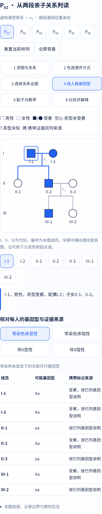

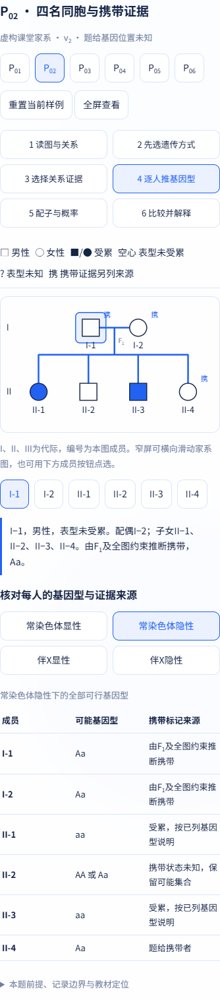

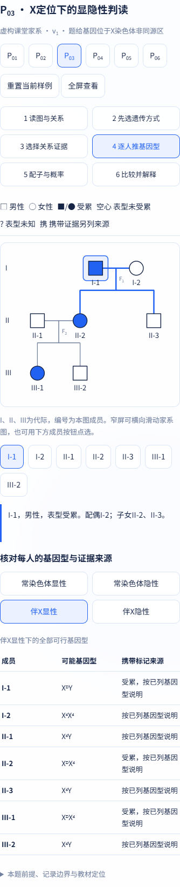

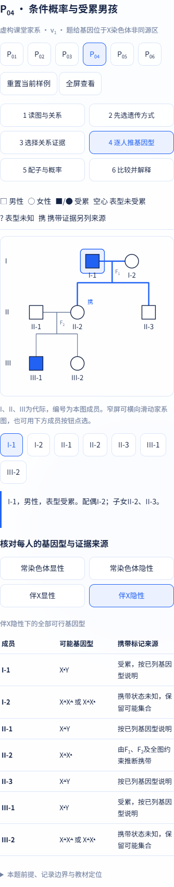

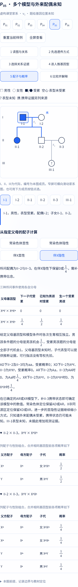

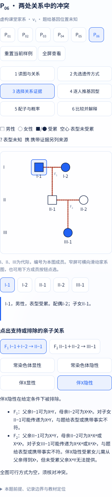

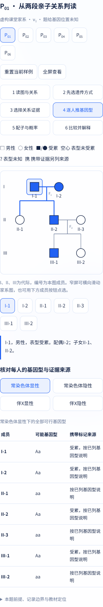

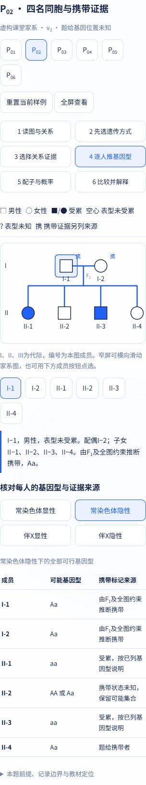

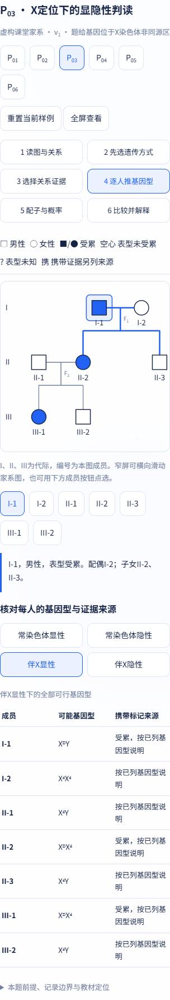

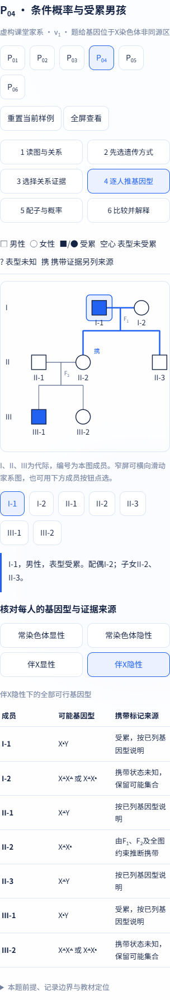

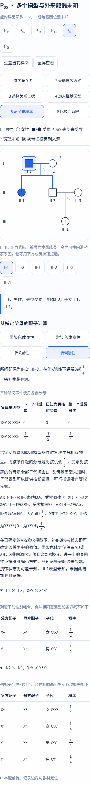

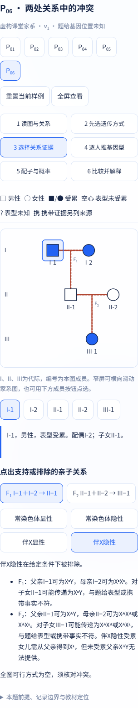
