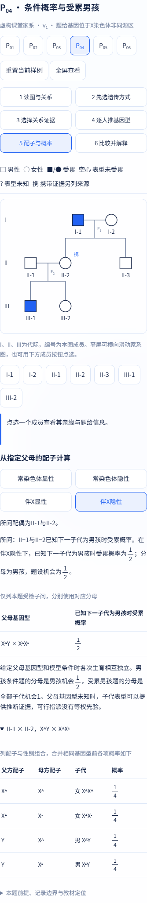
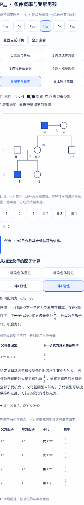
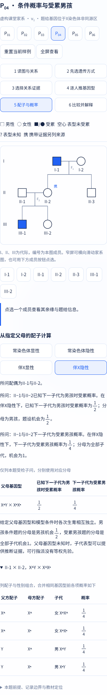
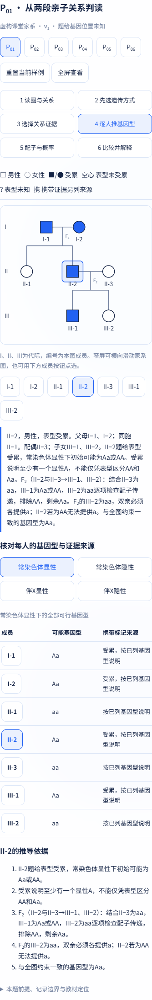
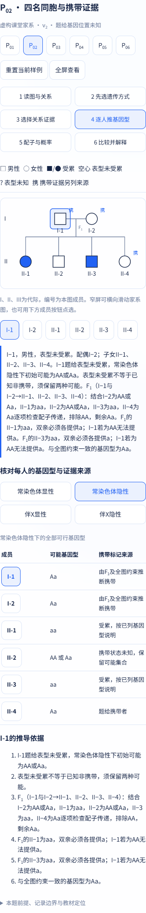
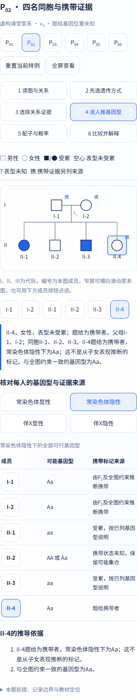
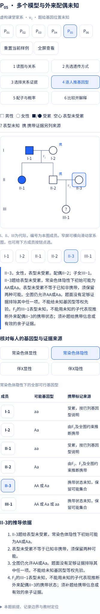

# 当前主线组合版本验收证据

推送前master由a91e09f前进到`944f66245f06a1ff46a18a8a7361d947cd9835df`，新增生成浮层完成/退出修复，涉及共享app、brand、样式和资源。已在功能分支保留历史整合，逐片解决app/index/公告冲突，保留双方内容。

本轮组合完整执行源码`08460c0a607516fe6e76b78702bbb67c22101940`，树`6b91cf7392d2cb9e70a7e161a4b4f79bc0bb0ece`。四项原审查修复首次提交为`25f498993decbf3c761667c24fbaab0a1361353c`；该源码的49组结果保留为[整合前历史记录](../review-20261127/README.md)，不当作组合完成证据。

最终证据提交只追加文档、精选页面和公告；最终head、树及元数据差异核验在Issue回复列出。所有功能验证只用本机模拟与独立浏览器配置。

| 审查项 | 本轮正常入口实际结果 |
| --- | --- |
| P04主句 | 纯条件1/2与男孩分母、纯联合1/4与全部子代分母、两问分列；生成/收藏/独立分享/刷新/重置均保持同一受检子问及导师结果 |
| 无高中前缀引用 | P99-v1/P02-v1有无前缀及P02-v2缺条件，在导师存在/缺失时10次具体本地拒绝，保留旧图/步骤/固定状态，仅新题和缺口进入导师、0自动POST |
| 逐人推导 | 360/390共12项：P01-II2有A且须向aa女儿给a；P02给定/推断/未知对照；P05 AR/XR保留未知外来成员 |
| 连续键盘 | 360/390下预测、模型、证据、表格点选与解释的Enter/空格、Tab/Shift+Tab/方向键及核对后焦点保留 |

[Edge审查专项](pedigree-review-edge.json) · [Chromium审查专项](pedigree-review-chromium.json)。各355项断言；保存的30份恢复上下文另按独立1/2与1/4预期核对。原head四项复现可查[修复前证据](../review-20261127/before-review.json)。

另在同一文档中保持P04样例和参数不变，按条件→联合→两问→条件切换分享URL，以文档哨兵确认未换文档；逐次核对所问、主句和初始步，再验AI页往返与重置。两套各28项、0自动POST。[Edge同图子问分享](share-events-edge.json) · [Chromium同图子问分享](share-events-chromium.json) · [可复现本机模拟脚本](share-events.mjs)。这是另行补验，不并入50组计数。

新增组合入口专项各95项：1366/390/360常规动效、减少动效、缺requestIdleCallback四种配置；实际按钮从P01转P04纯条件，记录页面在hide前已准备、完成对勾停留至少600ms、退出无滞留、拒绝和独立分享0自动POST。缺idle接口是Chromium中的API回退模拟，不是Safari实机验证。[Edge组合入口](pedigree-overlay-edge.json) · [Chromium组合入口](pedigree-overlay-chromium.json)

| 集合 | 通过组 | 失败组 | 进程超时 |
| --- | ---: | ---: | ---: |
| 本轮候选 | 29/50 | 21 | 0 |
| 本轮新master同基线 | 26/47 | 21 | 0 |
| 本轮Chromium专项 | 3/3 | 0 | 0 |
| 整合前25f4989（历史） | 28/49 | 21 | 0 |

原系谱Node38项保留，共46/46。原浏览器专项Edge1042、Chromium1041项，两套各35布局、六图收藏分享、8条拒绝和实际BFCache。Edge启用可选新master背景A/B，Chromium没开，因此计数差1。两者同为Chromium引擎家族。

| 集合 | 实际失败组 |
| --- | --- |
| 候选 | population-background、learning、ui-interactions、protocol-review、photosynthesis-integration、photosynthesis-browser、photosynthesis-model、leaf-disks-browser、leaf-disks-model、node、week1、week2、animation、chemistry-browser、math-browser、experiment-layout、unit-circle-browser、equilibria-browser、mendel-browser、microscope-browser、population-browser |
| 同基线 | population-background、learning、ui-interactions、protocol-review、photosynthesis-integration、photosynthesis-browser、photosynthesis-model、leaf-disks-browser、leaf-disks-model、node、week1、week2、animation、chemistry-browser、math-browser、experiment-layout、unit-circle-browser、equilibria-browser、mendel-browser、microscope-browser、population-browser |

同名或同计数不推定同根因，不计为通过。内部等待超时与外层进程超时分别记录。失败后的未记录断言未到达，其他独立组继续；Node全部测试按框架执行，失败测试内部后续断言未到达。[逐组命令/退出码/计数/失败/未到达/日志哈希与源文件哈希](execution-summary.json)。

运行副本的Windows换行CRLF与Git blob分别给SHA-256，转LF后逐一核对相同，不混称原始字节相同。候选及新master冻结副本逐文件与各自执行归档字节核对未变。原600题顺序内容保留，候选610题按实际题库组结果列出。

[原系谱Edge](pedigree-edge.json) · [原系谱Chromium](pedigree-chromium.json) · [六图控制台/独立SVG补验](console-previews.json)。Firefox/Safari、真机、真实AI、真实拍题、部署和额外扫描未执行；GitHub检查与签名在送审回复按最终head实读。

以下是新组合源码的七张390宽精选页面，360宽有同组的几何、图例、连线、触控目标和键盘检查。[PNG尺寸、SHA-256和执行SHA](screenshots.json)

