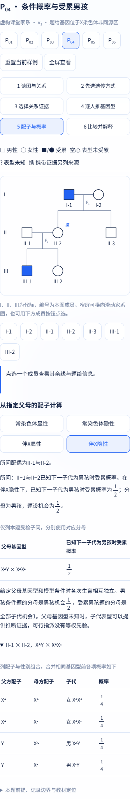
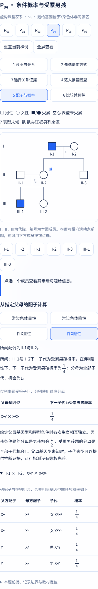
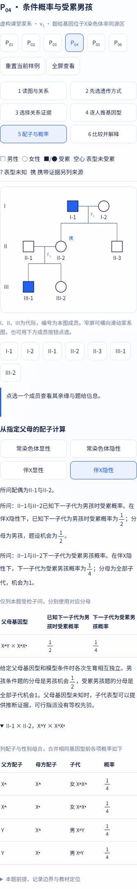
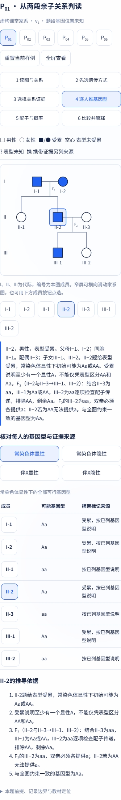
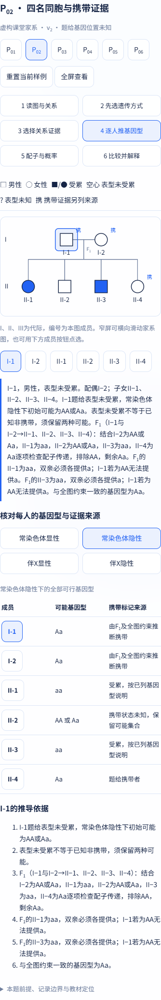
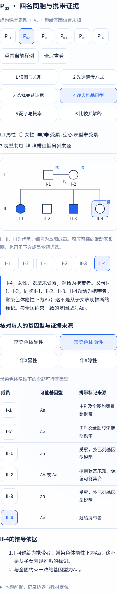
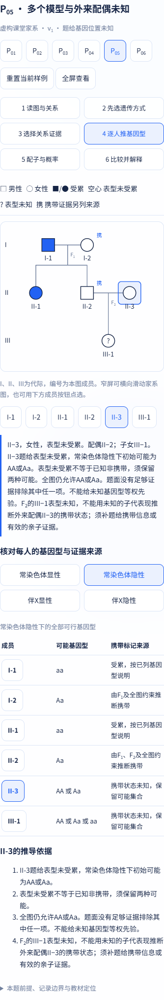

# 2026-11-27 系谱审查修复证据

对应[本轮审查](https://github.com/yanyucheng-master/ai-science-studio/pull/12#pullrequestreview-6076985084)。原审查head为`a04e70b43603583fff926c815ba697a0fb8da329`；本轮完整执行源码`25f498993decbf3c761667c24fbaab0a1361353c`，树`1b23f6f5d2ed5b7746d1d24e5c9ed4ffcbd86db0`，目标master`a91e09f4fb3d965ea927e55b305ca71f34ab8b82`。

最终证据提交相对该执行源码只追加文档、精选截图及公告；确切最终head/树和元数据差异核对在Issue回复列出。所有请求只到本机模拟，独立临时浏览器配置，不访问真实AI或个人浏览器资料。

| 审查项 | 预期与实际 |
| --- | --- |
| P04纯条件 | 主句/表格仅已知男孩受累1/2，分母男孩1/2。普通生成、收藏打开、独立分享、刷新和重置均保持同一受检子问 |
| P04纯联合 | 主句/表格仅受累男孩1/4，分母全部子代1。上述恢复路径均保持 |
| P04两问 | 分列1/2与1/4及各自分母，未增加无条件受累主结果 |
| 引用缺前缀 | P99-v1与P02-v1，有/无高中前缀，具体未知样例/版本诊断；当前图/步骤不变，导师仅新题与缺口、0自动POST。有效P02-v2缺条件亦具体拒绝 |
| 逐人推导 | P01 II-2受累有A，F2的III-2为aa需父方a，排除AA留下Aa；P02题给/推断/未知并列；P05外来成员仍未知 |
| 连续键盘 | 360/390下Enter/空格预测、Tab/Shift+Tab、候选/证据、表格成员、解释方向键与核对后焦点均留在当前控件 |

正常按钮的题面、预期、实际主句、恢复结果、请求数与键盘定位逐项可读：[Edge新增专项](pedigree-review-edge.json) · [Chromium新增专项](pedigree-review-chromium.json)。两套各355项断言；Edge与Chromium属于同一引擎家族。

原审查head的本轮独立实页对照：[修复前四项记录](before-review.json)。这组记录包含旧条件题错答主句、两条各一次本机模拟POST、原逐人文本及焦点BODY；不是实时生产或真实AI证据。

| 执行集合 | 通过组 | 失败组 | 进程超时 |
| --- | ---: | ---: | ---: |
| 本轮候选 | 28/49 | 21 | 0 |
| 本轮Chromium受影响专项 | 2/2 | 0 | 0 |
| 11月26日同master基线（历史引用） | 26/47 | 21 | 0 |
| 11月26日上一候选源码（历史引用） | 27/48 | 21 | 0 |

新系谱单测46/46，包含原38项。原系谱浏览器专项仍完整执行，Edge1042项、Chromium1041项，两套各35个布局/六图收藏分享/8条拒绝/实际BFCache。Edge另开可选主线背景A/B，Chromium未开该项，因此原专项计数差1。

当前主线SHA未变。本轮未重跑历史47组主线和48组上一候选；其原始执行日期、源码、命令、退出码、失败与未到达按原记录引用。本轮候选49组均实际启动运行，进程超时与内部等待超时分别记录，不以失败组同名或同计数推断同根因。

Windows归档运行副本为CRLF换行。原审查head的运行文件分别给出副本和Git blob的SHA-256，转为LF后内容一致；不混称其原始字节相同。候选冻结目录逐文件与执行归档比对未变，归档哈希另列。

| 本轮失败组 |
| --- |
| population-background、learning、ui-interactions、protocol-review、photosynthesis-integration、photosynthesis-browser、photosynthesis-model、leaf-disks-browser、leaf-disks-model、node、week1、week2、animation、chemistry-browser、math-browser、experiment-layout、unit-circle-browser、equilibria-browser、mendel-browser、microscope-browser、population-browser |

逐组命令、Node计数、退出码、失败位置、未到达、时间和日志哈希见[脱敏执行摘要](execution-summary.json)。未删除或弱化既有断言。原600题顺序及内容保持、题库仍610题。

共享路由/界面相关的题库、share、tutor、tutor-presentation、animation、ui-interactions、协议routing/intent/separators、原三套绘图与其他完整适用组按实际结果列出；同名失败不是通过。[原系谱Edge](pedigree-edge.json) · [原系谱Chromium](pedigree-chromium.json) · [六图控制台及独立SVG](console-previews.json)。

Firefox、Safari、真机、真实AI、真实拍题、部署与额外安全扫描未执行。最终GitHub Actions、check-runs、statuses和签名在送审回复读取后实报，空记录不视作通过。

以下七张为本轮执行源码390宽精选板块图；360宽有同一专项的几何、连线、图例、触控目标与连续键盘断言。[尺寸、源码SHA与PNG SHA-256](screenshots.json)

