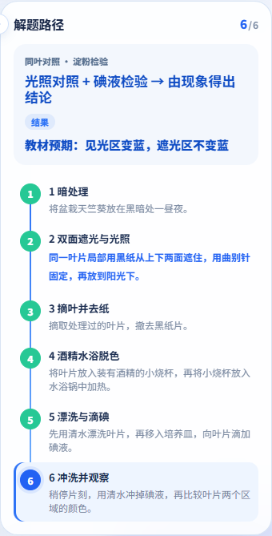
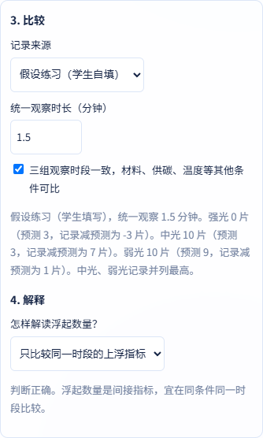
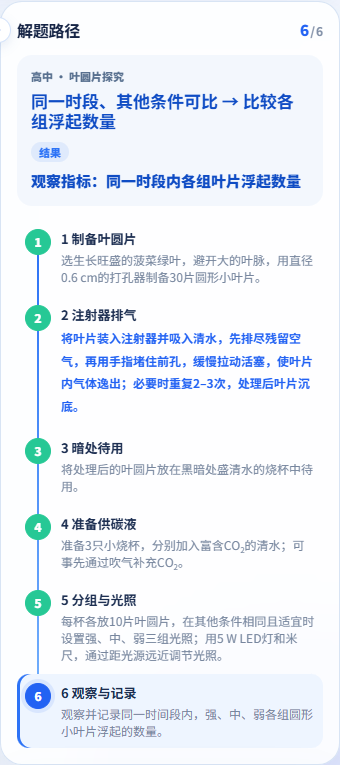

# 固定样例学习闭环及当前主线回归

逐族状态、独立预期、待补题据和学习记录边界见 [Issue #9 验收矩阵](../photosynthesis-coverage-20261108.md)。

初中同叶遮光和高中叶圆片共用各自的六步时间轴。场景、右侧路径、播放和滑块同步定位。初中冲洗完成后比较预测与教材预期。高中只比较学生选择来源后填写的同一时段浮片数。

| 对象 | 执行 SHA | Git 树 | Edge 通过 / 全部组 | 失败组 |
| --- | --- | --- | ---: | --- |
| joint | 45a63af11913fe70401a2050862d9a08ecafebf9 | c340acb83649f9255db6a9b55c178f7ef6204e1b | 45/47 | week2、formula |
| junior | 5be0c20179cfca05adde30bb23ebb9a34e58937d | c91b09bed2518f8dee93ed3e5477fc193170e613 | 42/44 | week2、formula |
| senior | ccc8a3a43633fdba14e06d9a97177238d97f0e60 | 2e1fac08fa359d931fddcbfc7584a5aa7cc1d105 | 42/44 | week2、formula |
| baseline | 9393867e204124eb477a0e6016dff94fbadf0f7e | d806ba109c52b11cb76c5be5bebac1354aa80818 | 33/37 | incline-guard、week2、formula、share |

执行 SHA 为冻结源码。证据提交只附加报告、截图和公告。每组命令、退出码、计数、时间和日志哈希分列。 [执行摘要](execution-summary.json)

| 版本 | Edge 学习视口组合 | Chromium 学习视口组合 | 正常按钮指代与对照 |
| --- | ---: | ---: | --- |
| junior | 5 | 5 | [编号指代及对照](junior-routing.json) |
| senior | 5 | 5 | [编号指代及对照](senior-routing.json) |
| joint | 10 | 10 | [编号指代及对照](joint-routing.json) |

完整学习专项使用 1366、820、390、360 和 844×390。390 组合还核对全屏、失败新题、收藏、分享的独立打开和刷新。
Edge 与 Chromium 分别运行，属于同引擎家族。样例输入和解释回馈逐例列出。 [初中学习](junior-learning.json) · [高中学习](senior-learning.json) · [联用学习](joint-learning.json) · [联用六刻度补验](timeline-ruler.json)

上一轮联用的两条编号指代各触发一次模拟回退请求。普通物理控制仍在本地生成。 [修复前正常按钮](numbered-reference-before.json)

斜面原脚本首个请求数断言仍期待一次远程坐标。当前入口已使用本地计算，因此正确期望为零。候选执行原有几何、刷新、个人配置模拟和篡改检查。旧基线复跑的待执行帧实际来自品牌变速函数，当时实验时钟已停止。当前 master 的品牌变速使用定时器，种群检查继续统计全部既有 RAF。离散及 S 型实际后台、前台结果分别列出。 [独立定位与原断言执行](independent-browser-diagnosis.json)

旧基线探针在离散阶段复现同一挂帧断言。上轮原始 S 型失败没有保存调用栈，因此单列本次来源观察。当前主线的原分享脚本在隐藏按钮处超时。相同网页的独立夹具改为验证等待页按钮不可见和公开复制入口拒绝，再执行后续原断言。两次结果与夹具哈希在执行摘要分开列出。

保留原失败和同 SHA 单独复核。Firefox、Safari、真机、真实 AI、真实相机识别和部署未执行。

以下为冻结联用源码的正常浏览器截图。高中数值为页面标注的假设练习输入。 [截图 SHA-256 与执行 SHA](manifest.json)

