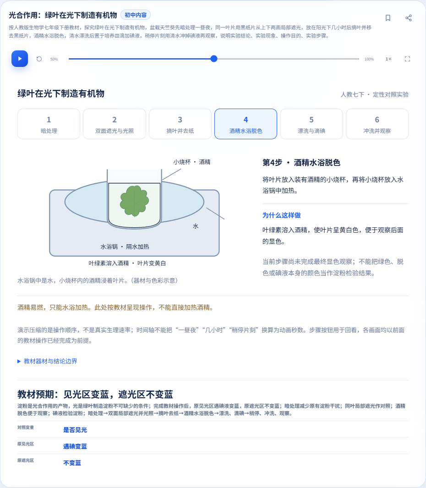
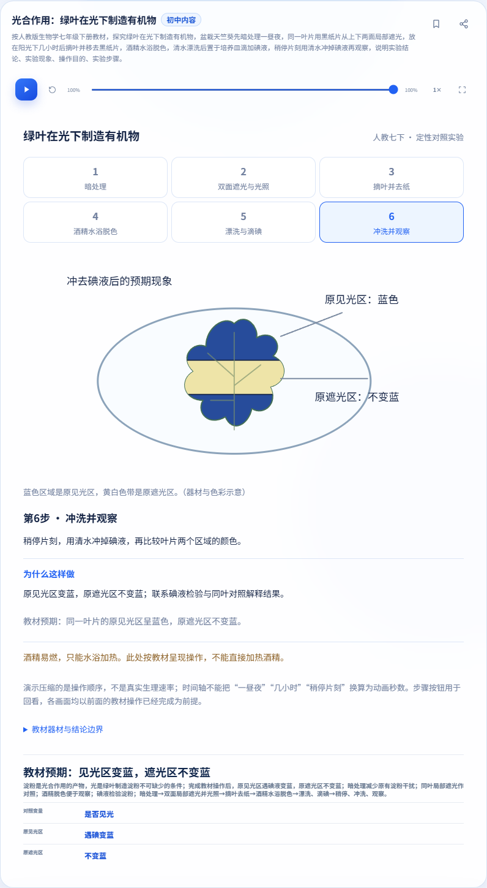
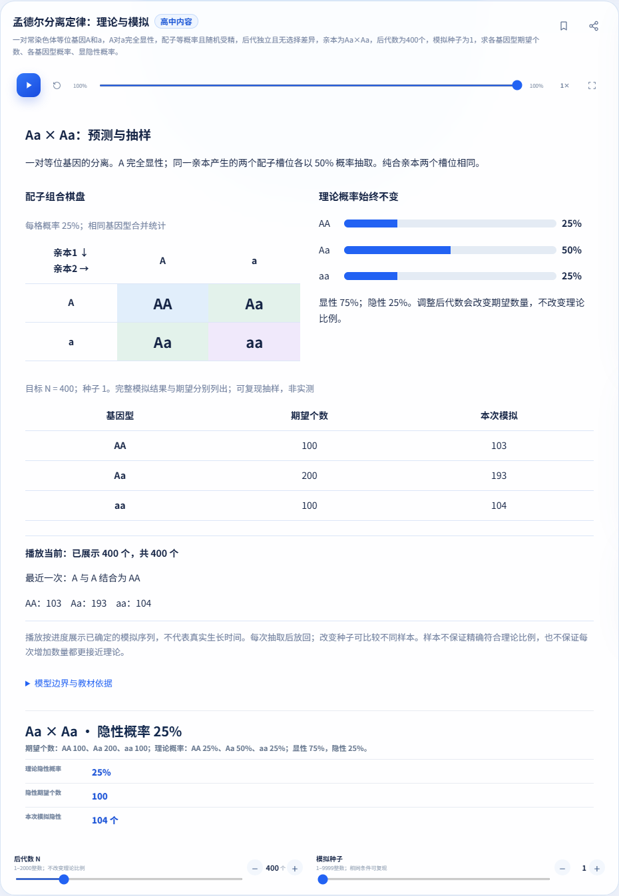
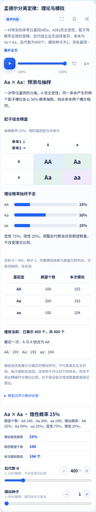

# 光合作用教材实验：交付证据

固定完整执行源码 `073b2a62512da325addb6b1f2c9aa7354cebb96c`，树 `022cc18aaf4a302d1a5bd744cc03f56f76263473`；基线 `1354fd9d2279d4f76cd72ad236c1557400a457f0`。完整执行期间不改产品/测试源码。后续测试夹具、文档和公告提交另列，实验产品逻辑与样式未改。

[教材正文映射](../photosynthesis-textbook.md) · [命令/退出码/计数/失败对照及交互摘要](execution-summary.json) · [图片SHA256](manifest.json)

候选33组：31通过、2失败、0进程超时、0未执行组。基线31组：29通过、2失败、0进程超时。组内定位超时/提前中止需与组统计分开读取，不把失败包装成全绿。

分享/公告补测SHA `2de6b4e034339ab15b357de6fc4be6cd0399951f`：两组退出码均0；分享14项检查、233题往返、38组调参、实际BFCache通过。干净基线补测只应用相同等待页夹具（并非未改测试源码），227题、38组、BFCache通过。两份夹具SHA256一致；见supplementalShare。此后交付仅增加证据和公告元数据，公告在最终交付head另验。

| 组 | 命令（server目录） | 退出码 | 实际计数 |
| --- | --- | --- | --- |
| photosynthesis-browser | `node scripts/verify-photosynthesis-browser.js` | 0 | {"checks": 180, "layouts": 17} |
| photosynthesis-model | `node --test test/biology-photosynthesis.test.js` | 0 | {"tests": 31, "pass": 31, "fail": 0, "cancelled": 0, "skipped": 0, "todo": 0} |
| node | `node --test` | 0 | {"tests": 824, "pass": 824, "fail": 0, "cancelled": 0, "skipped": 0, "todo": 0} |
| question-bank | `node scripts/verify-question-bank-browser.js` | 0 | {"totalQuestions": 481, "local": 233, "mockRoute": 248} |
| week1 | `node scripts/verify-week1-browser.js` | 0 | {"layouts": 50, "failures": 0} |
| week2 | `node scripts/verify-week2-browser.js` | 0 | {"checks": 144, "failures": 0} |
| tutor | `node scripts/verify-tutor-browser.js` | 0 | {"cases": 9} |
| animation | `node scripts/verify-animation-browser.js` | 0 | {"variants": 6} |
| announcements | `node scripts/verify-announcements-browser.js` | 0 | {"reportedPassLines": 8} |
| formula | `node scripts/verify-formula-browser.js` | 0 | {"layouts": 69, "failures": 0, "ai": 5, "mockAi": 5} |
| ai-quality | `node scripts/verify-ai-quality-browser.js` | 0 | {"cases": 17, "passedCases": 17} |
| share | `node scripts/verify-share-browser.js` | 1 | {"checks": 0, "roundTrips": 0} |
| instant | `node scripts/verify-instant-browser.js` | 0 | {"reportedPassLines": 13} |
| instant-routing | `node scripts/verify-instant-routing-browser.js` | 0 | {"reportedPassLines": 8} |
| tutor-diagram | `node scripts/verify-tutor-diagram-browser.js` | 0 | {"cases": 19, "passedCases": 19, "failedCases": 0} |
| tutor-presentation | `node scripts/verify-tutor-presentation-browser.js` | 0 | {"cases": 27, "passedCases": 27, "failedCases": 0} |
| incline-guard | `node scripts/verify-incline-diagram-browser.js --guard-only` | 1 | {"cases": 6, "passedCases": 1, "failedCases": 5} |
| incline-core | `node scripts/verify-incline-diagram-browser.js` | 0 | {"cases": 7, "passedCases": 7, "failedCases": 0} |
| incline-render | `node scripts/verify-incline-diagram-browser.js --render` | 0 | {"cases": 11, "passedCases": 11, "failedCases": 0} |
| incline-competition | `node scripts/verify-incline-diagram-browser.js --competition` | 0 | {"cases": 19, "passedCases": 19, "failedCases": 0} |
| incline-data | `node scripts/verify-incline-diagram-browser.js --data` | 0 | {"cases": 32, "passedCases": 32, "failedCases": 0} |
| chemistry-model | `node --test test/chemistry-experiments.test.js` | 0 | {"tests": 20, "pass": 20, "fail": 0, "cancelled": 0, "skipped": 0, "todo": 0} |
| chemistry-browser | `node scripts/verify-chemistry-browser.js` | 0 | {"checks": 200, "layouts": 6} |
| math-model | `node --test test/math-experiments.test.js` | 0 | {"tests": 25, "pass": 25, "fail": 0, "cancelled": 0, "skipped": 0, "todo": 0} |
| math-browser | `node scripts/verify-math-experiments-browser.js` | 0 | {"checks": 203, "layouts": 9} |
| experiment-layout | `node scripts/verify-experiment-layout-browser.js` | 0 | {"cases": 46, "passedCases": 46, "failedCases": 0} |
| unit-circle-model | `node --test test/unit-circle.test.js` | 0 | {"tests": 73, "pass": 73, "fail": 0, "cancelled": 0, "skipped": 0, "todo": 0} |
| unit-circle-browser | `node scripts/verify-unit-circle-browser.js` | 0 | {"checks": 219, "layouts": 15} |
| equilibria-model | `node --test test/chemistry-equilibria.test.js test/chemistry-equilibria-templates.test.js` | 0 | {"tests": 63, "pass": 63, "fail": 0, "cancelled": 0, "skipped": 0, "todo": 0} |
| equilibria-browser | `node scripts/verify-chemistry-equilibria-browser.js` | 0 | {"checks": 134, "layouts": 14} |
| mendel-model | `node --test test/biology-mendel.test.js` | 0 | {"tests": 17, "pass": 17, "fail": 0, "cancelled": 0, "skipped": 0, "todo": 0} |
| mendel-browser | `node scripts/verify-mendel-browser.js` | 0 | {"checks": 105, "layouts": 7} |
| acceptance-fixes | `node scripts/verify-acceptance-fixes-browser.js` | 0 | {"checks": 62, "failures": 0} |

## 原始失败与补测

完整执行保留两个与干净基线同签名的失败组：旧 share 在等待页点击隐藏按钮而提前超时；旧 incline --guard-only 的6例中5例仍期待已停用的坐标请求，实际0、断言1。未删除或弱化这些失败，也不把组内未到达的断言算通过。当前斜面 core/render/competition/data 另行完整执行。

share 仅更新等待页契约：断言按钮隐藏，并直接调用公开复制边界核对拒绝及0次复制；其后全部旧断言保留。干净基线与候选补测结果、源码/产品SHA、往返数量、38组调参和真实BFCache见 execution-summary.json 的 supplementalShare。原始失败仍在上表中，不改称33组全绿。

## 书上内容与网页示意

采用人教2024审核体系七下正文29–30页，具体纸质印次未标。器材、六步顺序、两次清水处理与预期现象按正文对齐。图稿是原创交互示意，不能声称是教材照片的复制，也不把动画秒数、颜色或尺寸当实测数据。未引入光强/温度/产量参数或其他光合作用实验。

共享播放/暂停/进度/重置/全屏是唯一播放器；六步按钮供回看。原见光区与原遮光区来自同一叶片，最后冲洗前不宣称已观察到最终变蓝。模型、页面、分享与导师的条件口径一致。

## 三宽实页与同基线风格对照

三张新实验图取水浴操作和最终观察；像素尺寸是完整实验卡裁图，视口宽度另列。两张已有孟德尔实验作同基线主题/控件/卡片参照。原始全量日志与截图、教材PDF/原页不提交。

### waterbath-1366.png（视口1366）

### observation-820.png（视口820）

### observation-390.png（视口390）

### reference-mendel-1366.png（视口1366）

### reference-mendel-390.png（视口390）

