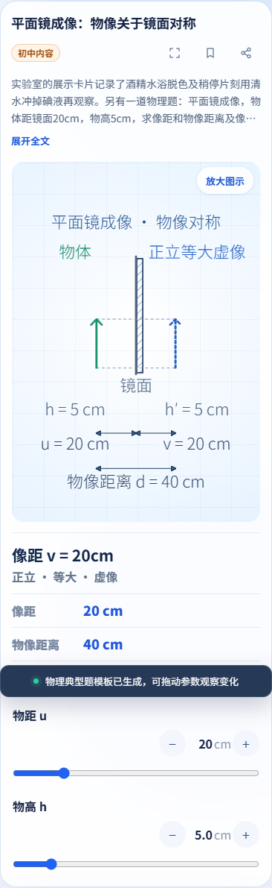
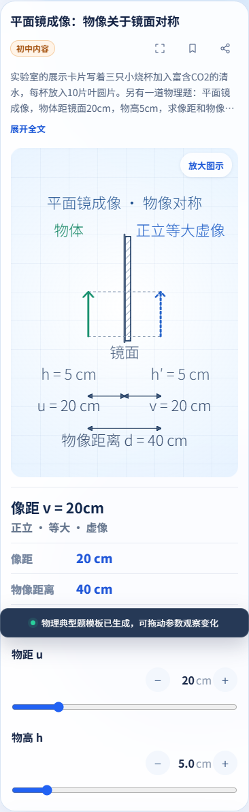
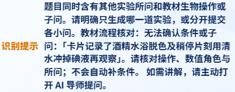
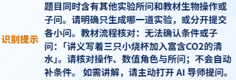

# 教材背景、实际所问与混合题路由

本次审查原文记录了教材操作作为背景时，两个 Draft PR 对完整物理题的误拦。独立分支各复现对应案例，联用同时复现两例。审查主线及最新主线均在正常按钮上生成平面镜，读数为 20、40、5 cm。 [审查原文](https://github.com/yanyucheng-master/ai-science-studio/issues/9#issuecomment-6686798102) · [修复前五个执行版本](before-fix.json)

固定教材流程先对原文做完整严格解析。失败归属区分报告性背景、显式题目范围和实际子问。记录里的操作可以作为子问的指代依据，单靠操作数量不足以拦截题目。其他模板仍读取完整原文进行条件核对。遇到真正的混合所问或无法确定范围的并列条件时，页面提示分开提交或限定目标，并保留原实验。固定流程缺项、冲突及范围外子问有具体本地提示。 [识别规则与有限句式边界](../photosynthesis-question-scope.md)

## 执行版本与逐组回归

| 版本 | 执行 SHA | 执行树 | 通过 | 失败 | 进程超时 |
| --- | --- | --- | ---: | ---: | ---: |
| junior | `4d0419f87f6866c555332c3895c95c5e252385fa` | `8e521d9c16e3416d37c25a1aa8c894276322ba5e` | 40 | 2 | 0 |
| senior | `d6ede383b36338d013b302083800d67d09e9e2f2` | `fb62059411610d8ee4adfb9ca44922baeaea44ec` | 39 | 3 | 0 |
| joint | `4a1dd68bbd59e96a0f964abccedf979bcbc181e0` | `18caa8d819c35125b2fd19675e846989b8040050` | 43 | 2 | 0 |

完整回归在冻结 Git 归档上使用 Edge 执行。Chromium 运行受影响专项，两者同属 Chromium 系。逐组记录包含真实命令、退出码、测试计数、UTC 时间、日志哈希及执行树。原始日志和未选图保存在本地。最终证据提交只增加本目录与公告记录，公告另外验证。 [执行摘要](execution-summary.json)

审查共同基线为 `e6f43c5b398fb039c80e2f02382119d3566ae1f5`。远端主线已到 `9393867e204124eb477a0e6016dff94fbadf0f7e`。最新主线仅运行本轮两个反例和控制的定向对照。只读合入预检在三个候选均发现动画测试脚本、公告和首页的冲突，合入及最新主线组合回归待后续整合。归档的基线 36 组和单独 share 测试夹具补测均来自 11 月 6 日相同旧基线 SHA，在执行摘要单列。

第一轮候选的旧混合题断言发现诊断标识缺失。页面当时已本地澄清且请求为 0。补回标识后，保留原断言，并重新冻结和执行完整回归。首轮被替代版本的退出码与失败独立保留。

## 正常按钮、请求及播放状态

| 版本及浏览器 | 新矩阵场景 | 本地生成 | 本地澄清 | 固定流程拒绝 | 普通概念 | 旧路由 | 分隔符 API / 按钮 |
| --- | ---: | ---: | ---: | ---: | ---: | ---: | ---: |
| [junior / edge](junior-focus.json) | 76 | 32 | 24 | 12 | 8 | 55 | 40 / 160 |
| [junior / chromium](junior-focus.json) | 76 | 32 | 24 | 12 | 8 | 55 | 40 / 160 |
| [senior / edge](senior-focus.json) | 64 | 28 | 20 | 8 | 8 | 55 | 40 / 160 |
| [senior / chromium](senior-focus.json) | 64 | 28 | 20 | 8 | 8 | 55 | 40 / 160 |
| [joint / edge](joint-focus.json) | 256 | 112 | 88 | 40 | 16 | 117 | 80 / 320 |
| [joint / chromium](joint-focus.json) | 256 | 112 | 88 | 40 | 16 | 117 | 80 / 320 |

两个独立分支各执行加载到本页的对应教材案例，联用覆盖两套注册顺序。新矩阵包含背景前置与后置、逗号和分号等标点、明确限定范围、并列子问、引文指代和无范围标记的混合条件。除普通概念回退外，请求数均为 0。普通概念有导师时确实收到模拟 503，缺少导师时请求数为 0。单独的模拟 200 路径记录了生成请求、导师请求和页面模拟回答。拒绝后检查旧实验、位置、继续播放以及导师上下文，具体提示和每例请求数见逐例文件。

18 例意图输入在实现前封存，实施过程中补了 4 例。完整、缺项、冲突、错误操作、额外子问和条件顺序的原矩阵另外执行。固定流程报告分开提供模板 API 与正常按钮样本。 [封存输入](inputs.json) · [初中固定流程](junior-fixed-protocol.json) · [高中固定流程](senior-fixed-protocol.json) · [联用固定流程](joint-fixed-protocol.json)

| 版本及浏览器 | 导师 | 学段 | 注册顺序 | 正常按钮记录 |
| --- | --- | --- | --- | ---: |
| junior / edge | 有 | junior | single | [19 例](junior-edge-01.json) |
| junior / edge | 有 | senior | single | [19 例](junior-edge-02.json) |
| junior / edge | 无 | junior | single | [19 例](junior-edge-03.json) |
| junior / edge | 无 | senior | single | [19 例](junior-edge-04.json) |
| junior / chromium | 有 | junior | single | [19 例](junior-chromium-01.json) |
| junior / chromium | 有 | senior | single | [19 例](junior-chromium-02.json) |
| junior / chromium | 无 | junior | single | [19 例](junior-chromium-03.json) |
| junior / chromium | 无 | senior | single | [19 例](junior-chromium-04.json) |
| senior / edge | 有 | junior | single | [16 例](senior-edge-01.json) |
| senior / edge | 有 | senior | single | [16 例](senior-edge-02.json) |
| senior / edge | 无 | junior | single | [16 例](senior-edge-03.json) |
| senior / edge | 无 | senior | single | [16 例](senior-edge-04.json) |
| senior / chromium | 有 | junior | single | [16 例](senior-chromium-01.json) |
| senior / chromium | 有 | senior | single | [16 例](senior-chromium-02.json) |
| senior / chromium | 无 | junior | single | [16 例](senior-chromium-03.json) |
| senior / chromium | 无 | senior | single | [16 例](senior-chromium-04.json) |
| joint / edge | 有 | junior | junior | [32 例](joint-edge-01.json) |
| joint / edge | 有 | senior | junior | [32 例](joint-edge-02.json) |
| joint / edge | 有 | junior | senior | [32 例](joint-edge-03.json) |
| joint / edge | 有 | senior | senior | [32 例](joint-edge-04.json) |
| joint / edge | 无 | junior | junior | [32 例](joint-edge-05.json) |
| joint / edge | 无 | senior | junior | [32 例](joint-edge-06.json) |
| joint / edge | 无 | junior | senior | [32 例](joint-edge-07.json) |
| joint / edge | 无 | senior | senior | [32 例](joint-edge-08.json) |
| joint / chromium | 有 | junior | junior | [32 例](joint-chromium-01.json) |
| joint / chromium | 有 | senior | junior | [32 例](joint-chromium-02.json) |
| joint / chromium | 有 | junior | senior | [32 例](joint-chromium-03.json) |
| joint / chromium | 有 | senior | senior | [32 例](joint-chromium-04.json) |
| joint / chromium | 无 | junior | junior | [32 例](joint-chromium-05.json) |
| joint / chromium | 无 | senior | junior | [32 例](joint-chromium-06.json) |
| joint / chromium | 无 | junior | senior | [32 例](joint-chromium-07.json) |
| joint / chromium | 无 | senior | senior | [32 例](joint-chromium-08.json) |

## 失败及未到达的断言

| 版本 | 回归失败 | 已完成种群后台模式 |
| --- | --- | --- |
| junior | incline-guard（退出 1）、population-background（退出 1） | discrete |
| senior | leaf-disks-browser（退出 1）、incline-guard（退出 1）、population-background（退出 1） | discrete |
| joint | incline-guard（退出 1）、population-background（退出 1） | discrete |
| baseline | share（退出 1）、incline-guard（退出 1）、population-background（退出 1） | discrete |

并行首跑记录了教材合法语义例的内部等待超时，以及 Chromium 高中正常按钮矩阵的末尾控制台断言失败。后者逐例断言已走完，控制台另有 ERR_NO_BUFFER_SPACE。首跑的组退出码和失败范围保留。同一执行 SHA 的串行复核结果如下，高中 Chromium 专项逐例链接采用复核记录，来源标在 JSON 中。

| 复核 | 退出码 | 结果 |
| --- | ---: | --- |
| senior-msedge-leaf-disks-browser | 0 | passed |
| junior-chromium-photosynthesis-browser | 0 | passed |
| senior-chromium-protocol-intent | 0 | passed |

旧斜面 guard 的请求数断言、种群后台可能中断的 S 型后续步骤、旧基线 share 的后续断言分别记录。相同签名仅作基线对照。受限环境的 Node 预检有 25 个用例因本机连接 EACCES 失败，正式冻结版本在允许本机连接的环境另跑。 [失败记录与未到达范围](failure-details.json)

Firefox、Safari、实体设备、真实相机识别、真实 AI 和部署未执行。CI 与扫描以送审时实际可见记录为准。预测、学生记录、比较、解释控件仍待实现，记录刷新、重置与收藏分享边界待协调。高中样例没有实测浮片数、排名、产氧量或速率。本次范围为 J02/H11 的部分样例。

## 精选页面证据

[截图尺寸、执行 SHA 和 SHA-256](manifest.json)

