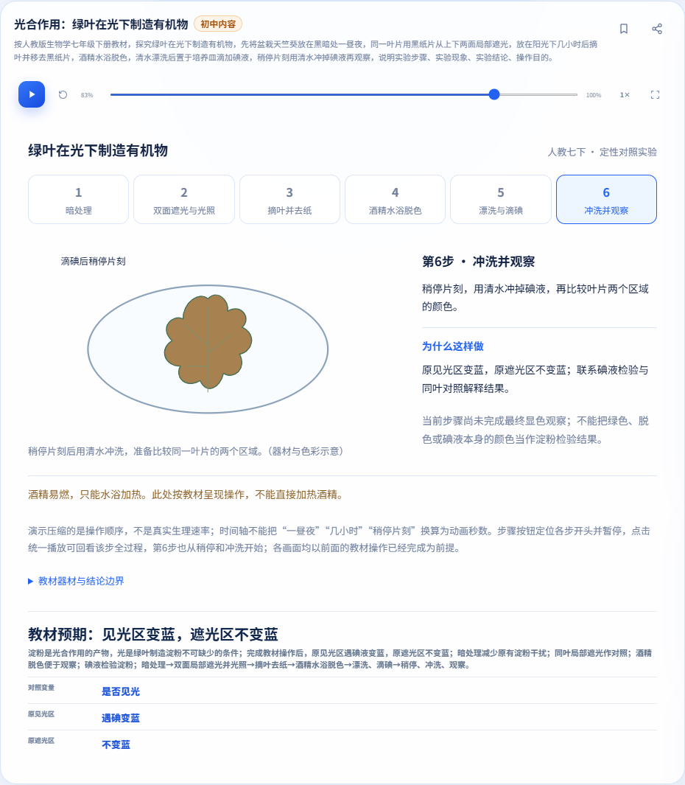
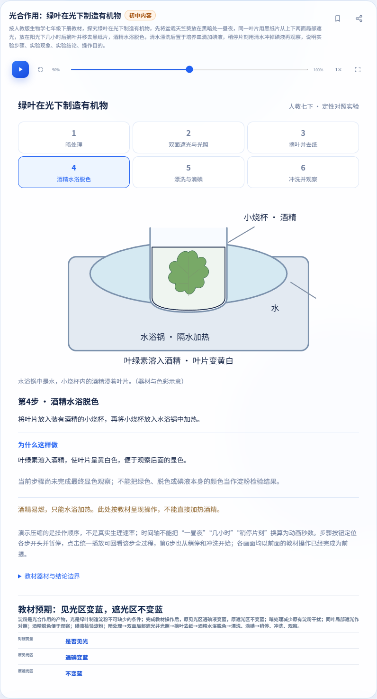
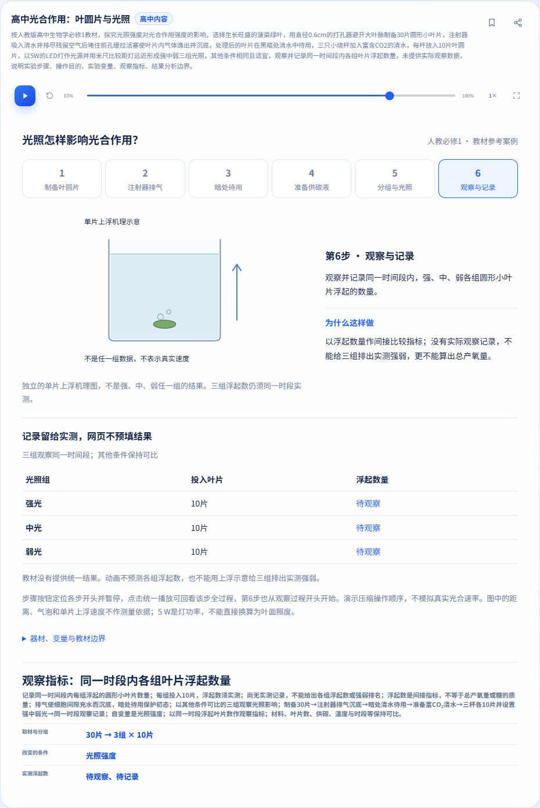
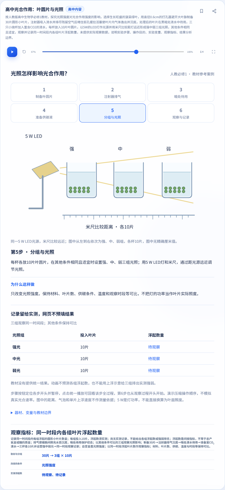

> 本页为此前日期的执行记录；最新路由修复及当前证据见[2026-11-06报告](../photosynthesis-routing-20261106/README.md)。

# 光合作用第二次退回修复证据（2026-11-05）

回应[本轮审查](https://github.com/yanyucheng-master/ai-science-studio/issues/9#issuecomment-6624372680)。本轮修复既有J02同叶遮光、H11叶圆片固定样例；预测/记录/比较控件仍未实现，见[互动方案和待协调边界](../photosynthesis-interaction-proposal.md)。不申报20族、P0矩阵或四批专题完成。

## 修复与边界

1. 共享识别成功、待确认和失败提示改用文本节点，拒绝提示禁止公式增强解析输入。分享拒绝提示同样原样显示。两解析器的原文片段保留标点和Unicode定位。`< > &`、引号、全角及中文不生成输入指定的DOM或事件。基线隔离观测确有HTML元素生成；未据此声称任意脚本执行或公网攻击链。
2. 本次固定教材流程无法完整识别时，正常生成按钮先显示本地具体原因，不自动发AI请求，保留原实验和播放位置。主动打开导师并发送才走既有请求；本地模拟503时也保留原诊断。新题导师上下文无旧题结果或步骤。其他实验既有成功/回退由完整回归核对，未改后端协议或模型。
3. 两实验失败按材料和操作的有限关联度选择对应诊断；关联相同或不明确时给范围提示，不以注册顺序替代判断。联用正反加载顺序、相反全局学段及完整无书名题均经正常按钮核对。
4. 条件采用动作、对象、语序和受限单位组合，完整消费条件与所有子问；允许省略书名及“未提供数据”元声明，科学条件仍必需，模型仍无实测计数。不支持任意自然语言。数值内部的逗号/空格等不能删掉后拼成另一个数，非法题仍拒绝。
5. 两实验步骤导航统一调用暂停，保持时钟、图标、可访问名称、aria-pressed和再次播放一致，不增加动画循环。已有真实前后台专项也加入播放中定位步骤后的暂停检查。
6. 六步按钮都定位该步开头并暂停；第六步从5/6开始，可继续播放全过程。初中冲洗完成前无最终蓝色；高中上浮仅机理示意，三组始终无编造记录。末步前/中/后、重置和实际按钮均有断言。

## 版本和完整执行

两PR分别面向master，保持Draft，各自可独立审查；联用分支仅归并两套功能供联合核验。未合并PR/主线、未部署。下列是**完整执行源码**；最终若只追加证据/文档/公告元数据，则另做公告验证并在Issue报告最终head和差异，不把旧SHA改称最终head已跑全量。

| 集合 | 完整执行SHA | Git树 | 通过组 | 失败组 | 进程超时 | 未启动组 |
| --- | --- | --- | ---: | ---: | ---: | ---: |
| junior | `d93c05b42c74aa578070154fec34aa74da0f72be` | `fc3ab3627e80c12070d7e845b7280295393111b2` | 37 | 2 | 0 | 0 |
| senior | `64abb1cb521a91de41a27d76223b467f5296e2c2` | `ea9b068eb4fd17dc2fc0350d5b2e75222299e5c2` | 38 | 1 | 0 | 0 |
| joint | `ad09a3807454825d6c309279d22b64ddcd562028` | `9d04e26744d18b957462d269f58942f507302006` | 40 | 2 | 0 | 0 |
| baseline | `e6f43c5b398fb039c80e2f02382119d3566ae1f5` | `a1eed39c85ecc1aad9d2533009a8255ee4beca45` | 33 | 3 | 0 | 0 |

每组的命令、退出码、时间、计数和日志哈希见[执行摘要](execution-summary.json)。失败脚本停止后未到达的断言不计通过。“进程超时0”不等于内部等待没有超时：基线share正是在隐藏按钮处内部30秒超时并退出1。

全量主浏览器为Edge，隔离Chromium只补新/受影响专项（初中3组、高中3组、联用2组），不冒称Chromium跑了全部旧入口。环境为Windows 10.0.26200 x64、Node24.22.1、Playwright1.62.1；两个浏览器同引擎，实际版本在JSON。所有时间戳UTC，仅本地服务器、独立临时配置和模拟响应。

Firefox、Safari、真机、真实相机/OCR准确率、真实AI/live、部署未执行。本地通过不等于GitHub CI、扫描或签名通过；实际最终head记录在Issue另报。

### Node和题库

| 集合 | Node通过/总数 | 题库总数 |
| --- | --- | ---: |
| junior | 995/995 | 574 |
| senior | 1031/1031 | 586 |
| joint | 1118/1118 | 600 |
| baseline | 906/906 | 560 |

主线560条题目内容及顺序保留，原有公告不改；拍题、移动样式、显微镜、种群12个文件逐字节相同，核对结果在执行摘要sourcePreservation。固定教材器材、流程、科学模型未改变。教材对应正文与镜像来源仍见[初中映射](https://github.com/yanyucheng-master/ai-science-studio/blob/ad09a3807454825d6c309279d22b64ddcd562028/docs/photosynthesis-textbook.md)、[高中映射](https://github.com/yanyucheng-master/ai-science-studio/blob/ad09a3807454825d6c309279d22b64ddcd562028/docs/leaf-disks-textbook.md)（独立PR只包含自身文档，联合分支可查看两份）。

### 失败、基线和未到达内容

- 四集合旧斜面guard均保留失败：预期一次请求、实际0的五项断言失败；不得记全绿，同签名也不等于根因已证明。
- 干净基线原share等待页按钮隐藏导致点击超时，后续断言未到达；另复制基线只修等待页测试夹具，验证隐藏和公开复制拒绝后继续旧断言，单独1组通过。候选用修订夹具，原失败未改写为通过。
- 种群后台按本轮实际逐集合记录：若S型暂停后pending RAF=1、预期0停止，则S型后续断言未到达；离散模式已完成。各集合可能不同，不能根据另一集合通过推断当前集合通过，也未擅自重写种群。

| 集合 | 种群后台状态 | 已完成模式 | 未到达 |
| --- | --- | --- | --- |
| joint | 失败：S型暂停pending 1≠0 | discrete | S型停止点后的断言 |
| junior | 失败：S型暂停pending 1≠0 | discrete | S型停止点后的断言 |
| senior | 通过 | discrete, logistic | 无（脚本完成） |
| baseline | 失败：S型暂停pending 1≠0 | discrete | S型停止点后的断言 |

## 真实入口证据

[独立输入/预期](inputs.json)：规则修改前写入并封存36例（SHA256封存记录附内）；另11例数值分隔回归单列，未冒称封存集或外部盲测。书名/无数据元声明三项旧预期按本轮产品要求更正，缺科学条件/矛盾/操作/附加子问未削弱。

[初中](review-junior.json)、[高中](review-senior.json)、[联用](review-joint.json)逐例给正常按钮的预期/实际、诊断、实验/位置保留、导师上下文、请求、DOM和播放结果。补充禁fallback API调用另有明确标记，不代替默认入口。明确主动导师503是本地模拟，预期控制台503单列，其他控制台错误仍须为0。

[补充证据](supplementary-evidence.json)列真实注册顺序、两类篡改分享拒绝、未改基线共享提示观察、数值错误的修复前证据及被替代的中途执行。V1发现数值拼接错误后中止，重新冻结V2并完整重跑；旧局部结果不混作最终证据。

[布局/状态证据](layout-state-evidence.json)包含360/390/820/1366和844×390、触控模拟、全屏滚动、几何/DOM、收藏/分享、刷新、真实BFCache、学科/导师往返与独立浏览器恢复检查；联用另测跨模板往返和既有入口。截图只是这些断言的配套，不能替代交互验收。旧日期的对照截图和报告保持历史原样，不冒称本轮执行。

## 逐项命令

以下均从隔离源码server目录运行；安装环境提供PLAYWRIGHT_MODULE、隔离PLAYWRIGHT_BROWSERS_PATH、BROWSER_CHANNEL。各组输出目录在本地独立保存，不提交原始日志/教材页/个人配置；表和JSON保留执行哈希。

### junior

| 命令 | 退出码 | 状态 | 计数 |
| --- | ---: | --- | --- |
| `node scripts/verify-photosynthesis-review-browser.js` | 0 | 通过 | checks=165, layouts=0, normalButtonCases=25, playback=2 |
| `node scripts/verify-photosynthesis-browser.js` | 0 | 通过 | checks=265, layouts=25, semanticCases=38 |
| `node --test test/biology-photosynthesis.test.js` | 0 | 通过 | tests=69, pass=69, fail=0, cancelled=0, skipped=0, todo=0 |
| `node --test` | 0 | 通过 | tests=995, pass=995, fail=0, cancelled=0, skipped=0, todo=0 |
| `node scripts/verify-question-bank-browser.js` | 0 | 通过 | totalQuestions=574, local=268, mockRoute=306 |
| `node scripts/verify-week1-browser.js` | 0 | 通过 | layouts=50, failures=0 |
| `node scripts/verify-week2-browser.js` | 0 | 通过 | checks=144, failures=0 |
| `node scripts/verify-tutor-browser.js` | 0 | 通过 | reportCases=9 |
| `node scripts/verify-animation-browser.js` | 0 | 通过 | variants=6 |
| `node scripts/verify-announcements-browser.js` | 0 | 通过 | cases=8, passedCases=8, failedCases=0 |
| `node scripts/verify-formula-browser.js` | 0 | 通过 | layouts=69, failures=0, ai=5 |
| `node scripts/verify-ai-quality-browser.js` | 0 | 通过 | reportCases=17 |
| `node scripts/verify-share-browser.js` | 0 | 通过 | checks=14, roundTrips=268, adjustedTemplates=43 |
| `node scripts/verify-instant-browser.js` | 0 | 通过 |  |
| `node scripts/verify-instant-routing-browser.js` | 0 | 通过 |  |
| `node scripts/verify-tutor-diagram-browser.js` | 0 | 通过 | cases=19, passedCases=19, failedCases=0 |
| `node scripts/verify-tutor-presentation-browser.js` | 0 | 通过 | cases=27, passedCases=27, failedCases=0 |
| `node scripts/verify-incline-diagram-browser.js --guard-only` | 1 | 失败 | cases=6, passedCases=1, failedCases=5 |
| `node scripts/verify-incline-diagram-browser.js` | 0 | 通过 | cases=7, passedCases=7, failedCases=0 |
| `node scripts/verify-incline-diagram-browser.js --render` | 0 | 通过 | cases=11, passedCases=11, failedCases=0 |
| `node scripts/verify-incline-diagram-browser.js --competition` | 0 | 通过 | cases=19, passedCases=19, failedCases=0 |
| `node scripts/verify-incline-diagram-browser.js --data` | 0 | 通过 | cases=32, passedCases=32, failedCases=0 |
| `node --test test/chemistry-experiments.test.js` | 0 | 通过 | tests=20, pass=20, fail=0, cancelled=0, skipped=0, todo=0 |
| `node scripts/verify-chemistry-browser.js` | 0 | 通过 | checks=200, layouts=6 |
| `node --test test/math-experiments.test.js` | 0 | 通过 | tests=25, pass=25, fail=0, cancelled=0, skipped=0, todo=0 |
| `node scripts/verify-math-experiments-browser.js` | 0 | 通过 | checks=203, layouts=9 |
| `node scripts/verify-experiment-layout-browser.js` | 0 | 通过 | layoutsCases=73, cases=46, passedCases=46, failedCases=0 |
| `node --test test/unit-circle.test.js` | 0 | 通过 | tests=73, pass=73, fail=0, cancelled=0, skipped=0, todo=0 |
| `node scripts/verify-unit-circle-browser.js` | 0 | 通过 | checks=219, layouts=15 |
| `node --test test/chemistry-equilibria.test.js test/chemistry-equilibria-templates.test.js` | 0 | 通过 | tests=63, pass=63, fail=0, cancelled=0, skipped=0, todo=0 |
| `node scripts/verify-chemistry-equilibria-browser.js` | 0 | 通过 | checks=134, layouts=14 |
| `node --test test/biology-mendel.test.js` | 0 | 通过 | tests=17, pass=17, fail=0, cancelled=0, skipped=0, todo=0 |
| `node scripts/verify-mendel-browser.js` | 0 | 通过 | checks=105, layouts=7 |
| `node scripts/verify-acceptance-fixes-browser.js` | 0 | 通过 | checks=62, failures=0 |
| `node --test test/biology-microscope.test.js test/biology-microscope-questions.test.js test/biology-microscope-templates.test.js` | 0 | 通过 | tests=36, pass=36, fail=0, cancelled=0, skipped=0, todo=0 |
| `node scripts/verify-microscope-browser.js` | 0 | 通过 | checks=249, layouts=21 |
| `node --test test/biology-population.test.js test/biology-population-logistic.test.js` | 0 | 通过 | tests=65, pass=65, fail=0, cancelled=0, skipped=0, todo=0 |
| `node scripts/verify-population-browser.js` | 0 | 通过 | checks=215, layouts=16 |
| `node scripts/verify-population-background-browser.js` | 1 | 失败 | checks=1 |

### senior

| 命令 | 退出码 | 状态 | 计数 |
| --- | ---: | --- | --- |
| `node scripts/verify-photosynthesis-review-browser.js` | 0 | 通过 | checks=201, layouts=0, normalButtonCases=37, playback=2 |
| `node scripts/verify-leaf-disks-browser.js` | 0 | 通过 | checks=301, layouts=25, semanticCases=49 |
| `node --test test/biology-leaf-disks.test.js` | 0 | 通过 | tests=94, pass=94, fail=0, cancelled=0, skipped=0, todo=0 |
| `node --test` | 0 | 通过 | tests=1031, pass=1031, fail=0, cancelled=0, skipped=0, todo=0 |
| `node scripts/verify-question-bank-browser.js` | 0 | 通过 | totalQuestions=586, local=270, mockRoute=316 |
| `node scripts/verify-week1-browser.js` | 0 | 通过 | layouts=50, failures=0 |
| `node scripts/verify-week2-browser.js` | 0 | 通过 | checks=144, failures=0 |
| `node scripts/verify-tutor-browser.js` | 0 | 通过 | reportCases=9 |
| `node scripts/verify-animation-browser.js` | 0 | 通过 | variants=6 |
| `node scripts/verify-announcements-browser.js` | 0 | 通过 | cases=8, passedCases=8, failedCases=0 |
| `node scripts/verify-formula-browser.js` | 0 | 通过 | layouts=69, failures=0, ai=5 |
| `node scripts/verify-ai-quality-browser.js` | 0 | 通过 | reportCases=17 |
| `node scripts/verify-share-browser.js` | 0 | 通过 | checks=14, roundTrips=270, adjustedTemplates=43 |
| `node scripts/verify-instant-browser.js` | 0 | 通过 |  |
| `node scripts/verify-instant-routing-browser.js` | 0 | 通过 |  |
| `node scripts/verify-tutor-diagram-browser.js` | 0 | 通过 | cases=19, passedCases=19, failedCases=0 |
| `node scripts/verify-tutor-presentation-browser.js` | 0 | 通过 | cases=27, passedCases=27, failedCases=0 |
| `node scripts/verify-incline-diagram-browser.js --guard-only` | 1 | 失败 | cases=6, passedCases=1, failedCases=5 |
| `node scripts/verify-incline-diagram-browser.js` | 0 | 通过 | cases=7, passedCases=7, failedCases=0 |
| `node scripts/verify-incline-diagram-browser.js --render` | 0 | 通过 | cases=11, passedCases=11, failedCases=0 |
| `node scripts/verify-incline-diagram-browser.js --competition` | 0 | 通过 | cases=19, passedCases=19, failedCases=0 |
| `node scripts/verify-incline-diagram-browser.js --data` | 0 | 通过 | cases=32, passedCases=32, failedCases=0 |
| `node --test test/chemistry-experiments.test.js` | 0 | 通过 | tests=20, pass=20, fail=0, cancelled=0, skipped=0, todo=0 |
| `node scripts/verify-chemistry-browser.js` | 0 | 通过 | checks=200, layouts=6 |
| `node --test test/math-experiments.test.js` | 0 | 通过 | tests=25, pass=25, fail=0, cancelled=0, skipped=0, todo=0 |
| `node scripts/verify-math-experiments-browser.js` | 0 | 通过 | checks=203, layouts=9 |
| `node scripts/verify-experiment-layout-browser.js` | 0 | 通过 | layoutsCases=73, cases=46, passedCases=46, failedCases=0 |
| `node --test test/unit-circle.test.js` | 0 | 通过 | tests=73, pass=73, fail=0, cancelled=0, skipped=0, todo=0 |
| `node scripts/verify-unit-circle-browser.js` | 0 | 通过 | checks=219, layouts=15 |
| `node --test test/chemistry-equilibria.test.js test/chemistry-equilibria-templates.test.js` | 0 | 通过 | tests=63, pass=63, fail=0, cancelled=0, skipped=0, todo=0 |
| `node scripts/verify-chemistry-equilibria-browser.js` | 0 | 通过 | checks=134, layouts=14 |
| `node --test test/biology-mendel.test.js` | 0 | 通过 | tests=17, pass=17, fail=0, cancelled=0, skipped=0, todo=0 |
| `node scripts/verify-mendel-browser.js` | 0 | 通过 | checks=105, layouts=7 |
| `node scripts/verify-acceptance-fixes-browser.js` | 0 | 通过 | checks=62, failures=0 |
| `node --test test/biology-microscope.test.js test/biology-microscope-questions.test.js test/biology-microscope-templates.test.js` | 0 | 通过 | tests=36, pass=36, fail=0, cancelled=0, skipped=0, todo=0 |
| `node scripts/verify-microscope-browser.js` | 0 | 通过 | checks=249, layouts=21 |
| `node --test test/biology-population.test.js test/biology-population-logistic.test.js` | 0 | 通过 | tests=65, pass=65, fail=0, cancelled=0, skipped=0, todo=0 |
| `node scripts/verify-population-browser.js` | 0 | 通过 | checks=215, layouts=16 |
| `node scripts/verify-population-background-browser.js` | 0 | 通过 | checks=2 |

### joint

| 命令 | 退出码 | 状态 | 计数 |
| --- | ---: | --- | --- |
| `node scripts/verify-photosynthesis-review-browser.js` | 0 | 通过 | checks=460, layouts=0, normalButtonCases=92, playback=4 |
| `node scripts/verify-photosynthesis-integration-browser.js` | 0 | 通过 | checks=39, layouts=0 |
| `node scripts/verify-photosynthesis-browser.js` | 0 | 通过 | checks=265, layouts=25, semanticCases=38 |
| `node --test test/biology-photosynthesis.test.js` | 0 | 通过 | tests=69, pass=69, fail=0, cancelled=0, skipped=0, todo=0 |
| `node scripts/verify-leaf-disks-browser.js` | 0 | 通过 | checks=301, layouts=25, semanticCases=49 |
| `node --test test/biology-leaf-disks.test.js` | 0 | 通过 | tests=94, pass=94, fail=0, cancelled=0, skipped=0, todo=0 |
| `node --test` | 0 | 通过 | tests=1118, pass=1118, fail=0, cancelled=0, skipped=0, todo=0 |
| `node scripts/verify-question-bank-browser.js` | 0 | 通过 | totalQuestions=600, local=276, mockRoute=324 |
| `node scripts/verify-week1-browser.js` | 0 | 通过 | layouts=50, failures=0 |
| `node scripts/verify-week2-browser.js` | 0 | 通过 | checks=144, failures=0 |
| `node scripts/verify-tutor-browser.js` | 0 | 通过 | reportCases=9 |
| `node scripts/verify-animation-browser.js` | 0 | 通过 | variants=6 |
| `node scripts/verify-announcements-browser.js` | 0 | 通过 | cases=8, passedCases=8, failedCases=0 |
| `node scripts/verify-formula-browser.js` | 0 | 通过 | layouts=69, failures=0, ai=5 |
| `node scripts/verify-ai-quality-browser.js` | 0 | 通过 | reportCases=17 |
| `node scripts/verify-share-browser.js` | 0 | 通过 | checks=14, roundTrips=276, adjustedTemplates=45 |
| `node scripts/verify-instant-browser.js` | 0 | 通过 |  |
| `node scripts/verify-instant-routing-browser.js` | 0 | 通过 |  |
| `node scripts/verify-tutor-diagram-browser.js` | 0 | 通过 | cases=19, passedCases=19, failedCases=0 |
| `node scripts/verify-tutor-presentation-browser.js` | 0 | 通过 | cases=27, passedCases=27, failedCases=0 |
| `node scripts/verify-incline-diagram-browser.js --guard-only` | 1 | 失败 | cases=6, passedCases=1, failedCases=5 |
| `node scripts/verify-incline-diagram-browser.js` | 0 | 通过 | cases=7, passedCases=7, failedCases=0 |
| `node scripts/verify-incline-diagram-browser.js --render` | 0 | 通过 | cases=11, passedCases=11, failedCases=0 |
| `node scripts/verify-incline-diagram-browser.js --competition` | 0 | 通过 | cases=19, passedCases=19, failedCases=0 |
| `node scripts/verify-incline-diagram-browser.js --data` | 0 | 通过 | cases=32, passedCases=32, failedCases=0 |
| `node --test test/chemistry-experiments.test.js` | 0 | 通过 | tests=20, pass=20, fail=0, cancelled=0, skipped=0, todo=0 |
| `node scripts/verify-chemistry-browser.js` | 0 | 通过 | checks=200, layouts=6 |
| `node --test test/math-experiments.test.js` | 0 | 通过 | tests=25, pass=25, fail=0, cancelled=0, skipped=0, todo=0 |
| `node scripts/verify-math-experiments-browser.js` | 0 | 通过 | checks=203, layouts=9 |
| `node scripts/verify-experiment-layout-browser.js` | 0 | 通过 | layoutsCases=73, cases=46, passedCases=46, failedCases=0 |
| `node --test test/unit-circle.test.js` | 0 | 通过 | tests=73, pass=73, fail=0, cancelled=0, skipped=0, todo=0 |
| `node scripts/verify-unit-circle-browser.js` | 0 | 通过 | checks=219, layouts=15 |
| `node --test test/chemistry-equilibria.test.js test/chemistry-equilibria-templates.test.js` | 0 | 通过 | tests=63, pass=63, fail=0, cancelled=0, skipped=0, todo=0 |
| `node scripts/verify-chemistry-equilibria-browser.js` | 0 | 通过 | checks=134, layouts=14 |
| `node --test test/biology-mendel.test.js` | 0 | 通过 | tests=17, pass=17, fail=0, cancelled=0, skipped=0, todo=0 |
| `node scripts/verify-mendel-browser.js` | 0 | 通过 | checks=105, layouts=7 |
| `node scripts/verify-acceptance-fixes-browser.js` | 0 | 通过 | checks=62, failures=0 |
| `node --test test/biology-microscope.test.js test/biology-microscope-questions.test.js test/biology-microscope-templates.test.js` | 0 | 通过 | tests=36, pass=36, fail=0, cancelled=0, skipped=0, todo=0 |
| `node scripts/verify-microscope-browser.js` | 0 | 通过 | checks=249, layouts=21 |
| `node --test test/biology-population.test.js test/biology-population-logistic.test.js` | 0 | 通过 | tests=65, pass=65, fail=0, cancelled=0, skipped=0, todo=0 |
| `node scripts/verify-population-browser.js` | 0 | 通过 | checks=215, layouts=16 |
| `node scripts/verify-population-background-browser.js` | 1 | 失败 | checks=1 |

### baseline

| 命令 | 退出码 | 状态 | 计数 |
| --- | ---: | --- | --- |
| `node --test` | 0 | 通过 | tests=906, pass=906, fail=0, cancelled=0, skipped=0, todo=0 |
| `node scripts/verify-question-bank-browser.js` | 0 | 通过 | totalQuestions=560, local=262, mockRoute=298 |
| `node scripts/verify-week1-browser.js` | 0 | 通过 | layouts=50, failures=0 |
| `node scripts/verify-week2-browser.js` | 0 | 通过 | checks=144, failures=0 |
| `node scripts/verify-tutor-browser.js` | 0 | 通过 | reportCases=9 |
| `node scripts/verify-animation-browser.js` | 0 | 通过 | variants=6 |
| `node scripts/verify-announcements-browser.js` | 0 | 通过 | cases=8, passedCases=8, failedCases=0 |
| `node scripts/verify-formula-browser.js` | 0 | 通过 | layouts=69, failures=0, ai=5 |
| `node scripts/verify-ai-quality-browser.js` | 0 | 通过 | reportCases=17 |
| `node scripts/verify-share-browser.js` | 1 | 失败 | checks=0, roundTrips=0 |
| `node scripts/verify-instant-browser.js` | 0 | 通过 |  |
| `node scripts/verify-instant-routing-browser.js` | 0 | 通过 |  |
| `node scripts/verify-tutor-diagram-browser.js` | 0 | 通过 | cases=19, passedCases=19, failedCases=0 |
| `node scripts/verify-tutor-presentation-browser.js` | 0 | 通过 | cases=27, passedCases=27, failedCases=0 |
| `node scripts/verify-incline-diagram-browser.js --guard-only` | 1 | 失败 | cases=6, passedCases=1, failedCases=5 |
| `node scripts/verify-incline-diagram-browser.js` | 0 | 通过 | cases=7, passedCases=7, failedCases=0 |
| `node scripts/verify-incline-diagram-browser.js --render` | 0 | 通过 | cases=11, passedCases=11, failedCases=0 |
| `node scripts/verify-incline-diagram-browser.js --competition` | 0 | 通过 | cases=19, passedCases=19, failedCases=0 |
| `node scripts/verify-incline-diagram-browser.js --data` | 0 | 通过 | cases=32, passedCases=32, failedCases=0 |
| `node --test test/chemistry-experiments.test.js` | 0 | 通过 | tests=20, pass=20, fail=0, cancelled=0, skipped=0, todo=0 |
| `node scripts/verify-chemistry-browser.js` | 0 | 通过 | checks=200, layouts=6 |
| `node --test test/math-experiments.test.js` | 0 | 通过 | tests=25, pass=25, fail=0, cancelled=0, skipped=0, todo=0 |
| `node scripts/verify-math-experiments-browser.js` | 0 | 通过 | checks=203, layouts=9 |
| `node scripts/verify-experiment-layout-browser.js` | 0 | 通过 | layoutsCases=73, cases=46, passedCases=46, failedCases=0 |
| `node --test test/unit-circle.test.js` | 0 | 通过 | tests=73, pass=73, fail=0, cancelled=0, skipped=0, todo=0 |
| `node scripts/verify-unit-circle-browser.js` | 0 | 通过 | checks=219, layouts=15 |
| `node --test test/chemistry-equilibria.test.js test/chemistry-equilibria-templates.test.js` | 0 | 通过 | tests=63, pass=63, fail=0, cancelled=0, skipped=0, todo=0 |
| `node scripts/verify-chemistry-equilibria-browser.js` | 0 | 通过 | checks=134, layouts=14 |
| `node --test test/biology-mendel.test.js` | 0 | 通过 | tests=17, pass=17, fail=0, cancelled=0, skipped=0, todo=0 |
| `node scripts/verify-mendel-browser.js` | 0 | 通过 | checks=105, layouts=7 |
| `node scripts/verify-acceptance-fixes-browser.js` | 0 | 通过 | checks=62, failures=0 |
| `node --test test/biology-microscope.test.js test/biology-microscope-questions.test.js test/biology-microscope-templates.test.js` | 0 | 通过 | tests=36, pass=36, fail=0, cancelled=0, skipped=0, todo=0 |
| `node scripts/verify-microscope-browser.js` | 0 | 通过 | checks=249, layouts=21 |
| `node --test test/biology-population.test.js test/biology-population-logistic.test.js` | 0 | 通过 | tests=65, pass=65, fail=0, cancelled=0, skipped=0, todo=0 |
| `node scripts/verify-population-browser.js` | 0 | 通过 | checks=215, layouts=16 |
| `node scripts/verify-population-background-browser.js` | 1 | 失败 | checks=1 |

## 精选当前页面

[图片SHA/尺寸/执行源码](manifest.json)，10张为本轮最终功能源码重新捕获；终态、过程和错误各自标明。未提交原教材PDF/页图或其余原始截图。

### junior · 第6步开头 · 1366

### junior · 教材操作场景 · 820

### junior · 第6步中段 · 390

### junior · 第6步终态 · 360

### junior · 拒绝提示中的原始文字 · 390

### senior · 第6步开头 · 1366

### senior · 教材操作场景 · 820

### senior · 第6步中段 · 390

### senior · 第6步终态 · 360

### senior · 拒绝提示中的原始文字 · 390

