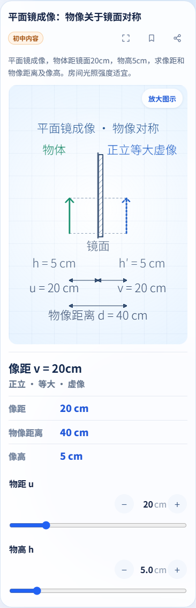
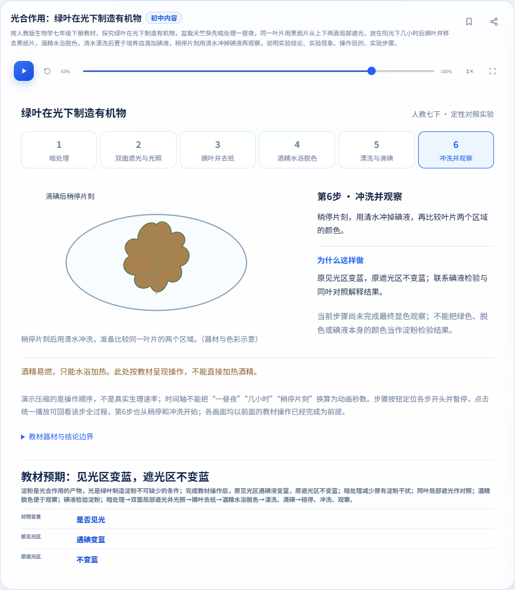
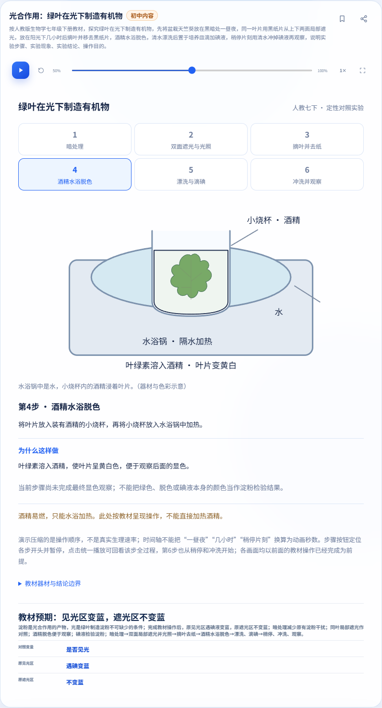
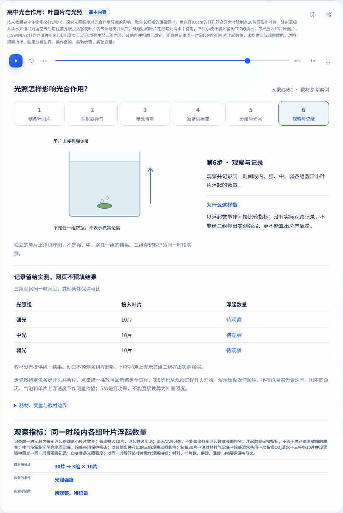
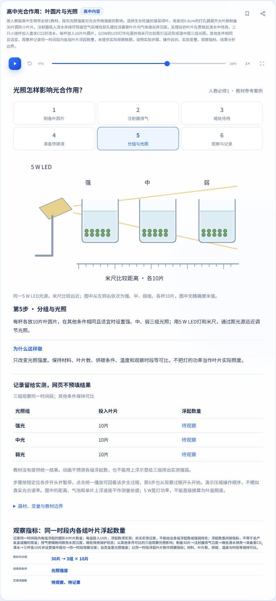

# 光合作用路由退回修复证据（2026-11-06）

回应[本轮实际审查](https://github.com/yanyucheng-master/ai-science-studio/issues/9#issuecomment-6663761843)。本轮只修复既有J02/H11固定样例与其他题目路由的隔离，并完成开发侧自测。预测、学生记录、比较和解释控件仍未实现，继续保留[待审互动方案](../photosynthesis-interaction-proposal.md)。没有把两个样例、P0矩阵或20族专题申报完成，也未合并/部署。

## 修复机制

旧实现用“光合作用”“光照强度”等宽泛关键词，在尝试原模板前强制判为生物，并将失败标成localOnly。独立PR和联用均各自用普通生成按钮复现了影响，不以联用证据代替单支。

现在`protocolCandidate`需要明确实验语境：材料—动作对，或实验目标与教材/操作的组合。候选仍完整调用原严格解析器；成功才跨学科生成，缺失/矛盾/错误步骤/越界/附加子问仍本地诊断、0自动请求。真正混合的实验要求不能被另一模板只接受一部分。非候选沿用原学科、本地成功和导师回退；不再收集固定模板的宽泛关键词失败。

菜单/检索`keywords`、候选、完整解析、失败归属`diagnosticPriority`各有职责。仅讨论相近研究目标的意义、普通学科概念、背景词和嵌入引号标签不作为固定流程指令。整道引号题或明确请求中的整道引号题仍进入本地核验；这个路由视图不传给科学解析器，不靠删引号使非法题被接受。[详细有限规则和边界](../photosynthesis-routing.md)。

教材流程、科学模型/常量、场景CSS、纯文本提示和六步播放器均保留；没有后端/模型或share-v1协议变更。主线拍题、移动样式、显微镜、种群12文件、560题内容/顺序及历史公告保持不变，执行摘要包含逐文件哈希和教材模型/场景保留核对。

## 修复前实际A/B

[原题、选择、真实识别/请求和旧实验状态](before-and-boundaries.json)。下表来自四个实际送审head/主线的正常按钮，模拟503只在本机，不证明真实AI可用。

| 案例 | 主线 | 初中旧head | 高中旧head | 联用旧head |
| --- | --- | --- | --- | --- |
| mirror-control | 正确生成 | 正确生成 | 正确生成 | 正确生成 |
| mirror-light | 正确生成 | 正确生成 | 被固定流程误拦 | 被固定流程误拦 |
| mirror-zone | 正确生成 | 被固定流程误拦 | 正确生成 | 被固定流程误拦 |
| general-photosynthesis | 正常模拟回退 | 被固定流程误拦 | 正常模拟回退 | 被固定流程误拦 |
| general-light | 正常模拟回退 | 正常模拟回退 | 被固定流程误拦 | 被固定流程误拦 |

旧head和基线完整SHA在JSON内逐份列出。初始五例中的普通光合作用题选择生物；为覆盖审查的物理入口，又单独对普通光合作用/灯光两例做四旧/三新版本正常按钮A/B，实际选择均为物理，逐次退出码和原报告另列physicsConceptAB，未把不同选择混称同一实页场景。本轮自查还在尚未推送的V1联用候选实际复现“引号内含完整教材名和逗号后实验标题”抢占；对应1例失败及被中止的三套候选记录保留，修复后重新冻结并跑完全部适用集合，不用V1中途结果充当最终执行。

## 完整执行版本

两个PR分别面向master、保持Draft，联用分支供联合核查。以下是完整执行源码和Git树；最终若仅增加证据/文档/公告元数据，另验公告并在Issue列最终head和差异，不将原执行SHA重命名为最终head已跑全量。

| 集合 | 完整执行SHA | Git树 | 通过组 | 失败组 | 进程超时 | 未启动组 |
| --- | --- | --- | ---: | ---: | ---: | ---: |
| junior | `11dabac2f2dcf37ad84893b6bf20cb9bc3aa900e` | `a3e9a667824becd5a724cf807cd53586d8d8043d` | 38 | 2 | 0 | 0 |
| senior | `85563f2669cf47472a6080637da5889d9af0bba6` | `c1c5736a7694c52f296e8a0dd569daeb9f8111f4` | 38 | 2 | 0 | 0 |
| joint | `72514d2b21ad1f95bef4bba9b7dff4dfd6bf7bce` | `62d0b5b4801eb4b6b5eacfb702177703e2ade3ea` | 41 | 2 | 0 | 0 |
| baseline | `e6f43c5b398fb039c80e2f02382119d3566ae1f5` | `a1eed39c85ecc1aad9d2533009a8255ee4beca45` | 33 | 3 | 0 | 0 |

[逐命令退出码/时间/计数/日志哈希](execution-summary.json)。未启动组0只表示枚举的进程都执行结束，**失败后的未到达断言不计通过**。内部30秒等待超时和整个进程超时分开。

Edge是完整适用集合的主浏览器，隔离Chromium只补新/受影响专项：初中4组、高中4组、联用3组，不称它跑了全部旧入口；两者同引擎。Windows、Node、浏览器实际版本与UTC时间在JSON。所有请求只用本地服务器、独立临时配置和模拟响应，不读真实密钥/个人浏览器资料。

完整集合首轮路由报告未传可选SHA标签，原标签`working-tree`保留；实际执行根为不可变Git归档，由runner summary和逐文件tar验证绑定。为解决标注缺口，每支另做1组显式传入SHA的Edge路由复验，原运行不改写；下文详细Edge矩阵来自这次复验，命令/退出码在执行摘要edgeSourceBoundRoutingRechecks。Chromium和精选捕获也显式传入SHA。

### Node与题库

| 集合 | Node通过/总数 | 题库 |
| --- | --- | ---: |
| junior | 1029/1029 | 574 |
| senior | 1065/1065 | 586 |
| joint | 1185/1185 | 600 |
| baseline | 906/906 | 560 |

## 正常按钮与状态证据

[33例独立题目和预期](inputs.json)：首28例先于实现封存，后加2例普通研究意义、1例引号背景和2例明确引号请求独立标明；不称外部盲测。候选Node断言不是实际页面证据。

[初中逐例](routing-junior.json)、[高中逐例](routing-senior.json)、[联用逐例](routing-joint.json)记录正常生成按钮、选择学科/学段、实际生成/提示、请求和旧实验/位置。`supplementaryPlan`仅为额外API观察，不替代实页结果。实际矩阵包含两学段、导师有/无、联用两种真实注册顺序，完整教材题跨学科成功，科学条件缺失/矛盾/错步骤/附加子问仍拒绝。

| 集合/浏览器 | 正常按钮案例通过 | 本地成功请求 | 固定流程拒绝请求 | 普通回退请求 |
| --- | ---: | ---: | ---: | ---: |
| junior/edge | 55/55 | 0 | 0 | 10 |
| junior/chromium | 55/55 | 0 | 0 | 10 |
| senior/edge | 55/55 | 0 | 0 | 10 |
| senior/chromium | 55/55 | 0 | 0 | 10 |
| joint/edge | 117/117 | 0 | 0 | 14 |
| joint/chromium | 117/117 | 0 | 0 | 14 |

普通回退模拟503时保留原题/原实验/暂停位置；导师缺失时无请求并给本地提示。另有普通问答模拟200→导师回答的正常按钮路径，标明模拟来源，不代表真实AI。拒绝新题导师上下文无旧结果/步骤。额外检查先记录既有“编辑自动暂停”，再通过真实按钮继续旧实验，最后拒绝固定流程题，确认播放仍继续且不重置。

[布局/原协议/联用证据](layout-and-protocol.json)保留原有纯文字安全、条件语义、统一播放与第6步前中后帧，以及360/390/820/1366、844×390、触控、全屏、收藏分享、刷新、真实BFCache、学科导师往返和独立浏览器导入等适用断言。初中冲洗完成前无最终蓝色；高中机理示意不填三组实测数或排名。

## 失败和未执行

| 集合 | 旧斜面guard | 种群后台 | share（基线原夹具/候选修订夹具） |
| --- | --- | --- | --- |
| junior | 失败（退出1） | 失败（退出1） | 通过（退出0） |
| senior | 失败（退出1） | 失败（退出1） | 通过（退出0） |
| joint | 失败（退出1） | 失败（退出1） | 通过（退出0） |
| baseline | 失败（退出1） | 失败（退出1） | 失败（退出1） |

- guard原失败逐例保留，请求0而期望1的案例不计通过；该失败案例中请求次数断言后的检查未到达，其他案例继续执行的结果另列。与基线同签名也不证明根因。
- 种群若在S型暂停pending RAF1≠0处停止，已完成的离散模式单列；S型后续before/hidden/after快照、真实页签隐藏/返回、状态/帧数/RAF不变断言，以及脚本结尾错误/API总检查都未到达，不能算通过。实际成功集合也照实保留，不据另一套结果抹平差异。
- 未改主线原share在等待页隐藏按钮处内部30秒超时，之后断言未到达；另复制基线仅改等待页测试夹具，验证按钮隐藏及公开copy拒绝后继续全部旧断言，单独1组结果在执行摘要。候选用修订夹具，原失败不倒改为通过。

| 集合 | 种群后台已完成模式 | 之后未到达 |
| --- | --- | --- |
| joint | discrete | S型快照/真实往返/不变断言及结尾总检查 |
| junior | discrete | S型快照/真实往返/不变断言及结尾总检查 |
| senior | discrete | S型快照/真实往返/不变断言及结尾总检查 |
| baseline | discrete | S型快照/真实往返/不变断言及结尾总检查 |

Firefox、Safari、真机、真实相机/OCR准确率、真实AI/live及部署未执行；全套旧浏览器集合未以Chromium重跑。本地通过不等于GitHub CI、扫描或签名通过，实际最终head记录在Issue另报。旧日期的报告/图片保留历史，不冒称本轮执行。

## 逐项命令

从相应隔离源码server目录执行。环境指向已安装PLAYWRIGHT_MODULE和隔离PLAYWRIGHT_BROWSERS_PATH，选择BROWSER_CHANNEL；原始日志和未选产物保留本地，公开的是脱敏摘要及哈希。

### junior

| 命令 | 退出码 | 状态 | 计数 |
| --- | ---: | --- | --- |
| `node scripts/verify-photosynthesis-routing-browser.js` | 0 | 通过 | failures=0, checks=56, cases=55, layouts=0, passedCases=55, failedCases=0 |
| `node scripts/verify-photosynthesis-review-browser.js` | 0 | 通过 | checks=165, layouts=0, normalButtonCases=25, playback=2 |
| `node scripts/verify-photosynthesis-browser.js` | 0 | 通过 | checks=265, layouts=25, semanticCases=38 |
| `node --test test/biology-photosynthesis.test.js` | 0 | 通过 | tests=69, pass=69, fail=0, cancelled=0, skipped=0, todo=0 |
| `node --test` | 0 | 通过 | tests=1029, pass=1029, fail=0, cancelled=0, skipped=0, todo=0 |
| `node scripts/verify-question-bank-browser.js` | 0 | 通过 | totalQuestions=574, local=268, mockRoute=306 |
| `node scripts/verify-week1-browser.js` | 0 | 通过 | layouts=50, failures=0 |
| `node scripts/verify-week2-browser.js` | 0 | 通过 | checks=144, failures=0 |
| `node scripts/verify-tutor-browser.js` | 0 | 通过 | reportCases=9 |
| `node scripts/verify-animation-browser.js` | 0 | 通过 | variants=6 |
| `node scripts/verify-announcements-browser.js` | 0 | 通过 | cases=8, passedCases=8, failedCases=0 |
| `node scripts/verify-formula-browser.js` | 0 | 通过 | layouts=69, failures=0, ai=5 |
| `node scripts/verify-ai-quality-browser.js` | 0 | 通过 | reportCases=17 |
| `node scripts/verify-share-browser.js` | 0 | 通过 | checks=14, roundTrips=268, adjustedTemplates=43 |
| `node scripts/verify-instant-browser.js` | 0 | 通过 | 脚本未输出断言总数 |
| `node scripts/verify-instant-routing-browser.js` | 0 | 通过 | 脚本未输出断言总数 |
| `node scripts/verify-tutor-diagram-browser.js` | 0 | 通过 | cases=19, passedCases=19, failedCases=0 |
| `node scripts/verify-tutor-presentation-browser.js` | 0 | 通过 | cases=27, passedCases=27, failedCases=0 |
| `node scripts/verify-incline-diagram-browser.js --guard-only` | 1 | 失败 | cases=6, passedCases=1, failedCases=5 |
| `node scripts/verify-incline-diagram-browser.js` | 0 | 通过 | cases=7, passedCases=7, failedCases=0 |
| `node scripts/verify-incline-diagram-browser.js --render` | 0 | 通过 | cases=11, passedCases=11, failedCases=0 |
| `node scripts/verify-incline-diagram-browser.js --competition` | 0 | 通过 | cases=19, passedCases=19, failedCases=0 |
| `node scripts/verify-incline-diagram-browser.js --data` | 0 | 通过 | cases=32, passedCases=32, failedCases=0 |
| `node --test test/chemistry-experiments.test.js` | 0 | 通过 | tests=20, pass=20, fail=0, cancelled=0, skipped=0, todo=0 |
| `node scripts/verify-chemistry-browser.js` | 0 | 通过 | checks=200, layouts=6 |
| `node --test test/math-experiments.test.js` | 0 | 通过 | tests=25, pass=25, fail=0, cancelled=0, skipped=0, todo=0 |
| `node scripts/verify-math-experiments-browser.js` | 0 | 通过 | checks=203, layouts=9 |
| `node scripts/verify-experiment-layout-browser.js` | 0 | 通过 | layoutsCases=73, cases=46, passedCases=46, failedCases=0 |
| `node --test test/unit-circle.test.js` | 0 | 通过 | tests=73, pass=73, fail=0, cancelled=0, skipped=0, todo=0 |
| `node scripts/verify-unit-circle-browser.js` | 0 | 通过 | checks=219, layouts=15 |
| `node --test test/chemistry-equilibria.test.js test/chemistry-equilibria-templates.test.js` | 0 | 通过 | tests=63, pass=63, fail=0, cancelled=0, skipped=0, todo=0 |
| `node scripts/verify-chemistry-equilibria-browser.js` | 0 | 通过 | checks=134, layouts=14 |
| `node --test test/biology-mendel.test.js` | 0 | 通过 | tests=17, pass=17, fail=0, cancelled=0, skipped=0, todo=0 |
| `node scripts/verify-mendel-browser.js` | 0 | 通过 | checks=105, layouts=7 |
| `node scripts/verify-acceptance-fixes-browser.js` | 0 | 通过 | checks=62, failures=0 |
| `node --test test/biology-microscope.test.js test/biology-microscope-questions.test.js test/biology-microscope-templates.test.js` | 0 | 通过 | tests=36, pass=36, fail=0, cancelled=0, skipped=0, todo=0 |
| `node scripts/verify-microscope-browser.js` | 0 | 通过 | checks=249, layouts=21 |
| `node --test test/biology-population.test.js test/biology-population-logistic.test.js` | 0 | 通过 | tests=65, pass=65, fail=0, cancelled=0, skipped=0, todo=0 |
| `node scripts/verify-population-browser.js` | 0 | 通过 | checks=215, layouts=16 |
| `node scripts/verify-population-background-browser.js` | 1 | 失败 | checks=1 |

### senior

| 命令 | 退出码 | 状态 | 计数 |
| --- | ---: | --- | --- |
| `node scripts/verify-photosynthesis-routing-browser.js` | 0 | 通过 | failures=0, checks=56, cases=55, layouts=0, passedCases=55, failedCases=0 |
| `node scripts/verify-photosynthesis-review-browser.js` | 0 | 通过 | checks=201, layouts=0, normalButtonCases=37, playback=2 |
| `node scripts/verify-leaf-disks-browser.js` | 0 | 通过 | checks=301, layouts=25, semanticCases=49 |
| `node --test test/biology-leaf-disks.test.js` | 0 | 通过 | tests=94, pass=94, fail=0, cancelled=0, skipped=0, todo=0 |
| `node --test` | 0 | 通过 | tests=1065, pass=1065, fail=0, cancelled=0, skipped=0, todo=0 |
| `node scripts/verify-question-bank-browser.js` | 0 | 通过 | totalQuestions=586, local=270, mockRoute=316 |
| `node scripts/verify-week1-browser.js` | 0 | 通过 | layouts=50, failures=0 |
| `node scripts/verify-week2-browser.js` | 0 | 通过 | checks=144, failures=0 |
| `node scripts/verify-tutor-browser.js` | 0 | 通过 | reportCases=9 |
| `node scripts/verify-animation-browser.js` | 0 | 通过 | variants=6 |
| `node scripts/verify-announcements-browser.js` | 0 | 通过 | cases=8, passedCases=8, failedCases=0 |
| `node scripts/verify-formula-browser.js` | 0 | 通过 | layouts=69, failures=0, ai=5 |
| `node scripts/verify-ai-quality-browser.js` | 0 | 通过 | reportCases=17 |
| `node scripts/verify-share-browser.js` | 0 | 通过 | checks=14, roundTrips=270, adjustedTemplates=43 |
| `node scripts/verify-instant-browser.js` | 0 | 通过 | 脚本未输出断言总数 |
| `node scripts/verify-instant-routing-browser.js` | 0 | 通过 | 脚本未输出断言总数 |
| `node scripts/verify-tutor-diagram-browser.js` | 0 | 通过 | cases=19, passedCases=19, failedCases=0 |
| `node scripts/verify-tutor-presentation-browser.js` | 0 | 通过 | cases=27, passedCases=27, failedCases=0 |
| `node scripts/verify-incline-diagram-browser.js --guard-only` | 1 | 失败 | cases=6, passedCases=1, failedCases=5 |
| `node scripts/verify-incline-diagram-browser.js` | 0 | 通过 | cases=7, passedCases=7, failedCases=0 |
| `node scripts/verify-incline-diagram-browser.js --render` | 0 | 通过 | cases=11, passedCases=11, failedCases=0 |
| `node scripts/verify-incline-diagram-browser.js --competition` | 0 | 通过 | cases=19, passedCases=19, failedCases=0 |
| `node scripts/verify-incline-diagram-browser.js --data` | 0 | 通过 | cases=32, passedCases=32, failedCases=0 |
| `node --test test/chemistry-experiments.test.js` | 0 | 通过 | tests=20, pass=20, fail=0, cancelled=0, skipped=0, todo=0 |
| `node scripts/verify-chemistry-browser.js` | 0 | 通过 | checks=200, layouts=6 |
| `node --test test/math-experiments.test.js` | 0 | 通过 | tests=25, pass=25, fail=0, cancelled=0, skipped=0, todo=0 |
| `node scripts/verify-math-experiments-browser.js` | 0 | 通过 | checks=203, layouts=9 |
| `node scripts/verify-experiment-layout-browser.js` | 0 | 通过 | layoutsCases=73, cases=46, passedCases=46, failedCases=0 |
| `node --test test/unit-circle.test.js` | 0 | 通过 | tests=73, pass=73, fail=0, cancelled=0, skipped=0, todo=0 |
| `node scripts/verify-unit-circle-browser.js` | 0 | 通过 | checks=219, layouts=15 |
| `node --test test/chemistry-equilibria.test.js test/chemistry-equilibria-templates.test.js` | 0 | 通过 | tests=63, pass=63, fail=0, cancelled=0, skipped=0, todo=0 |
| `node scripts/verify-chemistry-equilibria-browser.js` | 0 | 通过 | checks=134, layouts=14 |
| `node --test test/biology-mendel.test.js` | 0 | 通过 | tests=17, pass=17, fail=0, cancelled=0, skipped=0, todo=0 |
| `node scripts/verify-mendel-browser.js` | 0 | 通过 | checks=105, layouts=7 |
| `node scripts/verify-acceptance-fixes-browser.js` | 0 | 通过 | checks=62, failures=0 |
| `node --test test/biology-microscope.test.js test/biology-microscope-questions.test.js test/biology-microscope-templates.test.js` | 0 | 通过 | tests=36, pass=36, fail=0, cancelled=0, skipped=0, todo=0 |
| `node scripts/verify-microscope-browser.js` | 0 | 通过 | checks=249, layouts=21 |
| `node --test test/biology-population.test.js test/biology-population-logistic.test.js` | 0 | 通过 | tests=65, pass=65, fail=0, cancelled=0, skipped=0, todo=0 |
| `node scripts/verify-population-browser.js` | 0 | 通过 | checks=215, layouts=16 |
| `node scripts/verify-population-background-browser.js` | 1 | 失败 | checks=1 |

### joint

| 命令 | 退出码 | 状态 | 计数 |
| --- | ---: | --- | --- |
| `node scripts/verify-photosynthesis-routing-browser.js` | 0 | 通过 | failures=0, checks=118, cases=117, layouts=0, passedCases=117, failedCases=0 |
| `node scripts/verify-photosynthesis-review-browser.js` | 0 | 通过 | checks=460, layouts=0, normalButtonCases=92, playback=4 |
| `node scripts/verify-photosynthesis-integration-browser.js` | 0 | 通过 | checks=39, layouts=0 |
| `node scripts/verify-photosynthesis-browser.js` | 0 | 通过 | checks=265, layouts=25, semanticCases=38 |
| `node --test test/biology-photosynthesis.test.js` | 0 | 通过 | tests=69, pass=69, fail=0, cancelled=0, skipped=0, todo=0 |
| `node scripts/verify-leaf-disks-browser.js` | 0 | 通过 | checks=301, layouts=25, semanticCases=49 |
| `node --test test/biology-leaf-disks.test.js` | 0 | 通过 | tests=94, pass=94, fail=0, cancelled=0, skipped=0, todo=0 |
| `node --test` | 0 | 通过 | tests=1185, pass=1185, fail=0, cancelled=0, skipped=0, todo=0 |
| `node scripts/verify-question-bank-browser.js` | 0 | 通过 | totalQuestions=600, local=276, mockRoute=324 |
| `node scripts/verify-week1-browser.js` | 0 | 通过 | layouts=50, failures=0 |
| `node scripts/verify-week2-browser.js` | 0 | 通过 | checks=144, failures=0 |
| `node scripts/verify-tutor-browser.js` | 0 | 通过 | reportCases=9 |
| `node scripts/verify-animation-browser.js` | 0 | 通过 | variants=6 |
| `node scripts/verify-announcements-browser.js` | 0 | 通过 | cases=8, passedCases=8, failedCases=0 |
| `node scripts/verify-formula-browser.js` | 0 | 通过 | layouts=69, failures=0, ai=5 |
| `node scripts/verify-ai-quality-browser.js` | 0 | 通过 | reportCases=17 |
| `node scripts/verify-share-browser.js` | 0 | 通过 | checks=14, roundTrips=276, adjustedTemplates=45 |
| `node scripts/verify-instant-browser.js` | 0 | 通过 | 脚本未输出断言总数 |
| `node scripts/verify-instant-routing-browser.js` | 0 | 通过 | 脚本未输出断言总数 |
| `node scripts/verify-tutor-diagram-browser.js` | 0 | 通过 | cases=19, passedCases=19, failedCases=0 |
| `node scripts/verify-tutor-presentation-browser.js` | 0 | 通过 | cases=27, passedCases=27, failedCases=0 |
| `node scripts/verify-incline-diagram-browser.js --guard-only` | 1 | 失败 | cases=6, passedCases=1, failedCases=5 |
| `node scripts/verify-incline-diagram-browser.js` | 0 | 通过 | cases=7, passedCases=7, failedCases=0 |
| `node scripts/verify-incline-diagram-browser.js --render` | 0 | 通过 | cases=11, passedCases=11, failedCases=0 |
| `node scripts/verify-incline-diagram-browser.js --competition` | 0 | 通过 | cases=19, passedCases=19, failedCases=0 |
| `node scripts/verify-incline-diagram-browser.js --data` | 0 | 通过 | cases=32, passedCases=32, failedCases=0 |
| `node --test test/chemistry-experiments.test.js` | 0 | 通过 | tests=20, pass=20, fail=0, cancelled=0, skipped=0, todo=0 |
| `node scripts/verify-chemistry-browser.js` | 0 | 通过 | checks=200, layouts=6 |
| `node --test test/math-experiments.test.js` | 0 | 通过 | tests=25, pass=25, fail=0, cancelled=0, skipped=0, todo=0 |
| `node scripts/verify-math-experiments-browser.js` | 0 | 通过 | checks=203, layouts=9 |
| `node scripts/verify-experiment-layout-browser.js` | 0 | 通过 | layoutsCases=73, cases=46, passedCases=46, failedCases=0 |
| `node --test test/unit-circle.test.js` | 0 | 通过 | tests=73, pass=73, fail=0, cancelled=0, skipped=0, todo=0 |
| `node scripts/verify-unit-circle-browser.js` | 0 | 通过 | checks=219, layouts=15 |
| `node --test test/chemistry-equilibria.test.js test/chemistry-equilibria-templates.test.js` | 0 | 通过 | tests=63, pass=63, fail=0, cancelled=0, skipped=0, todo=0 |
| `node scripts/verify-chemistry-equilibria-browser.js` | 0 | 通过 | checks=134, layouts=14 |
| `node --test test/biology-mendel.test.js` | 0 | 通过 | tests=17, pass=17, fail=0, cancelled=0, skipped=0, todo=0 |
| `node scripts/verify-mendel-browser.js` | 0 | 通过 | checks=105, layouts=7 |
| `node scripts/verify-acceptance-fixes-browser.js` | 0 | 通过 | checks=62, failures=0 |
| `node --test test/biology-microscope.test.js test/biology-microscope-questions.test.js test/biology-microscope-templates.test.js` | 0 | 通过 | tests=36, pass=36, fail=0, cancelled=0, skipped=0, todo=0 |
| `node scripts/verify-microscope-browser.js` | 0 | 通过 | checks=249, layouts=21 |
| `node --test test/biology-population.test.js test/biology-population-logistic.test.js` | 0 | 通过 | tests=65, pass=65, fail=0, cancelled=0, skipped=0, todo=0 |
| `node scripts/verify-population-browser.js` | 0 | 通过 | checks=215, layouts=16 |
| `node scripts/verify-population-background-browser.js` | 1 | 失败 | checks=1 |

### baseline

| 命令 | 退出码 | 状态 | 计数 |
| --- | ---: | --- | --- |
| `node --test` | 0 | 通过 | tests=906, pass=906, fail=0, cancelled=0, skipped=0, todo=0 |
| `node scripts/verify-question-bank-browser.js` | 0 | 通过 | totalQuestions=560, local=262, mockRoute=298 |
| `node scripts/verify-week1-browser.js` | 0 | 通过 | layouts=50, failures=0 |
| `node scripts/verify-week2-browser.js` | 0 | 通过 | checks=144, failures=0 |
| `node scripts/verify-tutor-browser.js` | 0 | 通过 | reportCases=9 |
| `node scripts/verify-animation-browser.js` | 0 | 通过 | variants=6 |
| `node scripts/verify-announcements-browser.js` | 0 | 通过 | cases=8, passedCases=8, failedCases=0 |
| `node scripts/verify-formula-browser.js` | 0 | 通过 | layouts=69, failures=0, ai=5 |
| `node scripts/verify-ai-quality-browser.js` | 0 | 通过 | reportCases=17 |
| `node scripts/verify-share-browser.js` | 1 | 失败 | checks=0, roundTrips=0 |
| `node scripts/verify-instant-browser.js` | 0 | 通过 | 脚本未输出断言总数 |
| `node scripts/verify-instant-routing-browser.js` | 0 | 通过 | 脚本未输出断言总数 |
| `node scripts/verify-tutor-diagram-browser.js` | 0 | 通过 | cases=19, passedCases=19, failedCases=0 |
| `node scripts/verify-tutor-presentation-browser.js` | 0 | 通过 | cases=27, passedCases=27, failedCases=0 |
| `node scripts/verify-incline-diagram-browser.js --guard-only` | 1 | 失败 | cases=6, passedCases=1, failedCases=5 |
| `node scripts/verify-incline-diagram-browser.js` | 0 | 通过 | cases=7, passedCases=7, failedCases=0 |
| `node scripts/verify-incline-diagram-browser.js --render` | 0 | 通过 | cases=11, passedCases=11, failedCases=0 |
| `node scripts/verify-incline-diagram-browser.js --competition` | 0 | 通过 | cases=19, passedCases=19, failedCases=0 |
| `node scripts/verify-incline-diagram-browser.js --data` | 0 | 通过 | cases=32, passedCases=32, failedCases=0 |
| `node --test test/chemistry-experiments.test.js` | 0 | 通过 | tests=20, pass=20, fail=0, cancelled=0, skipped=0, todo=0 |
| `node scripts/verify-chemistry-browser.js` | 0 | 通过 | checks=200, layouts=6 |
| `node --test test/math-experiments.test.js` | 0 | 通过 | tests=25, pass=25, fail=0, cancelled=0, skipped=0, todo=0 |
| `node scripts/verify-math-experiments-browser.js` | 0 | 通过 | checks=203, layouts=9 |
| `node scripts/verify-experiment-layout-browser.js` | 0 | 通过 | layoutsCases=73, cases=46, passedCases=46, failedCases=0 |
| `node --test test/unit-circle.test.js` | 0 | 通过 | tests=73, pass=73, fail=0, cancelled=0, skipped=0, todo=0 |
| `node scripts/verify-unit-circle-browser.js` | 0 | 通过 | checks=219, layouts=15 |
| `node --test test/chemistry-equilibria.test.js test/chemistry-equilibria-templates.test.js` | 0 | 通过 | tests=63, pass=63, fail=0, cancelled=0, skipped=0, todo=0 |
| `node scripts/verify-chemistry-equilibria-browser.js` | 0 | 通过 | checks=134, layouts=14 |
| `node --test test/biology-mendel.test.js` | 0 | 通过 | tests=17, pass=17, fail=0, cancelled=0, skipped=0, todo=0 |
| `node scripts/verify-mendel-browser.js` | 0 | 通过 | checks=105, layouts=7 |
| `node scripts/verify-acceptance-fixes-browser.js` | 0 | 通过 | checks=62, failures=0 |
| `node --test test/biology-microscope.test.js test/biology-microscope-questions.test.js test/biology-microscope-templates.test.js` | 0 | 通过 | tests=36, pass=36, fail=0, cancelled=0, skipped=0, todo=0 |
| `node scripts/verify-microscope-browser.js` | 0 | 通过 | checks=249, layouts=21 |
| `node --test test/biology-population.test.js test/biology-population-logistic.test.js` | 0 | 通过 | tests=65, pass=65, fail=0, cancelled=0, skipped=0, todo=0 |
| `node scripts/verify-population-browser.js` | 0 | 通过 | checks=215, layouts=16 |
| `node scripts/verify-population-background-browser.js` | 1 | 失败 | checks=1 |

## 精选当前页面

[图片执行SHA/尺寸/SHA256](manifest.json)。镜像对照图等待临时提示自然消失后重捕，未编辑图像；两实验场景和范围外子问提示来自各自冻结源码。原教材PDF/页图、个人配置、原始日志和其余截图不提交。

### 未改主线 · 光照背景句平面镜

### junior · 光照背景句平面镜

### senior · 光照背景句平面镜

### joint · 光照背景句平面镜

### junior · 教材样例1366

### junior · 教材操作场景

### junior · 教材末步与记录边界

### junior · 固定流程范围外子问本地拒绝

### senior · 教材样例1366

### senior · 教材操作场景

### senior · 教材末步与记录边界

### senior · 固定流程范围外子问本地拒绝

