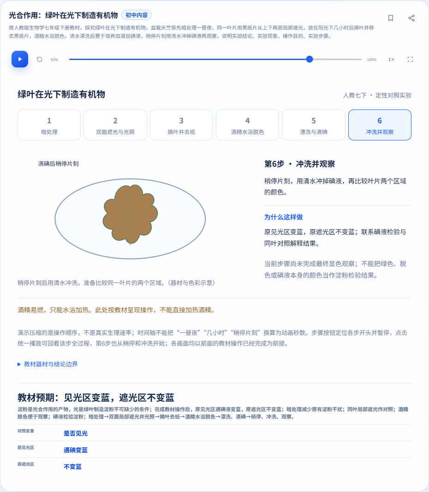
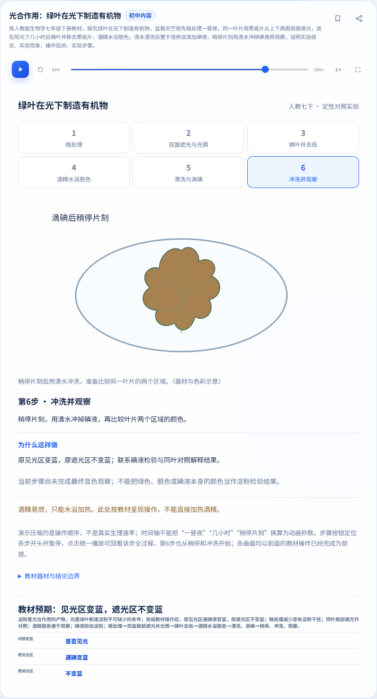
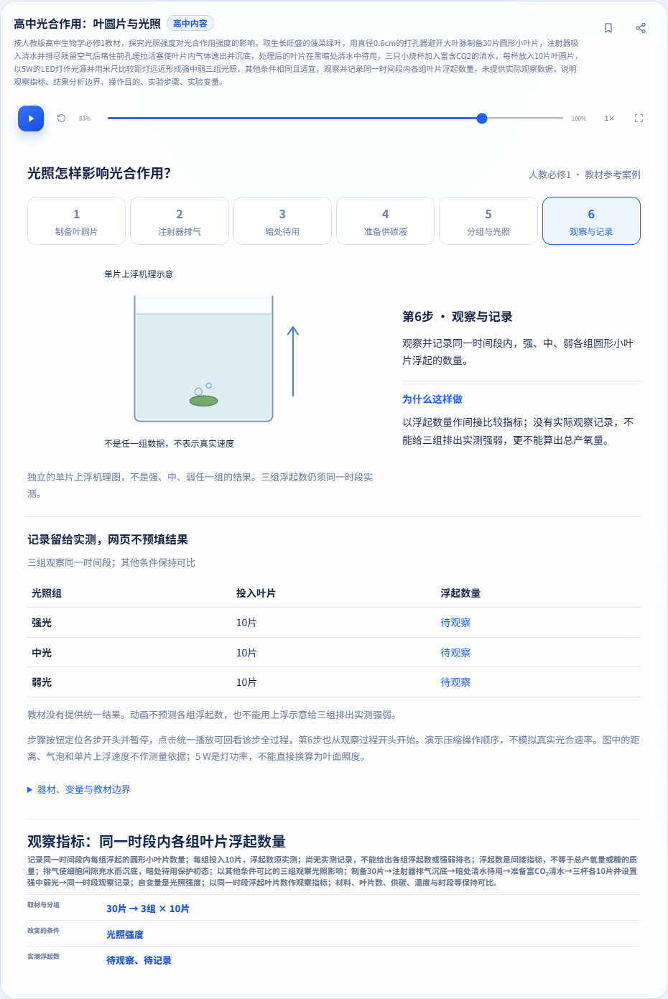
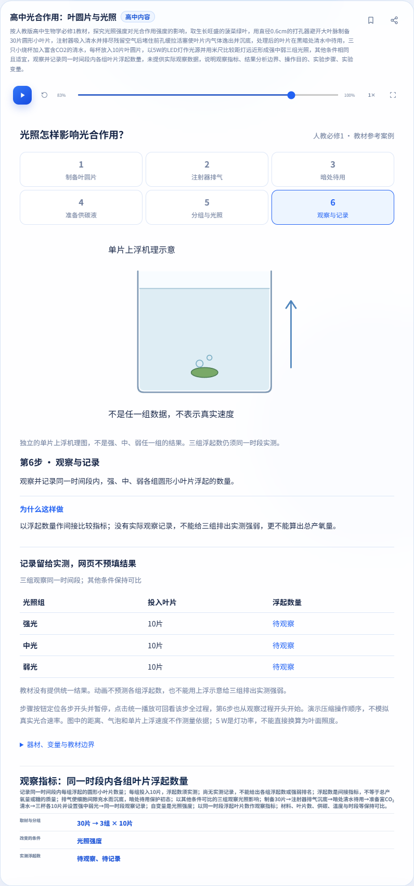

# 光合作用分隔符与严格解析一致性修复（2026-11-06）

回应[本轮审查](https://github.com/yanyucheng-master/ai-science-studio/issues/9#issuecomment-6677984038)。两个PR继续Draft，联用仅供联合审查。当前仅J02/H11部分教材样例；预测、学生记录、比较和解释控件仍未实现，记录刷新/重置/收藏分享边界待产品协调，[已有互动方案](../photosynthesis-interaction-proposal.md)不计完成。P0/20族专题未结项；未合并、推主线/公网、部署或恢复自动化。

## 修复与边界

旧候选有独立的句首/标点正则，先删空格再筛候选；严格解析却允许更多分隔及条件顺序。现在共享规划先对所有已加载固定模板执行完整严格解析，唯一成功直接生成，不受候选预筛挡住；成功判定同时仍经过既有通用参数/条件核对。归属判断复用同一组编译后的条件规则及所问规则，不再维护第二套动作/标点语法。

失败题使用完整原文解析的具体诊断。目标与教材/材料/操作组合，或至少两个独立操作，确认固定流程归属并本地拒绝；只确认一个操作，或目标/材料加所问的题标为不确定，先给已有本地模板成功机会，仍无成功则明确提示澄清，0自动AI。扫描仅判断归属，不能使跳过的字词变成科学接受、补条件或吞子问。普通概念和无操作证据的背景题保留原回退。两流程均有证据且无法唯一确认时明示歧义，不按注册先后选错误原因。

引用背景使用不透明边界，不能删除后拼接出新条件；整道引用题或明确引用请求仅用于判归属，科学解析仍使用原文。数值内部`3,0`/`3 0`等保护保留，完整值与单位间合法空格仍按既有规则处理。[规则及不确定边界](../photosynthesis-separators.md)。不改变科学模型、场景CSS、分享协议或后端/模型配置。

## 修复前：独立API与正常按钮分开

[三个实际送审head的原始输入、API结果、正常按钮/请求/旧实验状态](before-fix.json)。仅空格替换的完整题API为ok:true但candidate:false，缺项题API已有准确缺项但candidate:false；真实按钮均漏入本地模拟503。逗号控制通过。

| 版本 | 送审head | 按钮案例 | 通过 | 漏路由失败 |
| --- | --- | ---: | ---: | ---: |
| joint | `9bf399c10e98633f022f41b1e9e6a3cde9eb3aa2` | 8 | 4 | 4 |
| junior | `fe5ca6a6b2ca09347a14d39561ed1cd0f80fd5b6` | 4 | 2 | 2 |
| senior | `a3f5c42b6b4cbfaf1f2abe9ad37d3ac6cc4f59ec` | 4 | 2 | 2 |

未用联用结果代替独立PR；基线master没有这两个固定模板，不把原有普通AI行为算成相同产品缺陷。本轮无真实AI、真实网关或密钥。

## 实际完整执行源码

| 版本 | 源码SHA | Git树 | 组数 | 通过 | 失败 | 进程超时 |
| --- | --- | --- | ---: | ---: | ---: | ---: |
| junior | `ef9767692e62ac640dcb537b09826214735b738e` | `70a1660cd6a303ea6dbb0ff0a7dea446cd0235c7` | 41 | 40 | 1 | 0 |
| senior | `5bcc67bb706440c2c763899ce756854249bc90b1` | `8ccb3679ab34ff246a31c008548d8f00b69c90c2` | 41 | 39 | 2 | 0 |
| joint | `6c9db9c4833f209c5f3537a0c933a976ef4ee226` | `67846363cd75ac8cad2396de2c6a34b25bb23d9d` | 44 | 42 | 2 | 0 |
| baseline | `e6f43c5b398fb039c80e2f02382119d3566ae1f5` | `a1eed39c85ecc1aad9d2533009a8255ee4beca45` | 36 | 33 | 3 | 0 |

[逐命令退出码、UTC时间、计数、日志哈希、源码归档核对和保留文件](execution-summary.json)。[运行改动文件及逐项语法检查](static-checks.json)。所有枚举进程均启动并结束；这不表示失败后未到达的断言通过。整进程超时和脚本内部等待超时分开。所有固定源码逐文件与原Git归档一致；分隔符/路由报告从运行开始显式传入正确SHA，其他旧脚本未自带源码标签的报告由runner的SHA/实际根及归档比较绑定，原始缺失标签不伪造。不把历史SHA/标签改写为本轮执行。

最终head若仅追加文档、精选证据和公告元数据，会另验公告并在Issue列最终head/树和变化路径，完整功能集合仍绑定上述源码，不混称最终head重新全量执行。

完整集合使用Edge；隔离Chromium只补初中5组、高中5组、联用4组受影响专项。实际版本见JSON，二者同引擎，不代替Firefox/Safari。主线560题前缀顺序/内容、拍题/移动CSS/显微镜/种群12文件及原公告保留；教材模型和场景CSS相对各送审head的Git blob不变，CRLF归档与blob哈希独立记录。

| 版本 | Node通过/总数 | 题库总数 |
| --- | ---: | ---: |
| junior | 1075/1075 | 574 |
| senior | 1111/1111 | 586 |
| joint | 1276/1276 | 600 |
| baseline | 906/906 | 560 |

## 分隔、顺序与失败语义专项

[先封存的80例输入/预期与3个后补归属边界](inputs.json)。两教材流程×中文逗号/空格/顿号/无分隔/混合换行标点×完整/缺项/冲突/错误操作/额外子问/无所问/问句前置/条件换序。条件换序保留操作内部明确的先后语义；错误步骤仍拒绝。不是外部盲测，也不承诺任意自然语言。另有Node中12组种子换序×5分隔的不变量断言，计在各Node总数内，不伪造额外实页数量。

[初中](separators-junior.json)、[高中](separators-senior.json)、[联用](separators-joint.json)各自将templateApi与normalButtonCases分列。实际点击正常“生成实验”，未调用关闭回退的内部生成入口；逐例记录学科/学段、注册顺序、导师有/无、具体提示、请求、旧实验/位置/播放与新题导师上下文。

| 版本/浏览器 | 独立模板API | 正常按钮通过/总数 | 额外归属按钮 | 固定流程请求 |
| --- | ---: | ---: | ---: | ---: |
| junior/edge | 40 | 160/160 | 4 | 0 |
| junior/chromium | 40 | 160/160 | 4 | 0 |
| senior/edge | 40 | 160/160 | 4 | 0 |
| senior/chromium | 40 | 160/160 | 4 | 0 |
| joint/edge | 80 | 320/320 | 6 | 0 |
| joint/chromium | 80 | 320/320 | 6 | 0 |

为便于GitHub页面直接查看，逐按钮记录按分隔格式拆为小文件；索引JSON保留独立API、计数和额外归属按钮。

| 版本/浏览器 | 中文逗号 | 空格 | 顿号 | 无分隔 | 混合换行标点 |
| --- | --- | --- | --- | --- | --- |
| junior/edge | [记录](separators-junior-edge-comma.json) | [记录](separators-junior-edge-space.json) | [记录](separators-junior-edge-dun.json) | [记录](separators-junior-edge-none.json) | [记录](separators-junior-edge-mixed.json) |
| junior/chromium | [记录](separators-junior-chromium-comma.json) | [记录](separators-junior-chromium-space.json) | [记录](separators-junior-chromium-dun.json) | [记录](separators-junior-chromium-none.json) | [记录](separators-junior-chromium-mixed.json) |
| senior/edge | [记录](separators-senior-edge-comma.json) | [记录](separators-senior-edge-space.json) | [记录](separators-senior-edge-dun.json) | [记录](separators-senior-edge-none.json) | [记录](separators-senior-edge-mixed.json) |
| senior/chromium | [记录](separators-senior-chromium-comma.json) | [记录](separators-senior-chromium-space.json) | [记录](separators-senior-chromium-dun.json) | [记录](separators-senior-chromium-none.json) | [记录](separators-senior-chromium-mixed.json) |
| joint/edge | [记录](separators-joint-edge-comma.json) | [记录](separators-joint-edge-space.json) | [记录](separators-joint-edge-dun.json) | [记录](separators-joint-edge-none.json) | [记录](separators-joint-edge-mixed.json) |
| joint/chromium | [记录](separators-joint-chromium-comma.json) | [记录](separators-joint-chromium-space.json) | [记录](separators-joint-chromium-dun.json) | [记录](separators-joint-chromium-none.json) | [记录](separators-joint-chromium-mixed.json) |

每个输入在4个配对场景执行：导师存在/503/初中先注册/初中学段；导师存在/200/高中先/高中；导师缺失/503/初中先/高中；导师缺失/200/高中先/初中。独立分支仅加载其自身模板；**这是配对覆盖，不是所有维度全笛卡尔积**。固定成功和拒绝均0请求，因此模拟200/503配置没有被调用，不能冒称服务实际成功/失败；下节普通问答路径单列实际模拟交换。缺项提示核对到具体缺项名，拒绝保留旧实验/位置，新题导师无旧答案。编辑输入原本自动暂停，记录该行为后核对按钮不重置；另有下节的继续播放拒绝检查。

额外归属案例验证部分教材操作的背景句不抢占完整平面镜；仅一操作或一材料加所问且无其他本地成功则明确澄清而不自动请求。未将不确定归属静默判成某固定实验。

## 保留上轮正常路由、播放、安全及状态闭环

[初中路由](routing-junior.json)、[高中路由](routing-senior.json)、[联用路由](routing-joint.json)保留平面镜控制/光照背景/光合作用背景、普通光合作用及灯光问答、其他学科本地成功/正常回退、引号背景/明确引用题、完整固定题及缺失/矛盾/错误步骤/附加子问。

| 版本/浏览器 | 正常按钮通过/总数 | 本地成功请求 | 固定拒绝请求 | 普通回退实际模拟请求 |
| --- | ---: | ---: | ---: | ---: |
| junior/edge | 55/55 | 0 | 0 | 10 |
| junior/chromium | 55/55 | 0 | 0 | 10 |
| senior/edge | 55/55 | 0 | 0 | 10 |
| senior/chromium | 55/55 | 0 | 0 | 10 |
| joint/edge | 117/117 | 0 | 0 | 14 |
| joint/chromium | 117/117 | 0 | 0 | 14 |

普通回退实际模拟503与额外模拟200成功回答分别记录；导师缺失无请求，服务失败不清空原实验。playingRefusals记录输入编辑暂停、真实按钮恢复播放、再拒绝新题，旧实验继续且不重置。补充规划API仅额外观察，不代替按钮结果。

[布局/纯文本安全/统一播放器/状态](layout-and-protocol.json)包括两模板加载顺序、导师有无、字面特殊字符、六步/末步回放、360/390/820/1366、844×390、触控、全屏滚动、收藏分享、刷新、真实BFCache、学科/导师往返和独立浏览器导入等适用断言。截图不是这些断言的替代。初中冲洗前不显示最终蓝色；高中上浮机理不填实测浮片数、强弱排名、产氧量或速率。

## 失败、未到达和未执行

| 集合 | 旧斜面guard | 种群后台 | share |
| --- | --- | --- | --- |
| junior | 失败（退出1） | 通过（退出0） | 通过（退出0） |
| senior | 失败（退出1） | 失败（退出1） | 通过（退出0） |
| joint | 失败（退出1） | 失败（退出1） | 通过（退出0） |
| baseline | 失败（退出1） | 失败（退出1） | 失败（退出1） |

- guard实际请求0、期望1的失败原样保留，该失败案例中次数断言后未到达；其余案例继续执行另列。相同基线签名不证明根因，更不计通过。
- 种群后台若在S型暂停pending RAF1≠0处停止，离散模式已执行单列。之后S型前/隐藏/返回快照、真实页签往返、状态/帧数/RAF不变断言和脚本结尾错误/API总检查未到达；完整成功的集合据实列出，不用其他集合抹平。[实际失败报告](failure-details.json)。
- 干净基线share等待页隐藏按钮内部30秒超时，后续断言未到达。另复制基线仅修等待页夹具，验证按钮隐藏和公开copy拒绝后保留后续原断言，独立1组结果及前后脚本哈希列在执行摘要。候选修订夹具结果不改写原失败。

| 集合 | 种群后台已完成模式 | 未到达 |
| --- | --- | --- |
| joint | discrete | S型后续快照/真实往返/不变断言及结尾总检查 |
| junior | discrete, logistic | 无（该脚本完成） |
| senior | discrete | S型后续快照/真实往返/不变断言及结尾总检查 |
| baseline | discrete | S型后续快照/真实往返/不变断言及结尾总检查 |

Firefox/Safari、真机、真实相机/OCR准确率、真实AI/live、部署以及以Chromium为主的全套旧集合未执行。GitHub Actions/check-runs/statuses、CI/扫描/签名须按最终head另查，空记录不是通过。没有为了全绿删除/弱化现有断言；旧日期证据继续标为历史。

## 逐项执行命令

以下均在对应隔离源码server目录运行。环境指向本机安装的Playwright及隔离缓存，主浏览器Edge，专项副浏览器Chromium；独立临时配置、仅本地模拟，不读密钥和个人浏览器。原始日志/未选图片/教材原文保留本地，公开脱敏摘要和哈希。

### junior

| 命令 | 退出码 | 状态 | 计数 |
| --- | ---: | --- | --- |
| `node scripts/verify-photosynthesis-separators-browser.js` | 0 | 通过 | failures=0, checks=160, cases=160, layouts=0, templateApi=40, boundaries=4, passedCases=160, failedCases=0 |
| `node scripts/verify-photosynthesis-routing-browser.js` | 0 | 通过 | failures=0, checks=56, cases=55, layouts=0, passedCases=55, failedCases=0 |
| `node scripts/verify-photosynthesis-review-browser.js` | 0 | 通过 | checks=165, layouts=0, normalButtonCases=25, playback=2 |
| `node scripts/verify-photosynthesis-browser.js` | 0 | 通过 | checks=265, layouts=25, semanticCases=38 |
| `node --test test/biology-photosynthesis.test.js` | 0 | 通过 | tests=69, pass=69, fail=0, cancelled=0, skipped=0, todo=0 |
| `node --test` | 0 | 通过 | tests=1075, pass=1075, fail=0, cancelled=0, skipped=0, todo=0 |
| `node scripts/verify-question-bank-browser.js` | 0 | 通过 | totalQuestions=574, local=268, mockRoute=306 |
| `node scripts/verify-week1-browser.js` | 0 | 通过 | layouts=50, failures=0 |
| `node scripts/verify-week2-browser.js` | 0 | 通过 | checks=144, failures=0 |
| `node scripts/verify-tutor-browser.js` | 0 | 通过 | reportCases=9 |
| `node scripts/verify-animation-browser.js` | 0 | 通过 | variants=6 |
| `node scripts/verify-announcements-browser.js` | 0 | 通过 | cases=8, passedCases=8, failedCases=0 |
| `node scripts/verify-formula-browser.js` | 0 | 通过 | layouts=69, failures=0, ai=5 |
| `node scripts/verify-ai-quality-browser.js` | 0 | 通过 | reportCases=17 |
| `node scripts/verify-share-browser.js` | 0 | 通过 | checks=14, roundTrips=268, adjustedTemplates=43 |
| `node scripts/verify-instant-browser.js` | 0 | 通过 | 脚本未输出断言总数 |
| `node scripts/verify-instant-routing-browser.js` | 0 | 通过 | 脚本未输出断言总数 |
| `node scripts/verify-tutor-diagram-browser.js` | 0 | 通过 | cases=19, passedCases=19, failedCases=0 |
| `node scripts/verify-tutor-presentation-browser.js` | 0 | 通过 | cases=27, passedCases=27, failedCases=0 |
| `node scripts/verify-incline-diagram-browser.js --guard-only` | 1 | 失败 | cases=6, passedCases=1, failedCases=5 |
| `node scripts/verify-incline-diagram-browser.js` | 0 | 通过 | cases=7, passedCases=7, failedCases=0 |
| `node scripts/verify-incline-diagram-browser.js --render` | 0 | 通过 | cases=11, passedCases=11, failedCases=0 |
| `node scripts/verify-incline-diagram-browser.js --competition` | 0 | 通过 | cases=19, passedCases=19, failedCases=0 |
| `node scripts/verify-incline-diagram-browser.js --data` | 0 | 通过 | cases=32, passedCases=32, failedCases=0 |
| `node --test test/chemistry-experiments.test.js` | 0 | 通过 | tests=20, pass=20, fail=0, cancelled=0, skipped=0, todo=0 |
| `node scripts/verify-chemistry-browser.js` | 0 | 通过 | checks=200, layouts=6 |
| `node --test test/math-experiments.test.js` | 0 | 通过 | tests=25, pass=25, fail=0, cancelled=0, skipped=0, todo=0 |
| `node scripts/verify-math-experiments-browser.js` | 0 | 通过 | checks=203, layouts=9 |
| `node scripts/verify-experiment-layout-browser.js` | 0 | 通过 | layoutsCases=73, cases=46, passedCases=46, failedCases=0 |
| `node --test test/unit-circle.test.js` | 0 | 通过 | tests=73, pass=73, fail=0, cancelled=0, skipped=0, todo=0 |
| `node scripts/verify-unit-circle-browser.js` | 0 | 通过 | checks=219, layouts=15 |
| `node --test test/chemistry-equilibria.test.js test/chemistry-equilibria-templates.test.js` | 0 | 通过 | tests=63, pass=63, fail=0, cancelled=0, skipped=0, todo=0 |
| `node scripts/verify-chemistry-equilibria-browser.js` | 0 | 通过 | checks=134, layouts=14 |
| `node --test test/biology-mendel.test.js` | 0 | 通过 | tests=17, pass=17, fail=0, cancelled=0, skipped=0, todo=0 |
| `node scripts/verify-mendel-browser.js` | 0 | 通过 | checks=105, layouts=7 |
| `node scripts/verify-acceptance-fixes-browser.js` | 0 | 通过 | checks=62, failures=0 |
| `node --test test/biology-microscope.test.js test/biology-microscope-questions.test.js test/biology-microscope-templates.test.js` | 0 | 通过 | tests=36, pass=36, fail=0, cancelled=0, skipped=0, todo=0 |
| `node scripts/verify-microscope-browser.js` | 0 | 通过 | checks=249, layouts=21 |
| `node --test test/biology-population.test.js test/biology-population-logistic.test.js` | 0 | 通过 | tests=65, pass=65, fail=0, cancelled=0, skipped=0, todo=0 |
| `node scripts/verify-population-browser.js` | 0 | 通过 | checks=215, layouts=16 |
| `node scripts/verify-population-background-browser.js` | 0 | 通过 | checks=2 |

### senior

| 命令 | 退出码 | 状态 | 计数 |
| --- | ---: | --- | --- |
| `node scripts/verify-photosynthesis-separators-browser.js` | 0 | 通过 | failures=0, checks=160, cases=160, layouts=0, templateApi=40, boundaries=4, passedCases=160, failedCases=0 |
| `node scripts/verify-photosynthesis-routing-browser.js` | 0 | 通过 | failures=0, checks=56, cases=55, layouts=0, passedCases=55, failedCases=0 |
| `node scripts/verify-photosynthesis-review-browser.js` | 0 | 通过 | checks=201, layouts=0, normalButtonCases=37, playback=2 |
| `node scripts/verify-leaf-disks-browser.js` | 0 | 通过 | checks=301, layouts=25, semanticCases=49 |
| `node --test test/biology-leaf-disks.test.js` | 0 | 通过 | tests=94, pass=94, fail=0, cancelled=0, skipped=0, todo=0 |
| `node --test` | 0 | 通过 | tests=1111, pass=1111, fail=0, cancelled=0, skipped=0, todo=0 |
| `node scripts/verify-question-bank-browser.js` | 0 | 通过 | totalQuestions=586, local=270, mockRoute=316 |
| `node scripts/verify-week1-browser.js` | 0 | 通过 | layouts=50, failures=0 |
| `node scripts/verify-week2-browser.js` | 0 | 通过 | checks=144, failures=0 |
| `node scripts/verify-tutor-browser.js` | 0 | 通过 | reportCases=9 |
| `node scripts/verify-animation-browser.js` | 0 | 通过 | variants=6 |
| `node scripts/verify-announcements-browser.js` | 0 | 通过 | cases=8, passedCases=8, failedCases=0 |
| `node scripts/verify-formula-browser.js` | 0 | 通过 | layouts=69, failures=0, ai=5 |
| `node scripts/verify-ai-quality-browser.js` | 0 | 通过 | reportCases=17 |
| `node scripts/verify-share-browser.js` | 0 | 通过 | checks=14, roundTrips=270, adjustedTemplates=43 |
| `node scripts/verify-instant-browser.js` | 0 | 通过 | 脚本未输出断言总数 |
| `node scripts/verify-instant-routing-browser.js` | 0 | 通过 | 脚本未输出断言总数 |
| `node scripts/verify-tutor-diagram-browser.js` | 0 | 通过 | cases=19, passedCases=19, failedCases=0 |
| `node scripts/verify-tutor-presentation-browser.js` | 0 | 通过 | cases=27, passedCases=27, failedCases=0 |
| `node scripts/verify-incline-diagram-browser.js --guard-only` | 1 | 失败 | cases=6, passedCases=1, failedCases=5 |
| `node scripts/verify-incline-diagram-browser.js` | 0 | 通过 | cases=7, passedCases=7, failedCases=0 |
| `node scripts/verify-incline-diagram-browser.js --render` | 0 | 通过 | cases=11, passedCases=11, failedCases=0 |
| `node scripts/verify-incline-diagram-browser.js --competition` | 0 | 通过 | cases=19, passedCases=19, failedCases=0 |
| `node scripts/verify-incline-diagram-browser.js --data` | 0 | 通过 | cases=32, passedCases=32, failedCases=0 |
| `node --test test/chemistry-experiments.test.js` | 0 | 通过 | tests=20, pass=20, fail=0, cancelled=0, skipped=0, todo=0 |
| `node scripts/verify-chemistry-browser.js` | 0 | 通过 | checks=200, layouts=6 |
| `node --test test/math-experiments.test.js` | 0 | 通过 | tests=25, pass=25, fail=0, cancelled=0, skipped=0, todo=0 |
| `node scripts/verify-math-experiments-browser.js` | 0 | 通过 | checks=203, layouts=9 |
| `node scripts/verify-experiment-layout-browser.js` | 0 | 通过 | layoutsCases=73, cases=46, passedCases=46, failedCases=0 |
| `node --test test/unit-circle.test.js` | 0 | 通过 | tests=73, pass=73, fail=0, cancelled=0, skipped=0, todo=0 |
| `node scripts/verify-unit-circle-browser.js` | 0 | 通过 | checks=219, layouts=15 |
| `node --test test/chemistry-equilibria.test.js test/chemistry-equilibria-templates.test.js` | 0 | 通过 | tests=63, pass=63, fail=0, cancelled=0, skipped=0, todo=0 |
| `node scripts/verify-chemistry-equilibria-browser.js` | 0 | 通过 | checks=134, layouts=14 |
| `node --test test/biology-mendel.test.js` | 0 | 通过 | tests=17, pass=17, fail=0, cancelled=0, skipped=0, todo=0 |
| `node scripts/verify-mendel-browser.js` | 0 | 通过 | checks=105, layouts=7 |
| `node scripts/verify-acceptance-fixes-browser.js` | 0 | 通过 | checks=62, failures=0 |
| `node --test test/biology-microscope.test.js test/biology-microscope-questions.test.js test/biology-microscope-templates.test.js` | 0 | 通过 | tests=36, pass=36, fail=0, cancelled=0, skipped=0, todo=0 |
| `node scripts/verify-microscope-browser.js` | 0 | 通过 | checks=249, layouts=21 |
| `node --test test/biology-population.test.js test/biology-population-logistic.test.js` | 0 | 通过 | tests=65, pass=65, fail=0, cancelled=0, skipped=0, todo=0 |
| `node scripts/verify-population-browser.js` | 0 | 通过 | checks=215, layouts=16 |
| `node scripts/verify-population-background-browser.js` | 1 | 失败 | checks=1 |

### joint

| 命令 | 退出码 | 状态 | 计数 |
| --- | ---: | --- | --- |
| `node scripts/verify-photosynthesis-separators-browser.js` | 0 | 通过 | failures=0, checks=320, cases=320, layouts=0, templateApi=80, boundaries=6, passedCases=320, failedCases=0 |
| `node scripts/verify-photosynthesis-routing-browser.js` | 0 | 通过 | failures=0, checks=118, cases=117, layouts=0, passedCases=117, failedCases=0 |
| `node scripts/verify-photosynthesis-review-browser.js` | 0 | 通过 | checks=460, layouts=0, normalButtonCases=92, playback=4 |
| `node scripts/verify-photosynthesis-integration-browser.js` | 0 | 通过 | checks=39, layouts=0 |
| `node scripts/verify-photosynthesis-browser.js` | 0 | 通过 | checks=265, layouts=25, semanticCases=38 |
| `node --test test/biology-photosynthesis.test.js` | 0 | 通过 | tests=69, pass=69, fail=0, cancelled=0, skipped=0, todo=0 |
| `node scripts/verify-leaf-disks-browser.js` | 0 | 通过 | checks=301, layouts=25, semanticCases=49 |
| `node --test test/biology-leaf-disks.test.js` | 0 | 通过 | tests=94, pass=94, fail=0, cancelled=0, skipped=0, todo=0 |
| `node --test` | 0 | 通过 | tests=1276, pass=1276, fail=0, cancelled=0, skipped=0, todo=0 |
| `node scripts/verify-question-bank-browser.js` | 0 | 通过 | totalQuestions=600, local=276, mockRoute=324 |
| `node scripts/verify-week1-browser.js` | 0 | 通过 | layouts=50, failures=0 |
| `node scripts/verify-week2-browser.js` | 0 | 通过 | checks=144, failures=0 |
| `node scripts/verify-tutor-browser.js` | 0 | 通过 | reportCases=9 |
| `node scripts/verify-animation-browser.js` | 0 | 通过 | variants=6 |
| `node scripts/verify-announcements-browser.js` | 0 | 通过 | cases=8, passedCases=8, failedCases=0 |
| `node scripts/verify-formula-browser.js` | 0 | 通过 | layouts=69, failures=0, ai=5 |
| `node scripts/verify-ai-quality-browser.js` | 0 | 通过 | reportCases=17 |
| `node scripts/verify-share-browser.js` | 0 | 通过 | checks=14, roundTrips=276, adjustedTemplates=45 |
| `node scripts/verify-instant-browser.js` | 0 | 通过 | 脚本未输出断言总数 |
| `node scripts/verify-instant-routing-browser.js` | 0 | 通过 | 脚本未输出断言总数 |
| `node scripts/verify-tutor-diagram-browser.js` | 0 | 通过 | cases=19, passedCases=19, failedCases=0 |
| `node scripts/verify-tutor-presentation-browser.js` | 0 | 通过 | cases=27, passedCases=27, failedCases=0 |
| `node scripts/verify-incline-diagram-browser.js --guard-only` | 1 | 失败 | cases=6, passedCases=1, failedCases=5 |
| `node scripts/verify-incline-diagram-browser.js` | 0 | 通过 | cases=7, passedCases=7, failedCases=0 |
| `node scripts/verify-incline-diagram-browser.js --render` | 0 | 通过 | cases=11, passedCases=11, failedCases=0 |
| `node scripts/verify-incline-diagram-browser.js --competition` | 0 | 通过 | cases=19, passedCases=19, failedCases=0 |
| `node scripts/verify-incline-diagram-browser.js --data` | 0 | 通过 | cases=32, passedCases=32, failedCases=0 |
| `node --test test/chemistry-experiments.test.js` | 0 | 通过 | tests=20, pass=20, fail=0, cancelled=0, skipped=0, todo=0 |
| `node scripts/verify-chemistry-browser.js` | 0 | 通过 | checks=200, layouts=6 |
| `node --test test/math-experiments.test.js` | 0 | 通过 | tests=25, pass=25, fail=0, cancelled=0, skipped=0, todo=0 |
| `node scripts/verify-math-experiments-browser.js` | 0 | 通过 | checks=203, layouts=9 |
| `node scripts/verify-experiment-layout-browser.js` | 0 | 通过 | layoutsCases=73, cases=46, passedCases=46, failedCases=0 |
| `node --test test/unit-circle.test.js` | 0 | 通过 | tests=73, pass=73, fail=0, cancelled=0, skipped=0, todo=0 |
| `node scripts/verify-unit-circle-browser.js` | 0 | 通过 | checks=219, layouts=15 |
| `node --test test/chemistry-equilibria.test.js test/chemistry-equilibria-templates.test.js` | 0 | 通过 | tests=63, pass=63, fail=0, cancelled=0, skipped=0, todo=0 |
| `node scripts/verify-chemistry-equilibria-browser.js` | 0 | 通过 | checks=134, layouts=14 |
| `node --test test/biology-mendel.test.js` | 0 | 通过 | tests=17, pass=17, fail=0, cancelled=0, skipped=0, todo=0 |
| `node scripts/verify-mendel-browser.js` | 0 | 通过 | checks=105, layouts=7 |
| `node scripts/verify-acceptance-fixes-browser.js` | 0 | 通过 | checks=62, failures=0 |
| `node --test test/biology-microscope.test.js test/biology-microscope-questions.test.js test/biology-microscope-templates.test.js` | 0 | 通过 | tests=36, pass=36, fail=0, cancelled=0, skipped=0, todo=0 |
| `node scripts/verify-microscope-browser.js` | 0 | 通过 | checks=249, layouts=21 |
| `node --test test/biology-population.test.js test/biology-population-logistic.test.js` | 0 | 通过 | tests=65, pass=65, fail=0, cancelled=0, skipped=0, todo=0 |
| `node scripts/verify-population-browser.js` | 0 | 通过 | checks=215, layouts=16 |
| `node scripts/verify-population-background-browser.js` | 1 | 失败 | checks=1 |

### baseline

| 命令 | 退出码 | 状态 | 计数 |
| --- | ---: | --- | --- |
| `node --test` | 0 | 通过 | tests=906, pass=906, fail=0, cancelled=0, skipped=0, todo=0 |
| `node scripts/verify-question-bank-browser.js` | 0 | 通过 | totalQuestions=560, local=262, mockRoute=298 |
| `node scripts/verify-week1-browser.js` | 0 | 通过 | layouts=50, failures=0 |
| `node scripts/verify-week2-browser.js` | 0 | 通过 | checks=144, failures=0 |
| `node scripts/verify-tutor-browser.js` | 0 | 通过 | reportCases=9 |
| `node scripts/verify-animation-browser.js` | 0 | 通过 | variants=6 |
| `node scripts/verify-announcements-browser.js` | 0 | 通过 | cases=8, passedCases=8, failedCases=0 |
| `node scripts/verify-formula-browser.js` | 0 | 通过 | layouts=69, failures=0, ai=5 |
| `node scripts/verify-ai-quality-browser.js` | 0 | 通过 | reportCases=17 |
| `node scripts/verify-share-browser.js` | 1 | 失败 | checks=0, roundTrips=0 |
| `node scripts/verify-instant-browser.js` | 0 | 通过 | 脚本未输出断言总数 |
| `node scripts/verify-instant-routing-browser.js` | 0 | 通过 | 脚本未输出断言总数 |
| `node scripts/verify-tutor-diagram-browser.js` | 0 | 通过 | cases=19, passedCases=19, failedCases=0 |
| `node scripts/verify-tutor-presentation-browser.js` | 0 | 通过 | cases=27, passedCases=27, failedCases=0 |
| `node scripts/verify-incline-diagram-browser.js --guard-only` | 1 | 失败 | cases=6, passedCases=1, failedCases=5 |
| `node scripts/verify-incline-diagram-browser.js` | 0 | 通过 | cases=7, passedCases=7, failedCases=0 |
| `node scripts/verify-incline-diagram-browser.js --render` | 0 | 通过 | cases=11, passedCases=11, failedCases=0 |
| `node scripts/verify-incline-diagram-browser.js --competition` | 0 | 通过 | cases=19, passedCases=19, failedCases=0 |
| `node scripts/verify-incline-diagram-browser.js --data` | 0 | 通过 | cases=32, passedCases=32, failedCases=0 |
| `node --test test/chemistry-experiments.test.js` | 0 | 通过 | tests=20, pass=20, fail=0, cancelled=0, skipped=0, todo=0 |
| `node scripts/verify-chemistry-browser.js` | 0 | 通过 | checks=200, layouts=6 |
| `node --test test/math-experiments.test.js` | 0 | 通过 | tests=25, pass=25, fail=0, cancelled=0, skipped=0, todo=0 |
| `node scripts/verify-math-experiments-browser.js` | 0 | 通过 | checks=203, layouts=9 |
| `node scripts/verify-experiment-layout-browser.js` | 0 | 通过 | layoutsCases=73, cases=46, passedCases=46, failedCases=0 |
| `node --test test/unit-circle.test.js` | 0 | 通过 | tests=73, pass=73, fail=0, cancelled=0, skipped=0, todo=0 |
| `node scripts/verify-unit-circle-browser.js` | 0 | 通过 | checks=219, layouts=15 |
| `node --test test/chemistry-equilibria.test.js test/chemistry-equilibria-templates.test.js` | 0 | 通过 | tests=63, pass=63, fail=0, cancelled=0, skipped=0, todo=0 |
| `node scripts/verify-chemistry-equilibria-browser.js` | 0 | 通过 | checks=134, layouts=14 |
| `node --test test/biology-mendel.test.js` | 0 | 通过 | tests=17, pass=17, fail=0, cancelled=0, skipped=0, todo=0 |
| `node scripts/verify-mendel-browser.js` | 0 | 通过 | checks=105, layouts=7 |
| `node scripts/verify-acceptance-fixes-browser.js` | 0 | 通过 | checks=62, failures=0 |
| `node --test test/biology-microscope.test.js test/biology-microscope-questions.test.js test/biology-microscope-templates.test.js` | 0 | 通过 | tests=36, pass=36, fail=0, cancelled=0, skipped=0, todo=0 |
| `node scripts/verify-microscope-browser.js` | 0 | 通过 | checks=249, layouts=21 |
| `node --test test/biology-population.test.js test/biology-population-logistic.test.js` | 0 | 通过 | tests=65, pass=65, fail=0, cancelled=0, skipped=0, todo=0 |
| `node scripts/verify-population-browser.js` | 0 | 通过 | checks=215, layouts=16 |
| `node scripts/verify-population-background-browser.js` | 1 | 失败 | checks=1 |

## 精选当前页面

[图像尺寸、SHA256与实际执行源码](manifest.json)。以下均来自本轮冻结源码；未编辑图像。完整宽度/横屏/触控/全屏和状态断言见JSON。

### junior教材场景 1366

### junior教材场景 820

### junior教材场景 360

### junior空格分隔 完整生成

### junior空格分隔 缺项本地诊断

### senior教材场景 1366

### senior教材场景 820

### senior教材场景 360

### senior空格分隔 完整生成

### senior空格分隔 缺项本地诊断

